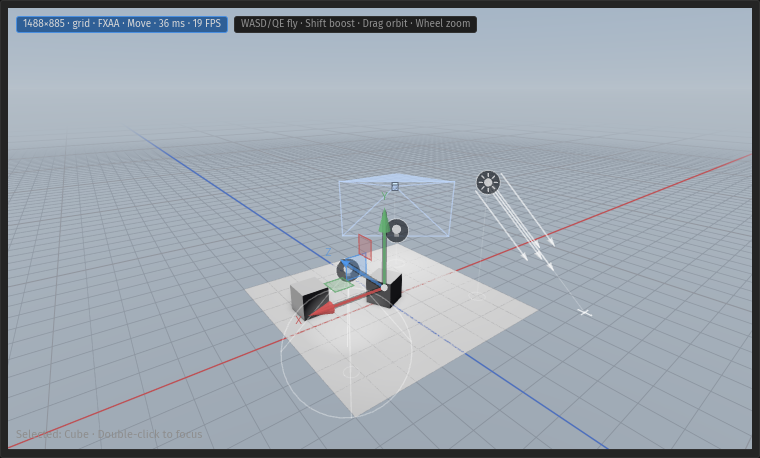
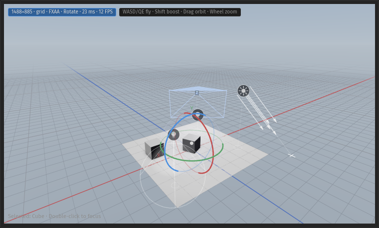
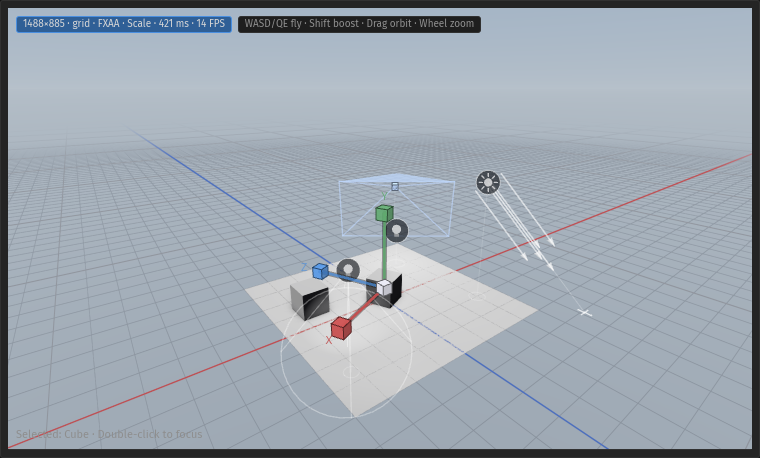
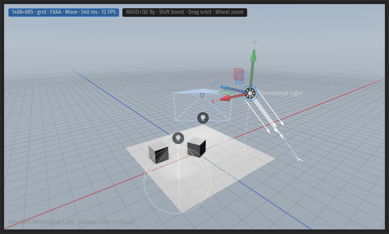
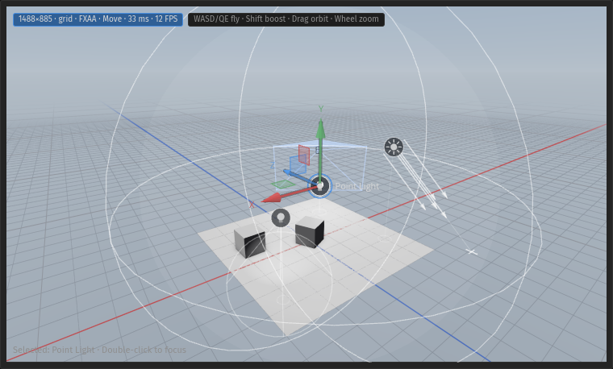
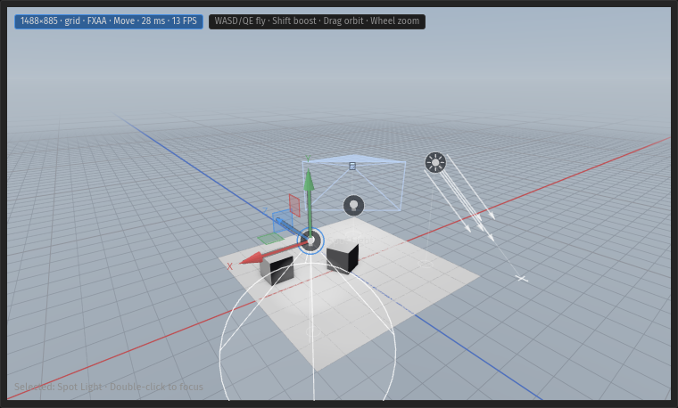
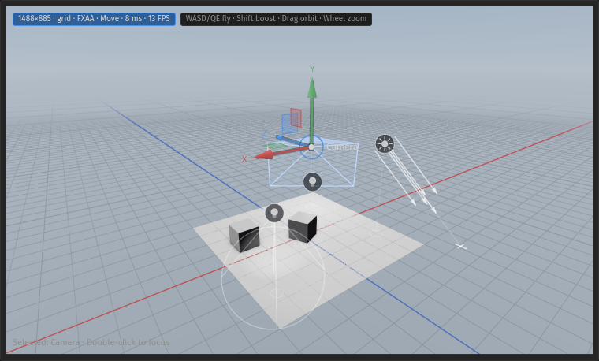
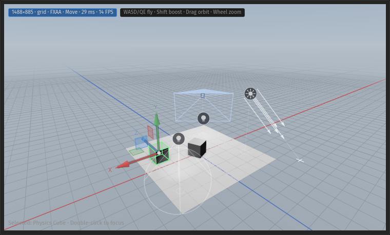

# Gizmos and scene markers

The viewport draws two overlays over the engine's render. Both are 2D canvases that rebuild the
orbit camera's projection (`uikit/components/viewport_math.rs`), so they need no engine calls: they
work from plain transform values and from component data the editor already reads.

| Overlay | Component | Shows |
|---|---|---|
| **Transform gizmo** | `components/gizmo.rs` | the Move, Rotate and Scale handles of the selected entity |
| **Scene markers** | `components/scene_markers.rs` | lights, cameras, colliders and empties, which have no mesh to look at |

Markers sit **under** the gizmo: a click goes to a gizmo handle first, then to a marker icon, then
to the scene (orbit and mesh picking).



## 1. Transform gizmo

Switch tools with `1` (Move), `2` (Rotate), `3` (Scale) while the pointer is over the viewport, or
from the View menu. The handle under the cursor lights up before you press it, and the one you are
dragging turns yellow. Every drag is one undo step per handle.

### Move (`1`)

* **Axis arrows** with shaded 3D cones and depth cueing: an axis pointing away from the camera is
  fainter, so the three arrows read as three dimensions instead of a flat cross.
* **Plane handles** (the small squares between two arrows): drag inside the XY, XZ or YZ plane. The
  press ray is intersected with the plane, so the object follows the cursor exactly on that plane.
* Movement is in **world** axes and writes the world position, so a child of a moved parent still
  follows the handle.

### Rotate (`2`)



* Three rings on a translucent sphere. The half of each ring that is **in front** of the object is
  bright and thick, the half behind it is faint, which makes the orientation of every ring obvious.
* While dragging, a **wedge** shows the swept angle and a label below the sphere shows the delta and the
  resulting angle (`Y +37.5°  →  62.5°`).
* The object turns **the way the cursor goes** from either side of the ring: the sign of the turn
  depends on whether the axis points at you or away from you (a positive rotation looks
  counter-clockwise when the axis points at the viewer, and screen angles run clockwise). It used to
  be a fixed sign, so the gizmo felt inverted from half of the viewing angles.


### Scale (`3`)



* The axis handles follow the object's **local** axes, with shaded cube ends. A rotated object
  therefore scales along what you see; before, the handles were world-aligned while the scale is
  local, so dragging "X" on a rotated mesh scaled a different, invisible axis and looked broken.
* The **centre cube** scales all three axes by the same factor (drag right or up to grow, left or
  down to shrink). The factor is exponential, so it never flips the sign and never reaches zero.
* Values are clamped to `0.01 .. 1000`.

For the texture side of scaling (a quad twice as big no longer stretches its material), see
[the UV scale section of the materials guide](materials-guide.md#6-scaling-an-object-keep-the-texture-density).

### Edits

The gizmo never calls the engine: it emits absolute edits and the app applies them.

| Edit | Applied as | History key |
|---|---|---|
| `Move { axis, position }` | world position | `gizmo:move:<id>:<axis>` |
| `MovePlane { plane, position }` | world position | `gizmo:move:<id>:<plane>` |
| `Rotate { axis, rotation }` | Euler degrees | `gizmo:rotate:<id>:<axis>` |
| `Scale { axis, scale }` | local scale | `gizmo:scale:<id>:<axis>` |
| `ScaleUniform { scale }` | local scale | `gizmo:scale:<id>:uniform` |

## 2. Scene markers

Lights, cameras and colliders are invisible in the render, so each gets a marker. Every marker has a
faint **stem to the ground** and a small ground ring, so its height is readable, and a plate icon
you can **click to select** the entity (the mesh raycast cannot hit them). Hover shows the name.

| Entity | Marker |
|---|---|
| **Directional light** | a sun and a bundle of parallel rays along the real shining direction, plus a cross where the centre ray meets the ground. An unrotated sun uses the engine's default direction (0.35, -0.82, 0.45), exactly like the renderer. |
| **Point light** | a bulb; when selected, the radius as a wire sphere and a soft shell |
| **Spot light** | a bulb and the cone (angle and range); the range is capped at 6 m for unselected lights so long cones do not flood the view |
| **Camera 3D** | a camera body with a lens, the frustum (field of view, aspect ratio, near and far) and the "up" triangle. Its size is **fixed in the world** (2.6 m deep): it does not grow or shrink as you fly around it, only its proportions follow the lens. |
| **Collider 3D** | (selected only) the box, sphere or capsule with its offset and the entity's scale; triggers are orange and labelled |
| **Empty entity** | a three-axis locator (red X, green Y, blue Z) |



| Point light (selected) | Spot light (selected) |
|---|---|
|  |  |

| Camera (selected) | Collider (selected) |
|---|---|
|  |  |

**Toggle:** View > Hide / Show Scene Markers (`editor.view.toggle_markers`). The data is kept, so
showing them again is instant.

### How they are built

`scene_markers::collect` walks the entities once and reads their components by name
(`Directional Light`, `Spot Light`, `Point Light`, `Camera 3D`, `Collider 3D`, `Light` for the
colour). It runs after every message that can change the scene (not on pointer moves or ticks), and
measures about 6 ms for the 287 entities of `dense_outdoor.caf`. Orientation comes from the entity's
local Euler angles, composed `Rz * Ry * Rx` like the engine; a directional light or camera under a
rotated parent is therefore drawn with its local aim.

## 3. Why a scale or rotation edit could be ignored (fixed)

An entity can carry the legacy `Transform` **and** the split `Position 3D` / `Rotation 3D` /
`Scale 3D` components; scenes saved by older editors have both (the Chair project's cube, cylinder,
sphere and camera do). The renderer and the hierarchy system build the world matrix from the split
components whenever `Position 3D` exists, but the C ABI used to write rotation and scale only to
`Transform`, and to read them from `Transform` first. The Inspector and the gizmos therefore showed
the new number (`Scale 47.159, 6.127, 9.381`) while the object kept rendering with the old, unchanged
`Scale 3D`: scale and rotation "did nothing", while position worked because it was already written to
both.

Now (`EngineAPI.cpp`, `prefersSplitComponents`): reads report the components the renderer uses, and
writes reach **every** component that is present, adding `Rotation 3D` / `Scale 3D` to a split entity
that lacks them. Covered by `entities_with_both_transform_and_split_components_render_their_scale_and_rotation`
(renders the entity before and after) and by a C ABI test (`tests/test_capi.cpp`).

## 4. For agents and scripts

* Query `markers`: whether they are visible and, per marker, the entity id, name, kind and world
  position.
* Actions `toggle_scene_markers` and `select_marker { id }` (the same as clicking the icon).
* Gizmo edits are ordinary `Message`s, so an agent can do no more than the UI.
* Headless driver: fixture `scene3d` builds a small engine-backed scene (floor, cubes, sun, point
  and spot light, camera) and needs `libcaffeine-capi`; see [headless-testing.md](headless-testing.md).

## 5. Limits

* The overlays use a 60° field of view and the orbit camera, like the viewport; a play-mode camera
  is not drawn through them.
* Move is world-space only (no local / world toggle yet), Rotate adds to the Euler angles (it can
  hit gimbal lock), and there is no snapping.
* Markers show a light's *shape*, not its colour or intensity numerically.
* Orientation ignores parent rotation (see above).
* Click-selection works on the icon only, not on the wire shapes.

## 6. Regenerating the images

```bash
cmake --build build --target caffeine-capi -j
./scripts/capture-gizmo-docs.sh        # headless screenshots of the scene3d fixture
```

The flow is `doppio/docs/flows/capture-gizmo-docs.json`; it drives the real UI (hierarchy rows and
the View menu) through the headless driver.
