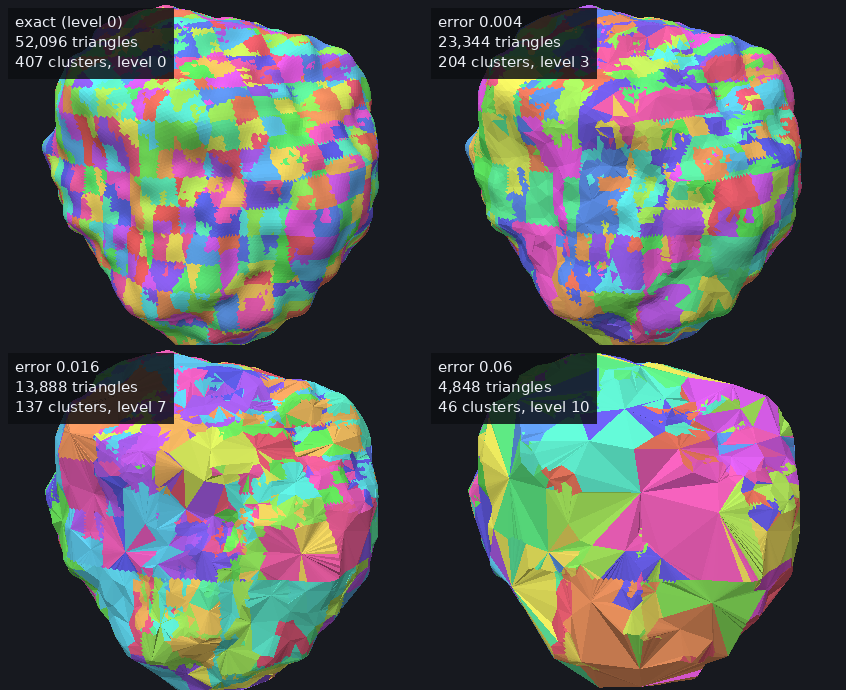

# Graphics improvement — Micromeshes and Photon roadmap

  Reference
  Engine
  Last updated: <time datetime="2026-11-20">2026-11-20</time>
  Source: <a href="https://github.com/devscafecommunity/caffeine/blob/main/doppio/docs/graphics-roadmap.md"><code>graphics-roadmap.md</code></a>

How to take the renderer from "good forward PBR with a screen-space GI" to dense,
virtualised geometry (<strong>Micromeshes</strong>) and world-space dynamic global illumination
(<strong>Photon</strong>), using only what SDL3 GPU can do on Vulkan, D3D12 and Metal.

Names: the geometry system is called **Micromeshes** and the GI system **Photon**. Both are our own designs.
No code, shader text or data layout is taken from other engines; the public literature (cluster hierarchies,
radiance cascades, voxel clipmaps, visibility buffers) is the only reference. This page is the graphics
companion of [`photoreal-world-roadmap.md`](photoreal-world-roadmap.md), which feeds it with terrain, nature and
materials.

> **Status (2026-11-20):** **Micromeshes M-0, M-1 and M-2 are done** (occlusion is single-phase), tested on the GPU and drawn through the real scene
> renderer (see [`micromeshes.md`](micromeshes.md)): RHI indirect draws and storage buffers, render stats and a HUD readout, the offline
> cluster hierarchy with normals, UVs, tangents and vertex colours, the GPU cut with per-instance transforms, the lit G-buffer draw and
> the sun cascades' own coarser cut into a shared index arena, and a single-phase occlusion test against last frame's depth. **Open in
> M-2:** two-phase occlusion and point and spot shadow cuts. **Photon has not started** (P-A: the conservative voxeliser first, because the direct-light injection cannot be verified
> before it; then motion vectors, then real direct light). Independent GPU work done meanwhile is **not** part of these phases:
> vegetation shading and wind, alpha-tested shadows, run-time material modifiers and GPU-displaced water (see the Nature and Water
> guides). The deterministic-world foundation shared with the world roadmap (`core/Hash.hpp`, the scatter core) is done.
>
> **M-0 is complete.** **Next, in order:** P-A, whose first item is the conservative voxeliser. Micromesh's next phases (M-3 streaming, the
> `.micromesh` section in `.caf`, a terrain cluster path to beat the benchmark's baseline) follow once the content pipeline needs them.

<figure class="doc-figure">
  
  <figcaption>Phase M-1 and M-2 as they run today: one rock, four error budgets, every colour a cluster (details in
  <a href="micromeshes.md">micromeshes.md</a>).</figcaption>
</figure>

## 1. Verdict

**Photon: already under way, finish it.** The engine has a compute radiance-cascade GI with a four-level voxel
far field and multi-bounce feedback (`PhotonCascades.hpp`). The proposal to "build a GI" is mostly
done; the work left is quality, validation and the world-space accuracy items its own header lists.

**Micromeshes: built and drawing in the scene, with one hard limit that shaped it.** The cluster hierarchy, the GPU cut with
per-instance transforms, the lit G-buffer draw, shadow cascades, occlusion and the benchmark set exist (`micromeshes.md`). SDL3 GPU
has indirect draws, storage buffers and compute passes, but **no mesh shaders, no portable 64-bit atomics and no indirect-count draw**,
so the cut is compacted into one index arena and drawn with one hardware draw per instance (large win, low risk, as planned). A
compute software rasteriser for sub-pixel triangles stays optional (M-4), using 32-bit atomics.

**Dropped as written:** an SDF-based GI (Photon already uses radiance cascades plus voxels; a second GI
would double the maintenance), and "trillions of triangles". The realistic target is **tens of millions of
source triangles in view with a frame-bound cost**, which is what clusters deliver.

### Where it stands (2026-11-20)

17 items done, 28 open. **Micromeshes are largely done; Photon has not started**, so the next real
work on this page is Photon P-A (see section 8 for the order).

| Phase | Done | Open | State |
|---|---|---|---|
| P-A Photon: make it correct | 0 | 4 | not started: the voxeliser, motion vectors, real direct light, regression scenes |
| P-B Photon: quality | 0 | 5 | not started |
| P-C Photon: scale and cost | 0 | 4 | not started |
| M-0 RHI and tooling | 4 | 0 | done: indirect draws, storage buffers, stats, the HUD readout, the benchmark set (Profiler entries still to add) |
| M-1 Cluster build | 4 | 1 | done; the `.micromesh` section in `.caf` and the packer live in a separate repo and are open |
| M-2 GPU cull and draw | 8 | 3 | done except two-phase occlusion, point/spot shadow cuts and adopting terrain |
| M-3 Streaming and memory | 0 | 3 | not started |
| M-4 Small triangles | 0 | 2 | optional, not started |
| M-5 Editor integration | 1 | 2 | the Inspector toggle is done; stats panel, debug view, generator export, site captures open |
| Shared items (section 6) | 0 | 4 | none started |

## 2. What exists (verified in the tree)

| Area | Status | Where |
|---|---|---|
| GI near field | **Done**: world-aligned cascades K-1..0, fused trace+merge, SH-L1 resolve | `PhotonCascades.cpp`, `photon_cascade.comp` |
| GI far field | **Done (fallback fill)**: four clipmap levels 0.25/0.5/1/2 m, probes with SH, Chebyshev queries | `PhotonCascades.hpp`, `PhotonFarField.hpp` |
| Multi-bounce | **Done**: previous irradiance fed back with a cap and reprojected history | header notes P5 |
| Baked AO | **Done**: BVH/GPU AO bake | `PhotonAOBake.cpp`, `PhotonGpuBake.cpp` |
| Direct light into GI | **Gap**: injection uses a hemispherical sky term, not the real lights and shadows | header "KNOWN GAPS" |
| Voxelisation | **Gap**: screen depth-accumulation fallback, so off-screen and back faces are missing | header "KNOWN GAPS" |
| Motion vectors | **Gap**: history reprojects with the previous matrix only | header P5 |
| Geometry LOD | **Done for opaque meshes that opt in** (Micromesh cluster cut); **partial** for the rest: 3 clustered-vertex LODs per mesh, terrain chunk LODs, CPU frustum cull | `micromesh/`, `MicromeshGpu.cpp`, `MeshLOD.cpp`, `TerrainLodSystem.cpp` |
| Occlusion | **Partial**: coarse CPU AABB occluders (max 16), Min-Z pyramid for GI, and for Micromesh a single-phase farthest-depth pyramid of last frame's depth | `CoarseOcclusion.hpp`, `MinZPyramid.cpp`, `MicromeshGpu.cpp` |
| Instancing | **Done, CPU-grouped**: batches of up to 256 by key | `InstanceBatch.hpp` |
| Shadows | **Done**: 4 directional cascades at 2048, point and spot maps | `GpuDirectionalShadowMap.hpp` |
| Post | **Done**: TAA, ACES, bloom, DOF, SSAO, motion blur, auto exposure | `PostProcessStack.cpp` |
| Compute and indirect in the RHI | **Done (M-0)**: indirect draws and dispatch, storage buffers, read-write compute buffers, capabilities, `readBuffer` | `rhi/CommandBuffer.hpp`, `tests/test_rhi_indirect.cpp` |
| Website page for Photon | **Stale**: says v0.1, no probe field, single bounce; the code is past that | `caffeine-website/.../editor/photon.md` |

## 3. Review of the proposal

* **"Cluster in Rust on a background thread."** Wrong place. Clustering must be an **engine core** module
  (`src/caffeine/micromesh`) behind the C ABI, because the renderer, the `.caf` packer and the runtime (no
  Rust) all need it. The Rust editor only triggers a bake and shows stats. Generators produce plain meshes;
  the cluster build is the last step of the asset pipeline and is cached, never run at game time.
* **"128-256 triangles per cluster, bounds plus geometric error."** Correct. Use 128 triangles and at most
  128 vertices per cluster, a bounding sphere, a normal cone for back-face culling and a **simplification
  error** per cluster group, with the parent's error never smaller than its children's (monotonic), so the
  cut through the hierarchy is crack-free and view-independent.
* **"Compute shaders choose visible clusters and detail."** Correct, and it is the core: two-phase GPU
  culling (previous-frame survivors first, then the rest against a fresh Min-Z pyramid) writing an indirect
  argument buffer. We already have the Min-Z pyramid code for GI to reuse.
* **"Software rasterisation in compute."** Only for triangles that cover under about 4 pixels, and only after
  the hardware path works. It needs a visibility buffer with atomic min on a packed value. Without 64-bit
  atomics, pack 24-bit depth plus 8-bit cluster-local id into 32 bits and resolve the rest in a second pass,
  or skip the software path. Treat it as optional.
* **"Eliminates LOD pop-in."** Only with crack-free simplification plus TAA-friendly dithered transitions.
  It does not remove material or shadow cost: shadow cascades must use the same cluster cut (coarser).
* **"Trillions of polygons."** No. Memory (cluster data streaming) and the per-pixel cost bound it. Plan for
  a fixed budget (visible clusters, rasterised pixels) and measure.
* **"Foliage and alpha."** Cluster rendering suits opaque geometry. Alpha-tested leaves and grass stay on
  the instanced path (with impostors) until a cutout-aware cluster path is justified.
* **GI "route A, SDF".** Not adopted: Photon already covers it with probes plus voxels. What the SDF idea
  adds that we lack is **accurate occlusion from off-screen and back-face geometry**, which the conservative
  triangle voxeliser (below) provides inside the existing design.
* **GI "route B, POM GI".** Only as a **micro-contact** term: the height maps already give POM
  self-shadow and a cavity term (`material-pipeline.md`). Extending that to a small indirect bounce in cavities
  is cheap and local, but it is a detail layer on top of Photon, not a GI.
* **"Anisotropic filtering, ACES, sRGB."** Already in (ACES fitted, sRGB, mip chains). Only the explicit
  anisotropic sampler setting is worth checking.

## 4. Roadmap — Photon (GI)

Photon first: it is closest to done, benefits every scene now, and Micromeshes will need its voxels.

### Phase P-A — Make it correct

> **Finding (2026-11-20):** a prototype injected the sun into the far-field radiance (a voxel march toward the light instead of
> shadow maps, in `photon_inject.comp`) and was **reverted**: in a red-wall-and-floor scene the result was identical with and
> without it, because the screen-space cascades dominate every visible pixel and the far field only fills what leaves the
> screen, where the screen-depth voxel fill has no geometry. The direct light cannot be tested, and so is not worth its cost,
> until the conservative voxeliser (third item) provides geometry the screen does not see. Order accordingly. The Photon GI
> component is now reflected (Inspector, scenes, scripts: `Photon GI`, with `Debug view`), which the next attempt needs; note
> that `Debug view` did not change the image on the `ComputeC0` path in that test, worth checking.

- [ ] Inject **real direct light** (sun, point, spot, with the shadow term) into the voxel/probe radiance
      instead of the hemispherical sky term. Test: a red wall lit by the sun tints a nearby white floor.
- [ ] **Motion vectors** pass (per object matrices, previous frame), used by Photon history, TAA and motion
      blur. Remove the "no motion vectors" gap; invalidate history on disocclusion by depth/normal test.
- [ ] Conservative **triangle voxeliser** with dirty-region updates (static geometry once, dynamic per
      frame), replacing the G-buffer fallback. Keep the fallback behind a quality tier.
- [ ] Headless regression scenes: Cornell box, light-through-door, thin wall leak. Fixed seeds, image
      thresholds in `doppio/tests/ui-flows`.

### Phase P-B — Quality and stability

- [ ] Normal-aware spatial-temporal denoise of the SH resolve; clamp fireflies; ghosting metrics in tests.
- [ ] Emissive surfaces as lights (materials already have emissive maps).
- [ ] Sky as a proper source: feed the prefiltered environment (split-sum) to Photon far field and to
      specular IBL, one source of truth.
- [ ] Glossy reflections from the probe field when screen-space tracing misses (replaces the per-object
      probe cubemaps as the fallback, so off-screen reflections stay stable).
- [ ] Per-view scratch resources (the header notes one shared scratch instance); needed for editor
      previews and split view.

### Phase P-C — Scale and cost

- [ ] Quality tiers with measured GPU budgets (Eco/Low/Balanced/High) and a frame-time governor.
- [ ] Clipmap far field following the camera with toroidal updates; larger worlds without re-fill spikes.
- [ ] Feed terrain and vegetation chunks (from the world roadmap) into the voxel volume as they stream in.
- [ ] Update the website Photon page to the real state and add the new knobs to the editor UI with `UiId`s.

## 5. Roadmap — Micromeshes (virtual geometry)

Each phase ships alone and keeps the old path as a fallback behind a flag.

### Phase M-0 — RHI and tooling prerequisites

- [x] `rhi/CommandBuffer` wraps indirect draws (`drawIndirect`, `drawIndexedIndirect`, multi-draw count), indirect dispatch,
      graphics **storage buffers** for the vertex and fragment stages and compute passes with read-write storage
      **buffers**; `BufferUsage::{Indirect, IndirectWrite, GraphicsStorage, GraphicsStorageWrite}`;
      `RenderDevice::capabilities()` (indirect draw and dispatch, storage, no mesh shaders, no 64-bit atomics) and
      `readBuffer`. Tested on the GPU in `tests/test_rhi_indirect.cpp`: indirect arguments decide what is drawn, and a
      compute pass writes the draw arguments (a miniature of GPU culling). The tests skip without a GPU or `glslc`.
- [x] CPU-side pass timers per stage (gather, shadows, opaque, translucent, total) and counters (meshes, frustum culled,
      draw calls, instanced draw calls, triangles) in `GpuSceneRenderer::lastFrameStats()`; C ABI **v11**
      `caffeine_session_render_stats`, the Rust `Engine::render_stats()` and the agent query `render_stats`.
      SDL3 GPU has no portable GPU timestamps, so the times are encoding time, not GPU time.
- [x] The viewport HUD shows the last frame's triangles, draws and Micromesh draws (cheap counters, no read-back). Still open: Profiler entries and a panel with the cluster counters.
- [x] **The reproducible benchmark set** (`./scripts/benchmark-micromesh.sh`): a dense rock field, a forest of 300 dense trees and a terrain at two grid
      sizes, fixed camera paths, content generated in code (no assets, byte-identical every run, tested), every renderer path that applies.
      Triangle and draw counts reproduce exactly; wall time is a whole frame including read-back, encode time the CPU's. Results in
      [`micromeshes.md`](micromeshes.md): Micromesh draws 6.1x (rocks) and 3.3x (forest) fewer triangles and a median frame of 0.56 and
      0.75 of the instanced one, but the forest costs more CPU (one draw per tree); the terrain baseline is 0.2 to 0.8 M triangles in 100 to
      400 draws. The old `assets/benchmarks` (an unused 43 KB scene) is not part of it.

### Phase M-1 — Cluster build (offline, core)

- [x] `micromesh` module (`src/caffeine/micromesh/Micromesh.hpp`): clusters of at most 128 triangles and 128 vertices along a Morton
      curve (our own, simpler than a greedy adjacency split), each with a tight bounding sphere, a back-face normal cone and a
      local vertex remap (one byte per index).
- [x] **Hierarchy**: clusters are grouped (4 at a time, widened when a group cannot shrink), each group is merged, simplified by
      **quadric edge collapse with its boundary locked** (and non-manifold edges), and split again, up to one root. A group's
      error is the larger of its collapse error and its children's, plus an epsilon, so it is **strictly** monotonic; its
      sphere contains the children's. A cut is "own error <= threshold < parent error" (optionally divided by the distance to
      the sphere for a projected error).
- [x] Versioned POD bytes: `serialize` / `deserialize` (bounds-checked), byte-identical rebuilds. C ABI **v12**
      `caffeine_micromesh_build` (positions, indices, stats, bytes) and the Rust `Engine::micromesh_build`, so generators and a
      packer can bake. **Not done:** the `.micromesh` section inside `.caf` and a `caf-pack` CLI (a separate submodule repo).
- [x] Tests (`tests/test_micromesh.cpp`, 9 cases): limits per cluster, every level coarser, one root on closed meshes, monotonic
      errors and sphere containment, **every cut of a sphere and a torus is closed and manifold (each edge in exactly two
      triangles) at 12 thresholds**, view-dependent cuts are crack-free and coarser far away, an open grid keeps its boundary and
      terminates, back-face cones never hide a facing cluster, degenerate input, byte-identical rebuilds and the ABI.
- [ ] Known limits: groups are neighbours on a Morton curve, not an adjacency graph, so a level removes about half the
      triangles on compact meshes and less on thin or branching ones; open meshes stop where their locked boundary pins
      everything (several roots); a collapse picks the best of the two endpoints and the midpoint (no optimal position);
      measured on meshes up to 82 k triangles (about a second to build 80 000); locked UV seams limit how far a mesh with many islands
      reduces. (Normals, UVs, tangents and vertex colours are carried now.)

### Phase M-2 — GPU culling and hardware draw

- [x] Upload to GPU buffers (`render/MicromeshGpu`): one storage buffer of cluster records (bounds, error spheres, cone, index range),
      one position buffer, one index buffer with every cluster's global indices, and an indirect-argument buffer.
- [x] Per-instance transforms: `MicromeshGpu::setInstances`, cull index `instance * clusterCount + cluster`, per-instance cut, frustum
  and cone, one dispatch and one indirect draw for the whole field (196 rocks, 16 M source triangles: 0.15 to 0.5 M drawn per frame, 10x
  fewer than the exact mesh on average). Images and GIF in [`micromeshes.md`](micromeshes.md). Still one hierarchy per object and a uniform scale per instance.
- [x] Compute pass 1 (`shaders/micromesh_cull.comp`): per cluster, the cut test (own error within the threshold, parent's not,
      optionally projected by distance), frustum test and back-face cone; it writes one indexed-draw argument set per cluster
      with `indexCount` 0 when culled, so the CPU issues the same `drawIndexedIndirect(args, 0, clusterCount)` every frame
      with no read-back and no atomics.
- [x] **Occlusion, single-phase**: each frame the previous depth buffer becomes a farthest-depth pyramid (`MicromeshHzb`, one storage
      buffer) and the camera's compacting cull drops clusters whose sphere is behind it (Mesh Renderer -> Micromesh occlusion, off by
      default). Behind a wall: 1.5x to 2.5x fewer triangles (2.1x mean), picture difference 0.11 / 255 mean; a cluster that becomes
      visible shows one frame late at silhouette edges. Images in [`micromeshes.md`](micromeshes.md).
- [ ] **Two-phase occlusion** (draw last frame's visible clusters, rebuild the pyramid from that depth, test the rest): removes the
      one-frame lag; needs the opaque pass split in two.
- [x] The indirect draw works on the GPU: `MicromeshGpu::draw` binds the buffers and issues one multi-draw over every cluster.
      **Tested on the GPU** (`tests/test_micromesh_gpu.cpp`): the cut the compute pass selects **equals the CPU's `selectCut`**
      at 4 distances x 3 thresholds, the cone filter equals `isBackFacing`, the frustum test equals the same sphere-plane test on
      the CPU, a farther camera picks a coarser cut, and a rendered cut covers the sphere's disc (fine and coarse alike).
- [x] Prerequisite for it: **shading normals** carried through every collapse and drawn with `MicromeshGpu::drawLit`; a coarse cut shades
  within 1.6 to 10 / 255 of the exact mesh (facets: 2.9 to 13). **UVs** are carried too (seams stay locked): a bump map and a UV
  checker stay within 1.2 to 11.7 / 255 of the exact render across the cuts. Images in [`micromeshes.md`](micromeshes.md). Tangents,
  vertex colours and a second UV set are still missing.
- [x] **Draw the visible clusters into the existing G-buffer targets through the scene pipeline** (Photon, SSAO, TAA and post keep
      working unchanged): Mesh Renderer -> **Micromesh** (+ error in px) draws the mesh as a cut through `scene_lit.frag`, one indexed
      draw per instance (the cull pass compacts the cut: SDL3 GPU has no indirect-count draw). 81 lit, shadowed rocks: 5.3x to 7.1x
      fewer triangles per frame for the camera, 10.8x from the air, picture difference 1.5 / 255. Details, the benchmark table and the
      limits in [`micromeshes.md`](micromeshes.md). Also fixed on the way: a dense mesh without materials re-read its file on
      every draw of every frame (4 to 8 ms of CPU per draw).
- [x] **Shadow cascades draw their own coarser cut** (same hierarchy, so no cracks): the sun's cascades are cut at four shadow texels by
      `shadow_micromesh.vert`, into a **shared index arena** that grows by itself (32 MB for 81 rocks instead of one full-size index buffer
      per rock). Point and spot shadows still draw the full mesh. Also: non-uniform scale, one hierarchy per sub-mesh, vertex colours
      carried. The editor viewport renders without shadow maps unless `ViewportSettings::shadows` is on (C ABI v14).
- [ ] Point and spot shadow maps draw their own coarser cut too (only the sun's cascades do).
- [ ] Terrain tiles and Nature rocks/trunks are first adopters; foliage stays instanced. (Rocks and trunks can opt in through the Mesh
      Renderer today; the Nature generator does not switch it on for what it places, and terrain has no cluster path: its baseline is in
      the benchmark set.)

### Phase M-3 — Streaming and memory

- [ ] Page cluster data in and out by distance and error with a fixed memory budget and an async
      upload queue; never stall a frame.
- [ ] Geometry compression (quantised positions and octahedral normals) and an LRU of pages.
- [ ] Hook the world chunks: a chunk's baked meshes are clustered when first cached and reused afterwards.

### Phase M-4 — Small-triangle path (optional, measure first)

- [ ] Compute rasteriser for clusters whose triangles are under ~4 pixels, writing a visibility buffer
      with 32-bit atomics and a resolve pass that fetches attributes. Gate on a measured win over the
      hardware path on dense rock/bark scenes.
- [ ] Material resolve in screen tiles to avoid one pass per material.

### Phase M-5 — Editor integration

- [x] Inspector toggle "Micromesh" on a Mesh Renderer (reflection exposes `Micromesh` and `Micromesh error (px)`); still open: a stats panel and a debug view (cluster colours,
      error cut, culled clusters), `UiId` catalogue entries for the toggle and MCP actions.
- [ ] Nature, Terrain and Water generators export through the cluster build; Nature gets a
      **cluster LOD** option replacing the old billboard-only plan for non-foliage parts.
- [ ] Docs and headless captures (cluster debug view) in the site.

## 6. Shared items

- [ ] **One visibility source**: the cluster cull and Photon voxelisation read the same instance data.
- [ ] **Frame graph light**: explicit pass list with resource lifetimes so culling, G-buffer, Photon,
      shadows and post are ordered and memory is reused; today the order is hand-written.
- [ ] **Quality governor**: one setting maps to Photon tier, shadow resolution, cluster error threshold,
      and runtime scalers (resolution, TAA upsampling).
- [ ] **Reference scenes** with fixed seeds rendered headless and compared as visual baselines.

## 7. Risks

| Risk | Mitigation |
|---|---|
| No mesh shaders, no 64-bit atomics in SDL3 GPU | hardware indirect draws first; software raster optional and 32-bit |
| Cracks between LOD groups | locked group boundaries, monotonic error, tests that cut at random thresholds |
| Photon history ghosts with moving objects | motion vectors, disocclusion tests, regression scenes |
| Voxeliser cost on dynamic geometry | static baked once, dynamic dirty-region updates only |
| Two geometry paths drift apart | flag-gated, same G-buffer output, shared tests |
| Scope | Photon P-A and Micromeshes M-0/M-1 are independent and can run in parallel |

## 8. Suggested order

Done: **M-0**, **M-1** and **M-2** (Micromeshes, up to single-phase occlusion). From here:

1. **P-A** (correct Photon): the conservative voxeliser first, then motion vectors, then real direct light and the regression scenes.
   Nothing of Photon is done, and every Micromesh and world item that wants GI waits on it.
2. **M-5**, the cheap part: the Nature, Terrain and Water generators switching Micromesh on, stats panel and debug view, `UiId`s, site
   captures. Also the `.micromesh` section in `.caf` (a cache for the first-frame build) and a terrain cluster path to beat the benchmark.
3. **P-B**, then **M-3** (streaming and compression) tied to the world chunks of the world roadmap.
4. **P-C**, two-phase occlusion and point/spot shadow cuts, and **M-4** only if profiling asks for it.

## 9. Related

- [`micromeshes.md`](micromeshes.md): what is built of Micromeshes, with renders from the GPU path.
- [`photoreal-world-roadmap.md`](photoreal-world-roadmap.md): the content generated for this renderer.
- [`material-pipeline.md`](material-pipeline.md): POM, displacement and height-derived AO.
- [`nature-generator-guide.md`](nature-generator-guide.md): vegetation LOD and instancing gaps.
- [`terrain-generator-guide.md`](terrain-generator-guide.md): tiled and large terrains.
