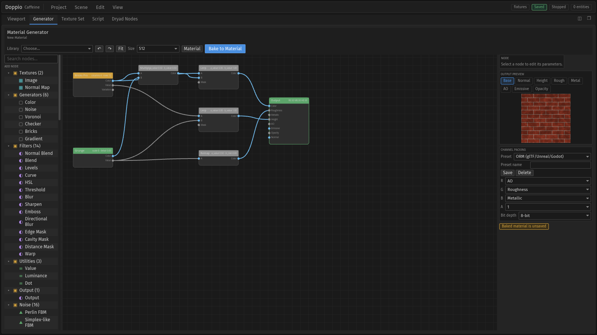

# Material, texture and generator pipeline — backlog

  Reference
  Doppio
  Last updated: <time datetime="2026-11-18">2026-11-18</time>
  Source: <a href="https://github.com/devscafecommunity/caffeine/blob/main/doppio/docs/material-pipeline.md"><code>material-pipeline.md</code></a>

The living checklist for materials, textures, map baking,
node generators and texture sets, kept current so the next change starts from the
real foundation instead of the history.

<figure class="doc-figure">
  
  <figcaption>The atomic graph baked to base colour, height, roughness, metallic, AO and packed maps, then assigned to the selected material.</figcaption>
</figure>

Living checklist for the Doppio material stack. Update the checkboxes as work
lands; keep the **current foundation** section accurate so a future agent can
continue without re-reading the whole history.

Clean-room rule: MaterialCraft, TextureCraft and MistyEngine under
`reference/` are read for public behaviour, formats and UI conventions only.
Do not copy source, shader text, node definitions or bundled assets.

## Current foundation (done)

- [x] `.mat` PBR assets: full `MaterialSurface`, presets, load/save, assign to
      Mesh Filter, Inspector slot, undoable scene assignment.
- [x] Engine sphere preview (`MaterialPreviewRenderer`) through the C ABI with
      orbit drag and throttled refresh.
- [x] Texture map utilities: normal from height (OpenGL/DirectX), AO from
      height, roughness/metallic from albedo, ORM, Unity HDRP mask, Unity
      metallic-smoothness. DirectX normals are flipped by the shader.
- [x] Material Studio: surface/maps/UV/advanced cards, texture picker, map
      baker, generated-map assignment.
- [x] Assets: texture/material/mesh/scene filter, search, image thumbnails and
      material albedo swatches.
- [x] Reusable `node_canvas` component: graph-space nodes, typed ports, cubic
      wires, drag, pan, zoom, selection and connect events.
- [x] Atomic material graph: Color, Image, Noise (value/Perlin), Voronoi,
      Checker, Bricks, Gradient, Blend, Levels, Curve, HSL, Threshold, Blur,
      Warp, Value, Luminance, Dot and Output (Color/Roughness/Metallic/Height/
      AO). Typed colour/scalar ports, blend masks and 13 blend modes.
- [x] Bake graph → base colour, height, roughness, metallic, AO, normal and
      packed maps; save and assign to the selected entity automatically.
- [x] Background worker bake with progress/cancel; the UI keeps the last
      result and never blocks the viewport. The Generator also runs a debounced
      low-resolution live bake of the Output node after every graph edit.
- [x] 8/16-bit generated maps and a channel-packing editor (ORM, Unity HDRP,
      Unity metallic-smoothness, custom R/G/B/A sources).
- [x] Per-material `<name>.mgraph` sidecar (versioned `CAFMGRAPH2` text, reads
      `CAFMGRAPH1`) with nodes, links, parameters, positions and resolution.
- [x] MCP queries/actions and `material-smoke` / `material-generator-smoke`.

## Phase 1 — Complete the generator foundation

- [x] Graph history, wire selection/delete/reconnect, reroute dots, palette
      search, 16-unit snapping, copy/paste, fit-to-graph, undo/redo MCP actions,
      Rust tests and the `material-generator-smoke` flow.

### Undo/redo for graph edits — done

- [x] Add a graph history stack per material (snapshots or reversible
      commands). `MaterialGraph` is `Clone`, so snapshots are the simplest
      first step; keep them small and cap memory.
- [x] Coalesce continuous edits with a stable key: `generator:move:<node>`,
      `generator:param:<node>:<param>`, so a drag is one step.
- [x] Cover Add/Delete node, Connect/disconnect, Move, every parameter, output
      assignment, resolution and graph load/clear.
- [x] `Ctrl+Z` / `Ctrl+Shift+Z` and `Ctrl+Y` while the Generator pane is
      focused; header Undo/Redo buttons remain available.
- [x] MCP `generator_undo` / `generator_redo` plus `can_undo`, `undo_name`,
      `can_redo`, `redo_name` in the `generator` query.
- [x] Tests: add→undo, connect→undo/redo, coalesced drag, delete link, dot,
      copy/paste and scene-shortcut routing.

### Wire editing — first pass done

- [x] Hit-test cubic wires (sample the bézier; ~5 px tolerance) and keep a
      separate wire-selection state from node selection.
- [x] Delete/Backspace removes a selected wire in one history step; right-click
      a wire and the properties-panel Delete link button do the same. Dragging a
      connected input detaches its source for reconnection.
- [x] Add a **reroute dot** node: one input/one output, pass-through; insert on
      double-click of a wire or with `insert_generator_dot`.
- [ ] Wire context menu and source swap of exactly two wires.
- [ ] Hover highlight + pointer feedback; canvas redraws only on changes.
- [x] Tests for wire hit distance, single-input replacement, cycle rejection,
      reroute round-trip and undo.

### Canvas polish — first pass done

- [x] Snap node placement to a 16-unit grid; toggle in the canvas toolbox.
- [x] Search field filters the node palette by node name or category; the
      palette is grouped by category in the shared tree view with collapsible
      groups. A Space/Tab modal search remains a future refinement.
- [x] Copy/paste the selected node (toolbox buttons and MCP); internal-link
      duplication/duplicate-selection is still pending.
- [ ] Optional frames/comments; keep them out of the first undo milestone.
- [x] Fit-to-graph ("Fit" button / `fit_generator`).
- [x] Node cards show a live 72 px thumbnail (96 px evaluated) of their own evaluated output,
      computed in the debounced background preview worker; errors simply omit
      that thumbnail and never block editing.

## Phase 2 — MaterialCraft-style node library

### Image and texture nodes

- [x] Project texture node: pick an image asset, sample UV, expose tiling and
      offset; reuse the texture picker and engine path resolver.
- [x] Image sampler node with nearest/linear and clamp/repeat.
- [x] UV projection choices: UV, planar, tri-planar (synthetic spherical
      domain until mesh-space UVs are available), cylindrical and spherical.
- [x] Normal-map input node and normal blend (whiteout/linear) for
      height/normal combinations.
- [x] Image decoding runs on the bake worker; decode errors abort with a
      message. A 4K resolution warning remains.

### More atomic generators/filters

- [x] Voronoi/cells with distance and cell-colour outputs.
- [x] Perlin and value noise with octaves, persistence and lacunarity;
      simplex/Worley variants and anisotropic scale/rotation remain.
- [x] Curve, levels (brightness/contrast/gamma/invert), HSL, blur and warp.
- [x] Sharpen, emboss and directional blur.
- [x] Threshold/soft mask, distance, edge-detect and cavity/curvature masks;
      dirt-like masks remain.
- [x] Blend additions: overlay variants, soft light/hard light, subtract,
      difference, darken/lighten, colour dodge/burn; per-channel alpha remains.
- [x] Scalar constants and a value node, typed colour/scalar ports; arithmetic
      nodes remain.
- [ ] Function/group nodes only after the atomic graph is stable; do not add a
      scripting VM in this phase.

### Bake and output

- [x] Bake on a worker thread with progress/cancel; the UI keeps the last
      result. Never freeze the viewport while cooking.
- [x] 16-bit generated maps plus 8-bit PNG defaults; float cook remains.
- [x] Channel-packing editor: destination R/G/B/A ← AO, roughness, metallic,
      height, smoothness, base luminance or constants; built-in ORM, Unity
      HDRP and Unity metallic-smoothness presets plus custom channels, saved
      user presets in `~/.config/caffeine/packing-presets.txt`.
- [x] AO derived from the height map and scene-geometry AO through Photon
      (`caffeine_session_bake_ao`, Material → AO from scene); displacement
      height bake remains.
- [x] Graph outputs generate base, normal, roughness, metallic, AO and height
      maps and pack them for the material; emissive/opacity outputs remain.

## Phase 3 — MaterialCraft interoperability

- [x] Import `.mcmat`: manifest, cooked maps, parameters and `source.sbs` → a
      Doppio `.mat`, map files, `.sbs` source and `.mgraph` sidecar.
- [x] Parse SBS XML `compNode` graphs (known filter mapping for color, noise,
      voronoi, checker, bricks, gradient, blend, levels, HSL, threshold, blur,
      sharpen, emboss, directional blur, warp, edge/cavity/distance masks,
      normal blend, image/normal-map nodes and outputs).
- [x] Preserve unknown filters and unsupported graph outputs as
      `NodeKind::Unknown` placeholders; keep all links and report warnings in
      the generator status/log.
- [x] Portable `.mcmat` export first: baked maps + manifest + minimal
      `source.sbs`, with node/link round-trip validation before writing.
- [ ] Full native SBS export parity. The current writer emits the Doppio subset
      and validates it against our own reader; do not claim Substance parity.
- [x] Headless `doppio-material` CLI (`import`, `import-sbs`, `export`,
      `bake-graph`, `inspect`) and MCP `import_materialcraft` /
      `export_materialcraft` actions using the same engine-backed helpers.
      `bake-graph <file.mgraph> [--size N] [--out DIR]` prints per-stage timing
      and is the quickest way to reproduce a slow bake outside the editor.

### Explicit node mapping

| SBS filter | Doppio node | Notes |
|---|---|---|
| `uniformcolor` / `solidcolor` | Color | colour parameter |
| `noise`, `perlin_noise`, `fractal_*` | Noise | value/Perlin, scale, octaves, seed |
| `voronoi` | Voronoi | scale, jitter, seed, mode |
| `checker` / `checkerboard` | Checker | scale and two colours |
| `bricks` / `brick` | Bricks | rows, columns, mortar, colours |
| `gradient*` | Gradient | angle and two colours |
| `blend` | Blend | destination/source inputs, opacity, blending mode |
| `normal_blend` | Normal Blend | whiteout/linear |
| `levels`, `hsl`, `threshold`/`mask` | Levels, HSL, Threshold | matching parameters |
| `blur`, `sharpen`, `emboss`, `directional_blur`, `warp` | corresponding filter node | radius/intensity mapped heuristically |
| `edge_detect`, `curvature`/`cavity`, `distance` | Edge/Cavity/Distance Mask | strength/threshold/radius |
| `image` / `normalmap` | Image / Normal Map | path, projection, tiling, offset, filter, wrap |
| `value`, `luminance`, `curve`, `dot` | Value, Luminance, Curve, Dot | constants/utilities |
| output bridge | Output | usage selects Color/Roughness/Metallic/Height/AO port |
| anything else | **Unknown placeholder** | links and port order preserved, warning reported |

Known-name parameters that cannot be represented keep the node as a placeholder
rather than silently dropping data. The native SBS writer covers this table and
is validated by importing its own output; it is not advertised as full
Substance Designer parity.

## Phase 4 — TextureCraft-style texture sets and painting

This is a separate pipeline from material graphs. Do not pretend the material
map baker is a texture painter. The texture-set foundation below is implemented
in `uikit/texture_set.rs`, `uikit/panels/texture_set.rs` and
`uikit/components/uv_canvas.rs`; the unchecked items are the remaining painter
depth.

- [x] Texture sets with UDIM tiles (1001–1010), channel definitions and
      per-tile RGBA resources.
- [x] Layer stack: paint/fill layers, visibility, opacity, 13 blend modes,
      reorder/delete and per-layer tile masks. Folder layers and thumbnails
      remain.
- [x] 2D UV painting canvas, channel selection and a 3D paint mode that
      ray-picks the selected mesh and paints at the hit UV. Pressure/stylus
      input, stamp masks, projection painting and seam handling remain.
- [x] Mesh-map bakes: AO/curvature from height, scene-AO import through
      Photon, and world-normal, world-position and object-ID bakes from the
      selected mesh UVs. Thickness and bent-normal bakes remain.
- [x] Built-in export presets (separate maps, glTF ORM, Unity HDRP mask) and a
      CLI `texset-export`; user-defined output templates remain.
- [x] Undo/redo from per-tile snapshots and the `.texset` project format
      (ZIP manifest + PNG tiles/masks).
- [ ] Integration: dropped texture becomes a material; generated maps can be
      used by the map baker and Generator image nodes.

## Phase 5 — Material rendering and asset polish

- [x] Preview shapes Sphere/Cube/Plane and an HDRI environment + exposure
      controls, rendered at 512 px with contain-fit framing; sphere remains the
      fast default.
- [x] Async material preview with begin/poll readback and no UI stall. The
      synchronous C ABI entry point remains for tools/tests.
- [x] Engine thumbnail decode (`caffeine_texture_load_thumbnail`) as the
      primary asset/material thumbnail path, with the Iced loader as fallback;
      cache entries are invalidated by file modification stamp. The GPU texture
      cache also hot-reloads a file whose stamp changed even while the scene or
      preview still holds the old pointer, retiring that texture instead of
      destroying it in use.
- [x] Apply saves dirty baked materials before assignment and creates a cube
      preview mesh on empty entities, so masks/bricks reach the `.mat` file.
- [x] Material picker in the Inspector with a searchable `.mat` list; internal
      asset drag/drop assigns materials/textures, and OS file drops work too.
- [ ] Drag presets into the generator canvas and reorder material maps.
- [x] glTF/OBJ material import: base color, metallic-roughness, normal,
      occlusion, emission, alpha and glTF UV transform into `.mat` + `.mgraph`.
- [x] Material preview overlays: DirectX/OpenGL, alpha mode, map presence and
      per-map resolution/missing-file badges.
- [x] C ABI version bumped to **2** with `caffeine_capi_version()` and a status
      bar badge; C API tests cover it.

## Procedural library and presets (no third-party assets needed)

User guide with rendered images: [materials-guide.md](materials-guide.md).

- [x] `uikit/procedural/`: ~123 data-driven, tileable, seeded, multi-threaded
      ops (`NodeKind::Proc`) — Noise 16, Natural 17, Patterns 18, Shapes 8,
      Math 25, Geometry 8, Height & PBR 14, **Realistic 17** (`realistic.rs`). Each op is one `OpDef` row (ports,
      `ParamSpec`s, colours, `eval`); the palette, properties panel, `.mgraph`
      (`proc <id> …`) and MaterialCraft (`doppio_proc`) are generated from it.
- [x] Output node: Emissive / Opacity / Normal inputs appended after
      Color..AO, plus `auto_height` (height from base luminance when Height is
      unconnected), `normalize_height` and `height_contrast`, so height is never
      a flat plane. `BakedMaterial` gained `emissive(16)`, `has_emissive`,
      `opacity(16)`, `has_opacity`, `normal`.
- [x] `uikit/material_library.rs`: 78 parameterisable presets (Stone, Brick,
      Concrete, Ground, Wood, Metal, Fabric, Organic, Sci-fi, Misc and the Realistic
      Rock/Water/Nature/Ground/Wood/Man-made families with optional accent layers
      and emissive wiring), picked from
      the generator header **Library** dropdown (one undoable step, resolution
      kept). Tests bake every preset at 64² and check base variance, height
      std-dev > 0.02, determinism and `.mgraph` round trip.
- [x] Output preview channel switcher (Base, Normal, Height, Roughness, Metal,
      AO, Emissive, Opacity). Each node card shows a live 72 px thumbnail (96 px evaluated) of its
      own evaluated output, refreshed with the same debounced worker pass.
- [ ] Preset parameters (seed / scale / wear) are not yet exposed in the UI.

World-scale plan (seed, scatter, streaming): [`photoreal-world-roadmap.md`](photoreal-world-roadmap.md).

## Definition of done for "the base is complete"

- Generator graph edit undo/redo and wire editing never lose work.
- A material and its graph survive save/reopen, and a graph bake is
  reproducible byte-for-byte at the same resolution.
- MaterialCraft import covers the node set we expose; unsupported data is
  reported, not dropped.
- Texture sets/painting have their own project format and undo; material maps
  can consume their exports.
- The preview and asset browser work without blocking the UI thread.
- `check-rust-ui.sh`, Rust tests, `[capi]`/`[material]`, and every MCP smoke
  pass; docs and UI captions are regenerated.

## Depth, bake and height packing

- [x] Parallax occlusion mapping in `scene_lit.frag`; height in the normal map's
      alpha (16-sampler limit); `MaterialSurface::heightScale/parallaxSteps`,
      `.mat` keys, C ABI v3, Rust `Material`, Material panel sliders. The
      ray-march moves toward the camera for recessed texels (alpha 1 = surface,
      0 = deepest), so pits read as depth instead of inverted peaks. POM
      self-shadowing applies to directional, point and spot lights; the height
      cavity also attenuates direct, ambient, IBL and reflected light, so the
      relief does not flatten into plastic when the sun is not grazing. Direct
      specular uses D*V*F without the extra PI factor that blew out highlights.
- [x] Generator bake size is selectable at 128/256/512/1024/2048 px. 2048 is
      the safe max; 4K needs a tiled/parallel evaluator (the current CPU memo
      peaks above practical memory at 4096×4096 with 16-bit maps).
- [x] Bake progress counts reachable nodes only and names the finalisation
      stages (`Packing maps`, `Baking occlusion`, `Writing maps`, `Done`). The
      automatic AO uses a separable box blur (O(pixels), not O(pixels ×
      radius)), so 2K bakes finish in seconds instead of appearing stuck.
- [x] Generator bake packs height into the normal alpha and enables depth;
      authored Normal / Emissive / Opacity outputs are written and wired.
- [x] Preview cache key includes texture file stamps, and a re-bake which
      rewrites the same PNG paths now reloads those GPU textures in place
      (`doppio/crates/engine/tests/material_preview.rs`).
- [x] **Pack a height map into the normal…** (external height images).
- [x] Parallax self-shadowing (`parallaxSelfShadow`) and a derivative-based UV frame
      (fixes the oblique/sheared look caused by non-u-aligned procedural tangents).
- [x] Geometric displacement: `displacement_mode geometric`, `displacement_scale` (m),
      `mesh_subdivisions` in the `.mat`; the mesh is midpoint-subdivided
      (`assets/MeshSubdivide.hpp`) and `scene_displace.vert` / `shadow_displace.vert` push
      vertices along normals by the normal-map alpha through the vertex-stage sampler
      (set 0, so the 16 fragment samplers are untouched). Normals are rebuilt by finite
      differences and the shadow pass uses the same formula, so relief casts real shadows.
      C ABI version 4. Material panel: "Geometric displacement" checkbox + depth + subdivisions.
- [x] Material preview: sun direction/height/intensity and a Shadows toggle (C ABI v5,
      `caffeine_session_set_material_preview_light`, agent action `set_material_preview_sun`),
      768 px render, closer camera, brighter floor, sky fill.
- [x] Shadow pass is order independent (`BlendMode::Min`); stale shadow maps are cleared when
      shadows are off; POM self-shadow multiplies with the shadow-map term.
- [x] Cross-session fix: process-wide GPU texture cache, procedural meshes and mesh cache are
      released on session shutdown (the device is leaked on purpose).
- [x] Re-bake fix: `GpuTextureCache` reloads a file rewritten in place (stamp changed) even
      while its ref count is non-zero.
- [x] UVs follow the object's scale (`uv_object_scale`, on by default; C ABI v6): the vertex
      shaders measure the model matrix's stretch along the tangent / bitangent and the fragment and
      displacement shaders multiply the tiled UV by it, so a scaled quad keeps its texture density.
      Instanced draws and the material preview keep the authored UVs. Material panel checkbox.
- [x] **Variation** node class (`procedural/variation.rs`, 6 ops): Noise Variation (Perlin / Simplex),
      Cell Variation (grid, Voronoi or a pattern's own cell ids), Patch Blend, Tile Shuffle, Wave
      Function Collapse (overlapping model, periodic output) and Diamond-Square (toroidal). Seven
      `Varied` presets use them; also in the Texture Generator (two `Procedural` presets).
- [ ] Variation: simple-tiled WFC with an explicit tile set and adjacency rules; WFC constraints
      (fixed cells, region masks); Diamond-Square with an erosion pass.
- [ ] Expand culling bounds by the displacement depth; distance-adaptive subdivision.
- [ ] Preset seed / scale / wear in the UI.

## Texture Generator (separate tool, see `texture-generator-guide.md`)

- [x] Its own pane, `.texgraph` file (`CAFTEXGRAPH1`), `Texture Output` node (Colour + alpha, or
      packed R/G/B/A), palette and presets; the material and texture loaders refuse each other's
      files, and the material palette hides the VFX & Shapes ops.
- [x] 10 VFX & Shapes ops (leaf, feather, droplet, shockwave ring, flame, smoke puff, sparks,
      radial burst, soft glow, colour ramp) and 16 presets.
- [x] Preview over a checkerboard with Colour / Alpha / R / G / B views.
- [x] PNG export (8 and 16 bit, straight alpha) and flipbook sheets that loop every `phase`
      parameter; `doppio-material bake-texture`; agent query `texture_generator` and actions.
- [ ] Float / EXR output for heightmaps and LUTs.
- [ ] Image-reader node and seamless (tiled) export mode in the Texture Generator.
- [ ] Preset seed / colour variation in the UI; more presets (decals, runes, scratches, stylised
      clouds).

## Nature Generator (separate tool, see `nature-generator-guide.md`)

- [x] Recipe-driven rocks (icosphere + noise + cut planes), trees (recursive tubes, broadleaf /
      conifer / dead) and plants (grass, fern, bush, flower); stylised / balanced / detailed quality.
- [x] Software 3D preview, `.obj` export (one file per part) and `.nature` recipes, **Place in scene** as a
      group with one entity per part and baked materials (library presets, Texture Generator cards).
- [x] Engine fix: `propagateTransforms` no longer crashes on children without a world matrix.
- [ ] Material slots per submesh (ABI), vertex colour, wind mask, leaf atlas, LOD / impostors, `.glb` writer.
- [ ] Scatter over terrain and biomes (belongs to the terrain generator).

