# Materials in Doppio: procedural library, real depth and baking

This guide covers what you need to author realistic, tileable PBR materials
**without downloading third-party assets**: the procedural node library, the
preset library, the Output node, parallax depth and how baking works.
Images are rendered by the engine itself and captured headless; the commands to
regenerate them are at the end.

## 1. The procedural library

The Generator tab is a node graph that bakes into the material's maps. Besides
the original nodes it now has **123 data-driven operations** (`uikit/procedural/`),
all seeded, tileable and multi-threaded:

| Category | Examples |
|---|---|
| Noise (16) | Perlin / Simplex-like / Value FBM, Ridged, Billow, Turbulence, Worley variants, Domain-warped, Clouds, Gabor-like |
| Natural (17) | Dirt, Scratches, Cracks, Rust, Moss, Strata, Sand ripples, Wood grain, Marble veins, Leather pores, Brushed metal, Caustics |
| Patterns (18) | Tiles, Hex tiles, Bricks (running bond), Herringbone, Basket weave, Stripes, Rings, Scales, Cobblestones, Planks, Diamond plate, Perforated, Knurl |
| Shapes (8) | Linear / radial / angular / diamond gradients, Circle, Rectangle, Polygon, Star |
| Math (25) | Add, Multiply, Lerp, Remap, Clamp, Power, Smoothstep, Posterize, Gradient Map, Channel Split/Merge… |
| Geometry (8) | Transform 2D, Mirror, Polar, Twirl, Pixelate, Slope Blur, Tile Sampler, Warp |
| Height & PBR (14) | Height-to-Normal, Height Blend, Terrace, Bevel, Curvature, multi-scale AO, Edge Wear, Dust |
| **Realistic (17)** | Rock Fracture, River Pebbles, Grass Blades, Water Waves, Foam, Bark Fissures, Soil Clumps, Leaf Litter, Lichen, Wet / Puddle Mask, Cavity Grime, Ice, Lava, Asphalt, Carbon Fibre, Paint Chips, Water Droplets |

They appear in the node palette grouped by category (searchable) and their
parameters get sliders, colour pickers and dropdowns automatically in the
properties panel, because each op is one table row (`OpDef`).

### Preset library (78 materials)

The **Library** dropdown in the Generator header starts from a ready-made
graph (one undoable step; your resolution is kept). Presets are normal graphs,
so you can keep editing them. Every preset has real height variation and tiles
seamlessly.

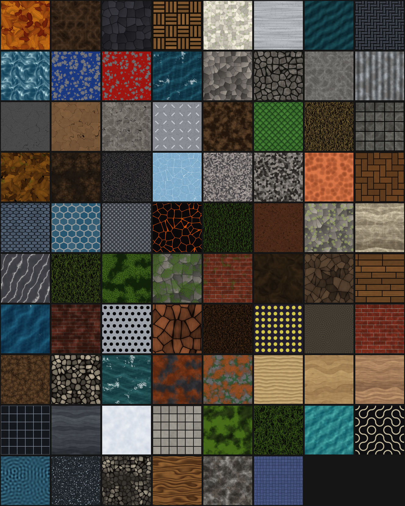

The same presets as height maps (white = surface, black = deepest) and as
normal maps:

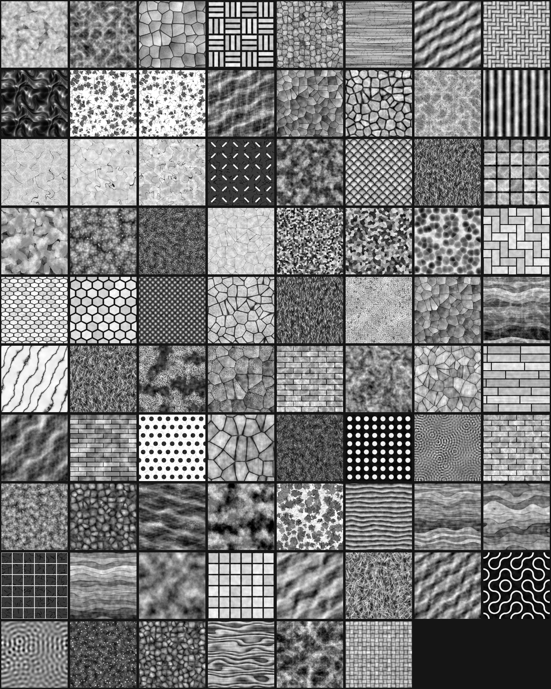

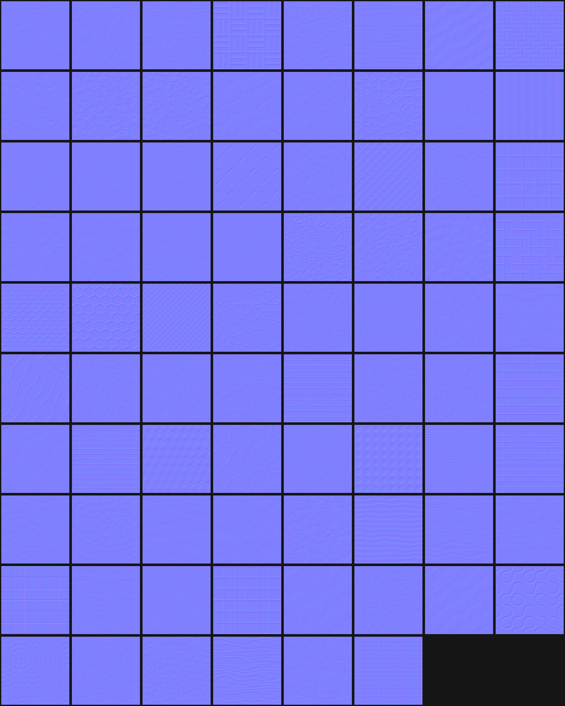

### Realistic library: rock, water, foliage, ground and man-made PBR

The *Realistic* category holds the Substance-style building blocks behind the photoreal
presets. All of them tile, are seeded and live in `uikit/procedural/realistic.rs`:

| Op | What it makes | Notable outputs |
|---|---|---|
| Rock Fracture | angular facets, each a tilted plane with sharp cracks | Colour, Height, Facet id |
| River Pebbles | tightly packed rounded stones with gaps | Colour, Height, Pebble id |
| Grass Blades | layered, tapered, leaning and curling blades over soil | Colour, Height, Blade id |
| Water Waves | sum of directional waves (integer wave vectors, so it tiles) plus capillary ripples | Colour, Height |
| Foam | crest foam with lacework, from any height input or its own noise | Mask |
| Bark Fissures | vertically stretched plates separated by fissures | Colour, Height |
| Soil Clumps | clods, crumbs and small stones | Colour, Height |
| Leaf Litter | overlapping leaves with veins, three to four layers deep | Colour, Height |
| Lichen | ragged colonies | Mask |
| Wet / Puddle Mask | low areas of a height input fill with water | Mask |
| Cavity Grime | dirt gathering in the crevices of a height input | Mask |
| Ice, Lava, Asphalt, Carbon Fibre, Paint Chips, Water Droplets | single-purpose surfaces | Lava also outputs **Emissive** |

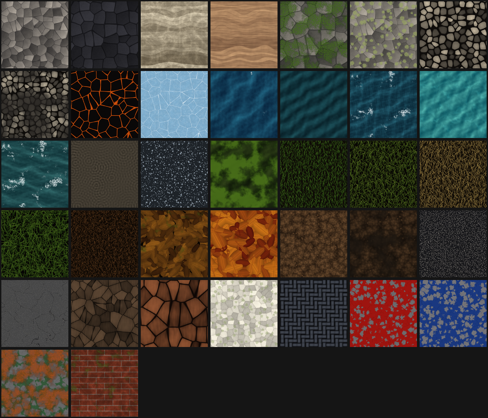

Rendered by the engine on a floor with parallax depth, a real sun and shadows:

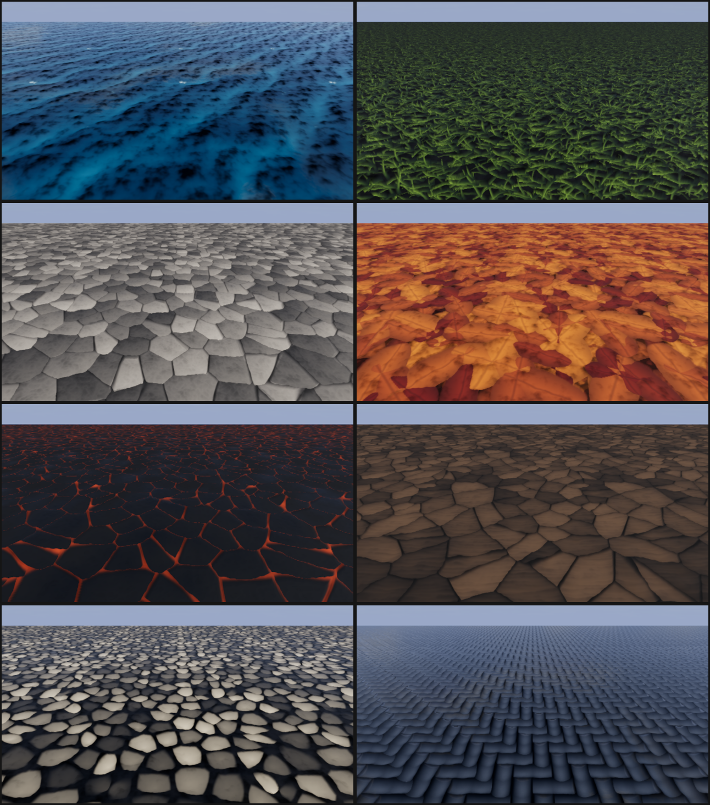

**Accent layers.** A preset can carry a third layer (moss, foam, rust, lichen, wetness...).
The accent's value is the mask: it blends its colour over the surface, drives the roughness
towards a target (wet = glossy) and adds a little height. Presets built this way are normal
graphs (`Lerp` nodes keyed by the accent), so you can rebalance or replace the accent in the
node editor. `wear` scales the accent as well.

Preset families: **Realistic Rock** (granite cliff, basalt columns, limestone, sandstone,
mossy boulder, lichen granite, river and wet pebbles, lava flow, frozen lake), **Realistic
Water** (ocean swell, choppy sea, calm lake, tropical shallows, river rapids, rain puddle,
droplets on glass, swamp), **Realistic Nature** (lawn, meadow, dry and tall wild grass, pine
needles, forest floor, autumn leaves), **Realistic Ground** (soil, forest mud, fresh and cracked
asphalt), **Realistic Wood** (oak, pine and birch bark) and **Realistic Man-made** (carbon fibre,
chipped red and blue paint, rusty painted panel, mossy brick wall).

## 2. The Output node

Inputs, in order (older graphs keep working: new ports are appended):

| Port | Meaning |
|---|---|
| Color, Roughness, Metallic, Height, AO | as before |
| **Emissive** | colour → baked to `<name>_gen_emissive_*.png`, sets the material's emission map |
| **Opacity** | scalar → baked into the base colour's alpha; the material switches to *Cutout* if it was opaque |
| **Normal** | optional authored normal (OpenGL); wins over the height-derived one |

Options: `auto_height` (default on: when **Height** is not connected, the height
is derived from the base colour's luminance so heights are never a flat plane),
`normalize_height` (stretches to the full 0..1 range) and `height_contrast`.

The generator's **Output preview** has a channel switcher so you can look at
every baked map, not only the colour:

| Height | Normal |
|---|---|
| 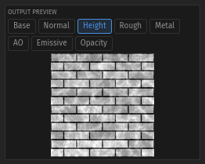 | 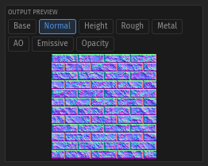 |
| **Roughness** | **AO** |
| 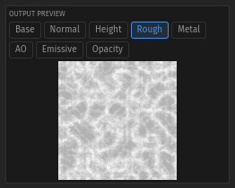 | 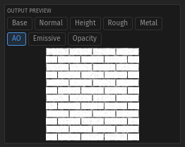 |

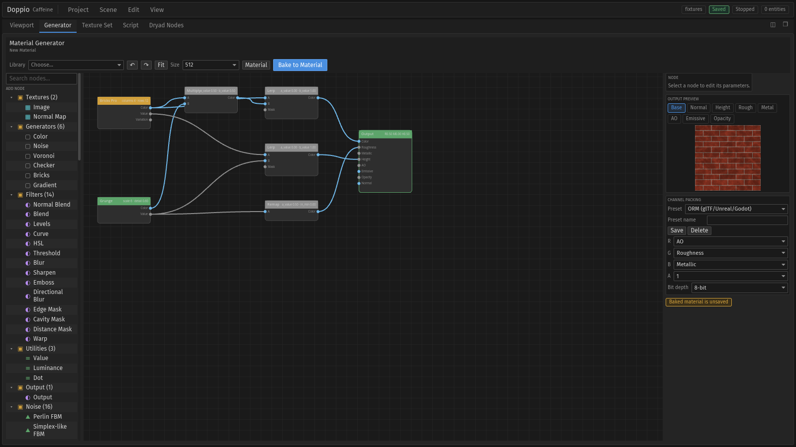

## 3. Real depth: parallax occlusion mapping

Before, a height map only fed the normal map, so surfaces were lit like relief
but stayed geometrically flat. The renderer now does **parallax occlusion
mapping** (POM) in the PBR shader: the view ray is marched through the height
field, the UV is shifted to where it first meets the surface, and every texture
(albedo, normal, ORM, emission) is sampled there. Bricks occlude their mortar,
cobbles overlap their joints.

Left: depth off. Right: depth on (same maps, same lights).

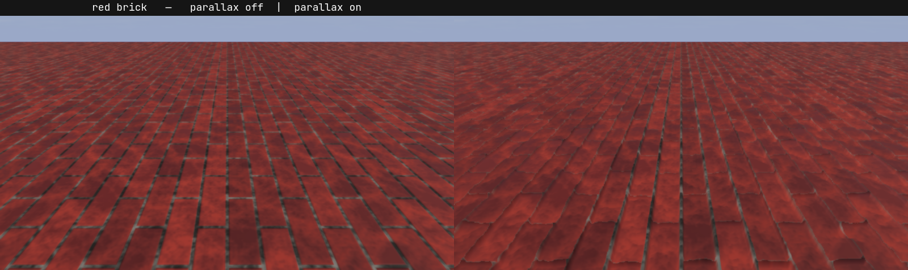
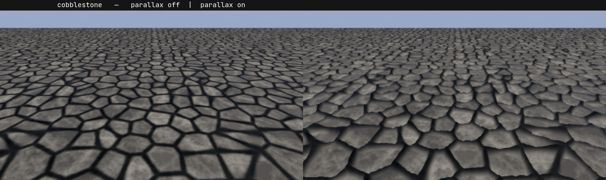
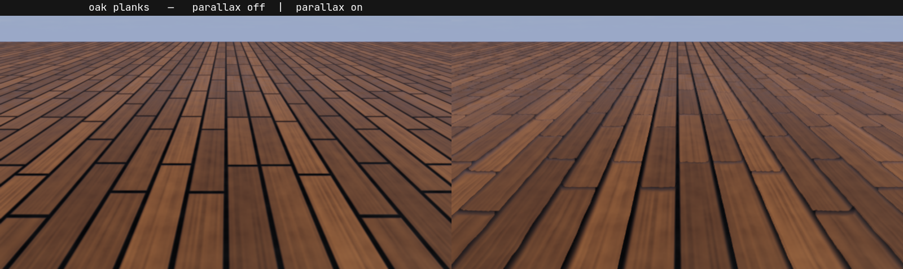
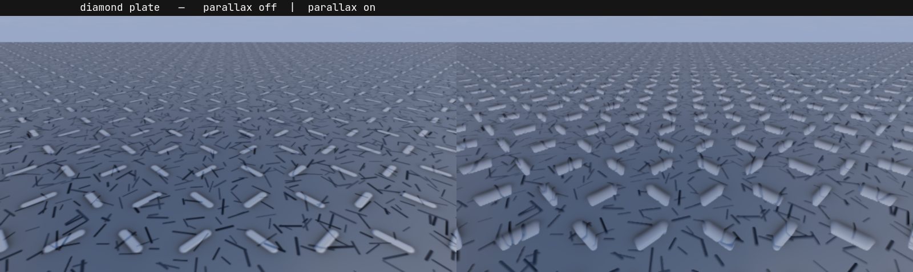
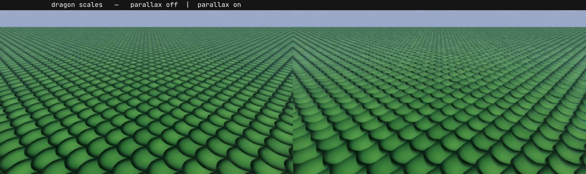
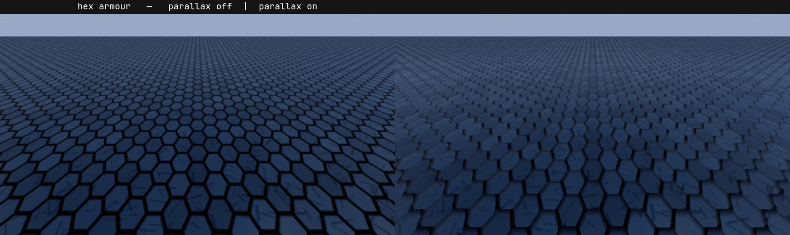
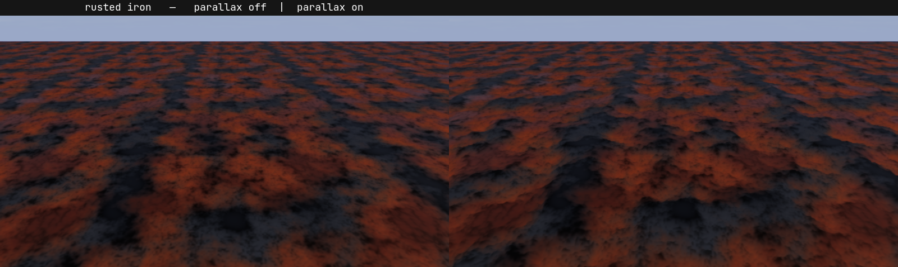
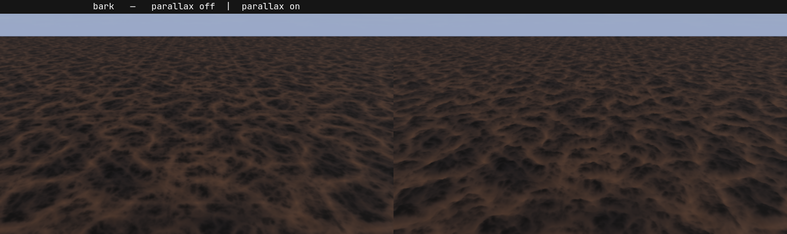

### How the height is stored

The renderer has 16 fragment samplers and the PBR shader already used all of
them (an SDL GPU limit), so the height lives in the **alpha channel of the
normal map** (`1` = surface, `0` = deepest). No extra texture or sampler.

* **Generator bake** writes the normal map with the baked height in alpha and
  turns parallax on (`height_scale` 0.035) when the height has relief. A value
  you already tuned is kept.
* **External height map**: in the Material panel press **Pack a height map into
  the normal…**, pick an image, and Doppio writes `<material>_height_normal.png`
  (height resampled to the normal's size) next to the material. Your original
  normal map is never overwritten; if the material has no normal yet, one is
  derived from the height first.

### Controls

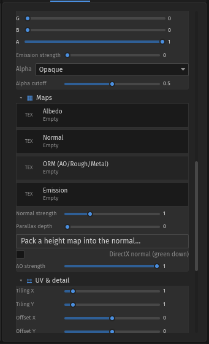

| Setting (`.mat`) | Meaning |
|---|---|
| **Parallax depth** (`height_scale`) | depth in UV units of the tiled texture; 0 = off, typical 0.02 – 0.06 |
| **Parallax steps** (`parallax_steps`) | maximum ray-march steps (4 – 96); the shader uses fewer when looking straight on |

Notes and limits: the effect needs a normal map whose alpha holds the height
(external normal maps usually have alpha 255 = flat, so nothing happens until
you pack a height); grazing angles are offset-limited to avoid smearing; polygon
silhouettes and shadows are not displaced (it is a texture-space technique).
`height_scale` and `parallax_steps` are part of the C ABI (version 3), the
`.mat` file (`height_scale`, `parallax_steps`) and the preview cache key.

## 4. Baking, repeatedly

Baking writes `<material>_gen_*.png` over the same file names every time. The
material preview used to key its cache on the path only, so a second bake looked
unchanged. The preview now also hashes each texture's modification time and size,
so **every bake refreshes the preview** (and any tool that rewrites a map in
place does too). Covered by `generator_bake_can_run_again_and_stores_height_as_real_depth`.

**Why a re-bake could still look unchanged.** The preview's hash was right, but the engine's
GPU texture cache only refreshed a file that changed on disk when its reference count was zero.
The count is raised on every acquire and never drops while a map is used, so the first bake
stayed on screen. The cache now reloads whenever the file's modification time moves (covered by
`preview_reloads_a_map_rewritten_in_place`).

Purely procedural graphs also preview and bake **without an engine session**;
only graphs that read project images need one to locate them.

## 5. The material preview: light, shadows and resolution

The preview sphere now has its own sun. Under the shape / environment / exposure controls:

| Control | Effect |
|---|---|
| Light direction | sun yaw around the subject (-180..180 degrees) |
| Light height | sun elevation (2..89 degrees) |
| Light intensity | sun brightness |
| Shadows | toggles the shadow map |

Agents use `set_material_preview_sun` (`yaw`, `elevation`, `intensity`, `shadows`). The preview
renders at 768 px with the camera closer, on a brighter floor with a soft sky fill, so a
material's relief, its cast shadow and its wet or dry gloss can be judged immediately.
With *Geometric displacement* enabled the sphere is subdivided and really displaced, and its
silhouette and shadows show it.

**Engine fix found while building this.** The directional shadow pass has no depth attachment, so
whichever mesh was drawn last overwrote the others: a floor drawn after a sphere erased the
sphere's shadow. The pass now uses `BlendMode::Min`, which keeps the nearest occluder
regardless of draw order. The process-wide GPU caches (textures, procedural meshes, mesh cache)
are also released when a session shuts down, so a second session no longer inherits handles
from a dead device.

## 6. Regenerating the images

```bash
./rebuild.sh                              # engine + Doppio (needs ImageMagick for the sheets)
./scripts/render-material-gallery.sh      # bakes all presets, renders sheets + depth comparisons
./scripts/capture-material-docs.sh        # headless UI screenshots (generator, channels, panel)
doppio/target/release/doppio-material bake-preset "Red Brick" --out /tmp/brick   # one preset to disk
```

* `doppio-material bake-preset <name|--all> --out DIR [--size 512] [--depth 0.04] [--list]`
  writes `*_base.png`, `*_normal.png` (height in alpha), `*_orm.png`, `*.mat`
  and `*_flat.mat` (same maps, depth off) — usable in any scene.
* The depth renders use `caffeine-render-snapshot` with
  `SNAP_FLOOR_MAT=<file.mat> SNAP_ONLY_FLOOR=1` and view preset 4.
* The UI screenshots come from the headless driver (see
  [headless-testing.md](headless-testing.md)); the flow is
  `doppio/docs/flows/capture-material-docs.json`.
