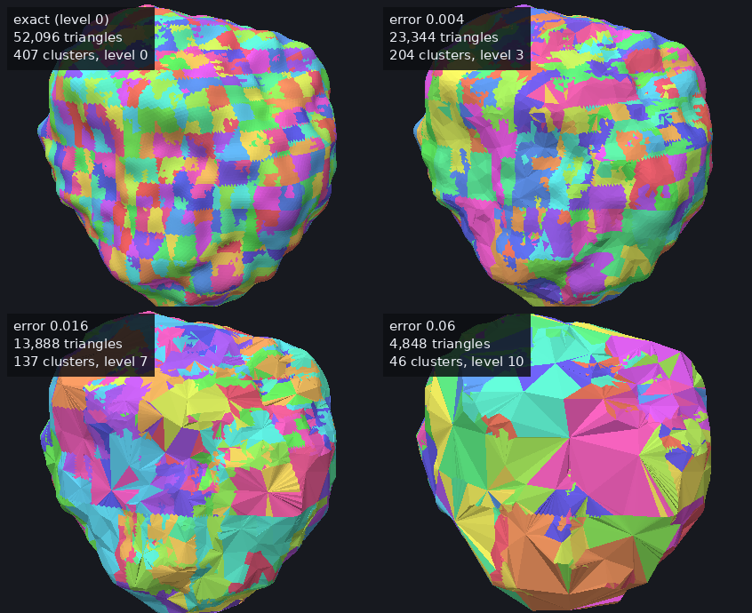
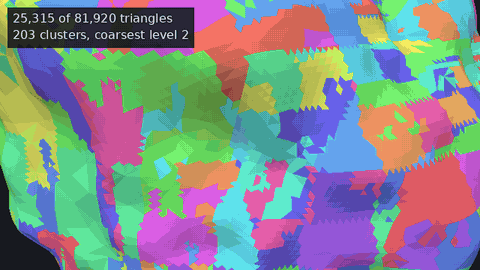
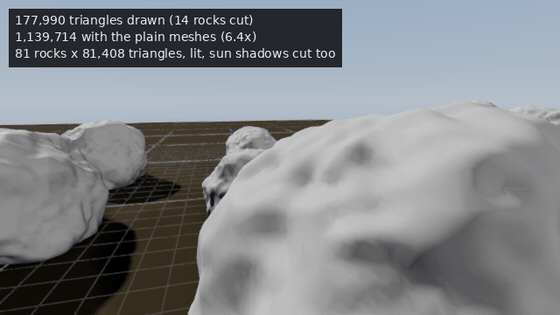
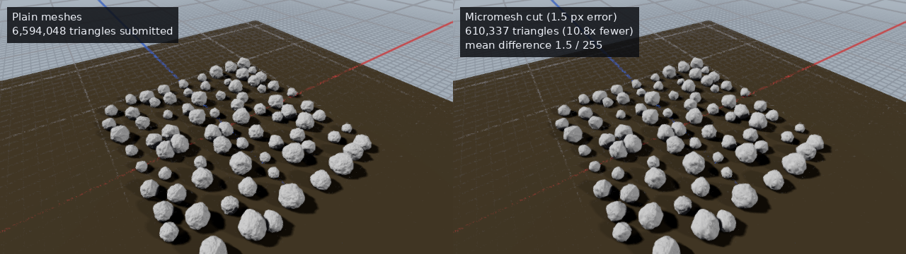
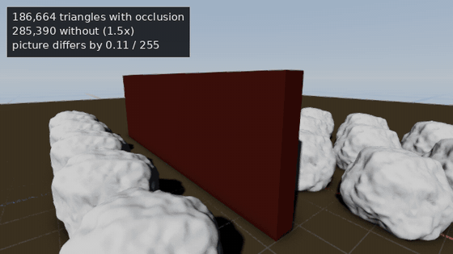
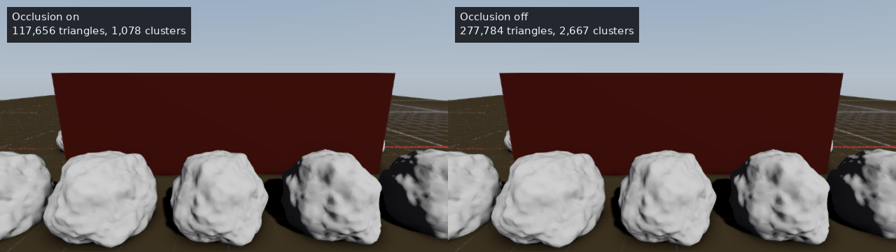
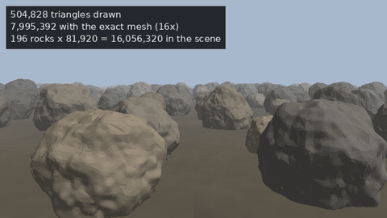
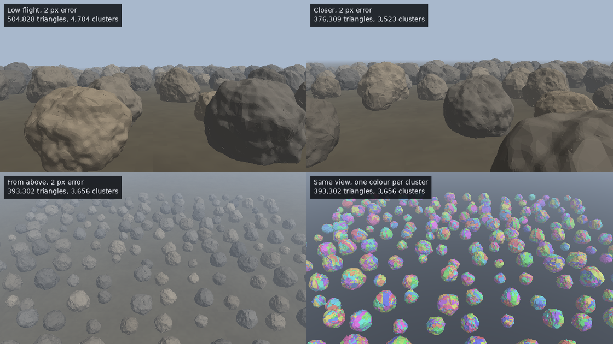
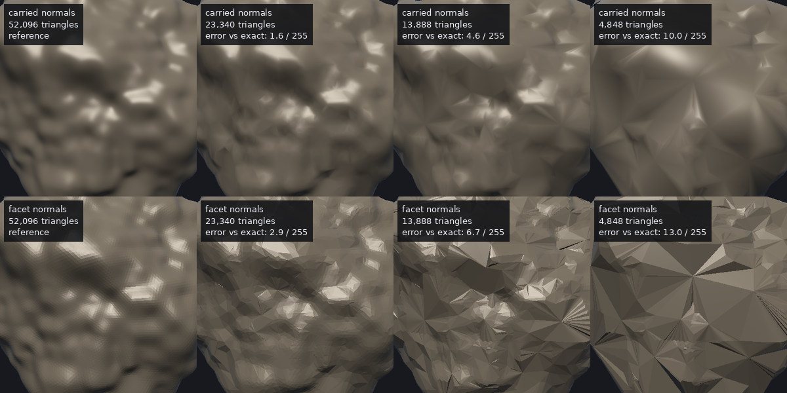
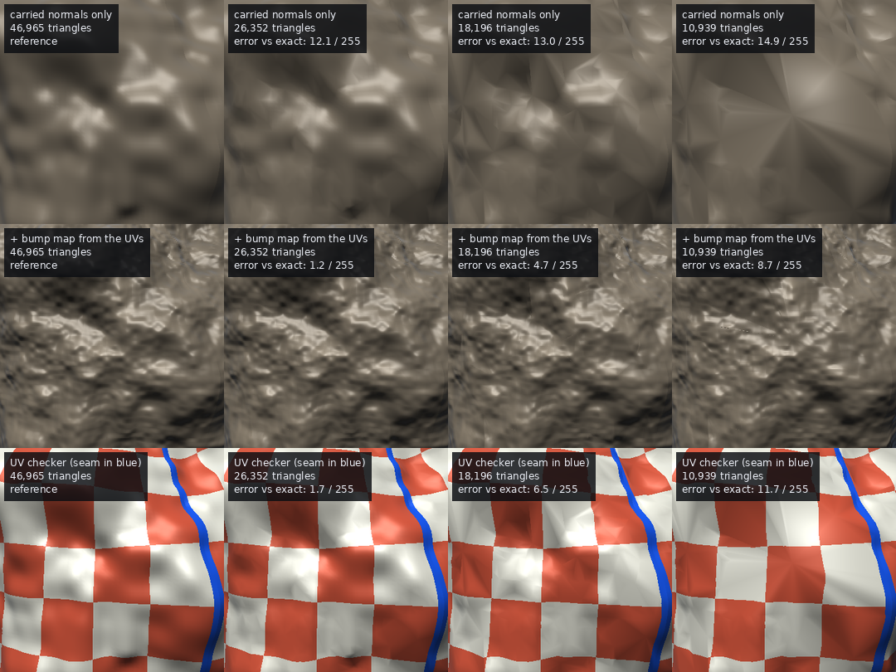

# Micromeshes: clusters, cuts and the GPU draw

<div class="doc-meta">
  <span class="doc-badge doc-badge--reference">Reference</span>
  <span class="doc-badge">Engine</span>
  <span>Last updated: <time datetime="2026-11-21">2026-11-21</time></span>
  <span>Source: <a href="https://github.com/devscafecommunity/caffeine/blob/main/doppio/docs/micromeshes.md"><code>micromeshes.md</code></a></span>
</div>

<p class="doc-lede">A mesh is cut into clusters of at most 128 triangles and a hierarchy of simplified levels. Each
frame a compute pass picks the coarsest cut whose error is invisible and one draw renders it, now through the lit scene
renderer and its G-buffer. This page shows what exists, with renders from the real GPU path, and what is still missing.</p>

Micromeshes are our own design (see [`graphics-roadmap.md`](graphics-roadmap.md) for the plan and the review of the
original proposal). Everything on this page is implemented and tested except the items under *What is missing*.

## 1. What you are looking at

<figure class="doc-figure">
  
  <figcaption>One rock of 81 920 triangles, four error budgets. Every colour patch is one cluster (at most 128 triangles). The
  counts are the clusters that survive the frustum and back-face tests, so the exact cut shows only the half that faces the
  camera. The coarser cuts use bigger flat clusters made from merged and simplified groups.</figcaption>
</figure>

<figure class="doc-figure">
  
  <figcaption>The same error budget while the camera pulls away and returns: the GPU picks a coarser cut by itself, and the
  triangle counter in the corner follows. Frames are rendered by <code>MicromeshGpu</code>: the cull compute pass, then one
  <code>drawIndexedIndirect</code> over every cluster.</figcaption>
</figure>

## 2. In the scene: the lit G-buffer draw

Turn on **Micromesh** in a Mesh Renderer (the Inspector shows it with its **Micromesh error (px)**; scripts and scenes see the
same two fields) and the scene renderer draws that mesh as a cluster cut instead of a plain mesh: same lit shader
(`scene_lit.frag`), same G-buffer, so Photon, SSAO and TAA need nothing new.

<figure class="doc-figure">
  
  <figcaption>The real scene renderer (the lit shader, the G-buffer, the sun's shadow cascades): 81 rocks of 81 408 triangles each, 6.6 million
  triangles in the scene. With the cut on, between <strong>178 000 and 833 000</strong> triangles are drawn per frame by the camera against
  <strong>1.1 to 5.9 million</strong> for the plain meshes (<strong>5.3x to 7.1x fewer, 6.2x on average</strong>, at a 1.5 px error), and
  the shadows come from the cascades' own coarser cut. Rendered by <code>./scripts/render-micromesh-scene-docs.sh</code>.</figcaption>
</figure>

<figure class="doc-figure">
  
  <figcaption>The same aerial view both ways: 6 594 048 triangles submitted against 610 337 (<strong>10.8x fewer</strong>), and the two
  pictures differ by <strong>1.5 / 255</strong> on average, sun shadows and shading included (the shadows of the right picture
  come from the coarser cascade cut).</figcaption>
</figure>

| Piece | What it does |
|---|---|
| `MeshRendererComponent::micromesh`, `micromeshPixels` | the switch and the error budget in screen pixels (converted to world units per metre with the camera's projection and the view height) |
| `GpuSceneRenderer::micromeshAssetFor` | once per mesh asset and geometry revision: welds the vertices that agree on position, normal and UV (meshes are often stored unindexed), builds the hierarchy with the mesh's own normals, UVs and tangents, uploads it |
| `beginMicromeshFrame` | once per frame, when the draws are final: groups the entities by mesh asset (every entity of a mesh is one **instance** of it), uploads one matrix buffer per asset and resets the index arena |
| `cullMicromeshView` | compute, outside any render pass: **one dispatch chain per asset and view** (the camera first, then each sun cascade) cuts every instance of the mesh at once |
| `micromesh_compact.comp` | the same cut, frustum and back-face tests as the per-cluster pass, in four passes (reset, count, reserve, copy): every selected cluster appends its indices to a **shared index arena**, so each instance is **one indexed draw** and memory follows what is visible |
| `scene_micromesh.vert`, `shadow_micromesh.vert` | the scene vertex shader (positions, normals, UVs, tangents and vertex colours in five slots, normals by the inverse transpose) and the positions-only cascade shader; both read the matrix from the instance buffer |
| `caffeine_session_micromesh_stats` (C ABI v14) | draws, selected clusters, selected and source triangles of the last frame (blocking read-back, for tools and tests); `CaffeineRenderStats::micromesh_draws` is the cheap counter |

Details worth knowing:

* **Shadows.** The sun's cascades cut the mesh too: the same hierarchy with an error budget of **four shadow texels** (a world
  distance, since a cascade is orthographic, with no back-face test and a frustum test per cascade), drawn by `shadow_micromesh.vert`
  into the same shadow atlas. Same hierarchy means no cracks; a coarser cut means far fewer triangles in the shadow pass. Point
  and spot shadows still draw the full mesh. **The editor viewport renders without shadow maps by default** (a deliberate
  editor cost choice); `ViewportSettings::shadows` (C ABI v14, `CaffeineViewportSettings::shadows`) turns them on, which is
  how the images and tests here are made.
* **The arena.** One index buffer serves every mesh and view of a frame, so memory follows what is visible, not what exists: this
  scene asks for 1.8 to 8.2 million indices a frame over its 6 views (the camera and 5 cascades) and the arena settled at
  **32 MB** for 81 rocks, where one full-size index buffer per rock would be 80 MB and grows with the rock count. It starts at
  16 MB and grows by itself (doubling, up to 256 MB) when a counter read-back every 15 frames shows it was too small; a cut that
  does not fit is **not drawn that frame** (`overflowed` in the stats), so growth shows as a few frames of missing shadows or
  rocks, never as a corrupt draw. The camera is cut first, so it is the last to lose.
* **Sub-meshes, scale, colours.** A mesh with several materials gets one hierarchy per sub-mesh, drawn with its material. An OBJ's `usemtl` groups are
  sub-meshes, and the Mesh Filter's **Material slots** (`a.mat;b.mat`) give each an authored material: the renderer then makes one draw per slot, so
  a slot can be alpha-tested or have wind (it draws plain) while the others stay Micromeshes.
  A non-uniform scale is handled: errors and bounds use the largest scale (conservative) and the back-face test is skipped for
  such an instance. Vertex colours are carried through the build (averaged at a collapse). This also fixed the plain
  scene shaders, which transformed normals by the model matrix and shaded a stretched mesh wrongly (now the inverse transpose).
* **A multi-draw of clusters is not free on the CPU.** SDL3 GPU has no indirect-*count* draw, so the per-cluster path
  (one indirect draw per cluster, used by the instanced field below) costs encoding time that grows with the cluster count. The
  scene path compacts instead: one draw per instance whatever the cut selects. A test checks the compacted cut keeps exactly the same
  clusters and triangles as the per-cluster one.
* **Dense meshes without materials were slow to draw at all.** For a mesh with no material or sibling PNG, `resolveMeshAlbedo`
  re-read and scanned the whole mesh file for texture names **on every draw of every frame** (4 to 8 ms of CPU per draw). It is
  now remembered until the file's modification time changes (this speeds up any such mesh, Micromesh or not).
* **A renderer limit found on the way:** the pipeline description kept only 4 vertex buffers; a fifth was dropped silently
  (the vertex colours read as black). It is 8 now.

### Occlusion

An instance can also be culled against **what last frame's depth buffer shows**: Mesh Renderer -> **Micromesh occlusion**. Each frame
the previous depth buffer is reduced to a **farthest-depth pyramid** (`MicromeshHzb`, `micromesh_hzb.comp`: one storage buffer, level
after level, each texel the maximum of the four below it; Photon's Min-Z pyramid keeps the nearest depth, the opposite reduction).
The camera's compacting cull then projects each cluster's bounding sphere with last frame's matrices, picks the pyramid level where
its footprint spans at most two texels, and drops the cluster when the sphere's nearest depth is beyond the farthest depth of every
texel under it. Anything undecidable stays visible: a sphere near or behind the camera, one that reaches past the screen edge.

<figure class="doc-figure">
  
  <figcaption>The camera swings through 1.8 radians around a 10 m wall with 18 dense rocks (45 696 triangles each) behind it and 6 in front. Every
  frame is drawn twice from the same camera, with occlusion on and off. With it on, the camera's cut keeps between <strong>112 000 and
  280 000</strong> triangles against <strong>277 000 to 297 000</strong> (<strong>1.5x to 2.5x fewer, 2.1x on average</strong>; 2.2x fewer
  clusters), and the two pictures differ by <strong>0.11 / 255</strong> on average. Rendered by
  <code>./scripts/render-micromesh-scene-docs.sh</code>.</figcaption>
</figure>

<figure class="doc-figure">
  
  <figcaption>The middle of the swing: the wall hides most of the rocks behind it, and the picture is the same with and without the test.</figcaption>
</figure>

**This is a single-phase test, not the two-phase one of the roadmap.** It uses last frame's picture, so a cluster that was hidden last
frame and becomes visible this frame (the camera moved, or an occluder moved away) shows **one frame late**. In the swing above that
costs a few edge pixels: the worst single pixel of a frame differs by up to 250 / 255 (a rock's edge arriving one frame late), while the
mean difference never exceeds 0.15 / 255. That is why the switch is **off by default** and per instance. A true two-phase test (draw the
clusters seen last frame, rebuild the pyramid from that depth, test the rest) needs the opaque pass split in two, and is not done. Only
the camera's cut is tested; shadow cascades are not (their view is the light's). Needs a previous frame of the same view at the same
size, so the first frame after a resize culls nothing; the pyramid costs a depth read and about 1.3x the depth buffer in memory.

### Benchmark

`./scripts/render-micromesh-scene-docs.sh` also prints this table (a fixed scene: 81 rocks of 81 408 triangles, a 72-frame flight,
camera cut at 1.5 px, cascades at four texels, then the same flight with plain instanced meshes). Triangle counts are exact and
reproducible; the times are **CPU encoding time** (SDL3 GPU has no portable GPU timestamps), so they say nothing about GPU cost.

| per frame | min | mean | max |
|---|---|---|---|
| triangles, camera cut | 177 990 | 551 593 | 833 381 |
| triangles, plain meshes | 1 139 714 | 3 516 375 | 5 861 378 |
| fewer triangles (x) | 5.3 | 6.2 | 7.1 |
| rocks cut (draws) | 14 | 43 | 72 |
| clusters selected | 1 710 | 5 457 | 8 335 |
| index arena used (indices, all 6 views) | 1 800 487 | 5 303 878 | 8 186 050 |
| CPU encode ms, cut | 6.0 | 9.7 | 20.7 |
| CPU encode ms, plain | 4.9 | 10.4 | 18.8 |

### Benchmark set

`./scripts/benchmark-micromesh.sh` runs the **reproducible benchmark set**: a dense rock field, a forest of dense trees and a terrain, each
flown by a fixed 40-frame camera path at 640x360 with the sun's shadows on, through every renderer path that applies. The content is
generated in code from hashes (no assets; a test checks the OBJ files are byte-identical between runs and their triangle counts fixed),
so the **triangle and draw counts are exactly the same on every run** (two runs here matched to the last digit). The times are not: *wall*
is a whole frame including the read-back of the picture, so it follows the GPU but also the machine (two runs here agreed within about
5%): compare rows of one run, not numbers between machines. *Encode* is CPU command-recording time. `BENCH_OUT=<dir>` keeps the raw
per-frame numbers (`benchmarks.json`).

**Rock field**: 81 rocks x 81 408 triangles (6.6 M), a low flight.

| configuration | triangles (min / median / max) | draw calls | wall ms | encode ms |
|---|---|---|---|---|
| plain meshes (instanced) | 1 139 714 / 3 215 618 / 5 861 378 | 2 / 2 / 2 | 15.1 / 23.8 / 40.8 | 4.3 / 5.2 / 12.0 |
| Micromesh | 177 992 / 527 412 / 833 391 | 15 / 40 / 73 | 8.9 / 13.3 / 19.5 | 5.9 / 8.6 / 13.8 |

6.1x fewer triangles, median wall time 0.56 of the plain's.

**Forest**: 300 trees x 47 808 triangles (a barky trunk and three lumpy crowns, brown and green vertex colours; 14.3 M), a flight between them.

| configuration | triangles (min / median / max) | draw calls | wall ms | encode ms |
|---|---|---|---|---|
| plain meshes (instanced) | 908 354 / 5 139 362 / 10 756 802 | 2 / 2 / 2 | 24.4 / 49.4 / 93.5 | 14.8 / 15.5 / 28.1 |
| Micromesh | 313 828 / 1 570 378 / 2 864 164 | 20 / 108 / 226 | 23.1 / 37.3 / 58.0 | 18.2 / 26.9 / 39.5 |

3.3x fewer triangles, median wall time 0.75 of the plain's, but **the CPU pays**: median encoding goes from 15.5 to 26.9 ms because
every tree is its own draw (108 against the two instanced batches). The forest here is opaque; leaf cards with alpha stay on the
instanced path by design, so a real forest is a mix and this one is the best case for Micromesh.

**Terrain**: an 800 m terrain at two grid sizes, a flight over it. The engine's chunked terrain path only (Micromesh does not draw terrain yet).

| grid | source triangles | triangles submitted (min / median / max) | draw calls | wall ms | encode ms |
|---|---|---|---|---|---|
| 513 x 513 | 524 288 | 192 512 / 227 328 / 313 344 | 94 / 111 / 153 | 11.2 / 15.5 / 29.2 | 6.1 / 9.6 / 22.1 |
| 1025 x 1025 | 2 097 152 | 724 992 / 839 680 / 1 173 504 | 354 / 410 / 573 | 21.3 / 32.5 / 38.7 | 12.9 / 22.6 / 28.0 |

The terrain's chunk LOD already submits 43 % (513) and 40 % (1025) of the source triangles, one draw per visible chunk. Four times the
triangles cost about twice the frame time. (Writing this benchmark showed that terrain draws were missing from the frame counters, which
reported 0 triangles and 0 draws for a terrain; they count now.) This is the baseline a terrain cluster path has to beat.

The viewport HUD shows the same counters live: `... · 610.3k tris · 74 draws · 72 micromesh` (triangles submitted, draws, and
how many meshes were drawn as a cut).

What it does not do yet: skinned meshes (their vertices move every frame, so rest-pose clusters would be wrong: they draw plain, by
design), alpha-tested or translucent materials and wind-animated foliage (they stay on the instanced path, by design: the roadmap
keeps foliage there), and point and spot shadows (full mesh). Each instance is still its own draw (instances of one mesh share
geometry, the dispatch and the arena, not a draw: that would need vertex pulling). The hierarchy is built the first time a mesh is
seen, about a second for 80 000 triangles; an offline `.micromesh` section in the `.caf` is the planned way to not pay it at run time.

## 3. Instances in one dispatch: a field of rocks

One hierarchy can be drawn many times. Each instance has an affine transform with a uniform scale, and the cull
pass decides **per instance**: its own cut (error and distance), its own frustum test and its own back-face test.
The whole field is **one compute dispatch and one `drawIndexedIndirect`**.

<figure class="doc-figure">
  
  <figcaption>A flight over 196 instances of the 81 920-triangle rock (16 056 320 triangles in the scene), all through
  <code>MicromeshGpu</code>. The counters are read back from the draw arguments: between <strong>149 000 and 508 000</strong>
  triangles are drawn per frame, against <strong>0.6 to 8.0 million</strong> if the exact mesh were drawn with the same
  frustum and back-face culling (<strong>4x to 16x fewer, 10x on average</strong>, at a 2 px error).</figcaption>
</figure>

<figure class="doc-figure">
  
  <figcaption>The same field in four views. From above, 393 302 triangles are drawn instead of 8 542 464 (<strong>22x fewer</strong>);
  the bottom right shows the clusters that were picked: near rocks are cut into many small clusters, far ones into a
  few big flat ones.</figcaption>
</figure>

| Item | Where |
|---|---|
| `MicromeshGpu::setInstances(transforms)` | uploads four vec4 per instance (the first three matrix rows, then the scale) as a compute buffer and as a graphics storage buffer |
| Cull index | invocation `g = instance * clusterCount + cluster`; spheres, errors and the cone axis are brought to world space before the tests |
| Draw argument | `firstInstance = g`; the vertex shader reads `instance = g / clusterCount`, `cluster = g % clusterCount` and the matrix from `instanceBuffer()` |
| `readStats()` | visible clusters and triangles over every instance (blocking read-back, for tools and tests) |

A far instance is cut coarser than a near one even when it is bigger, and an instance behind the camera or far to the
side contributes no draw at all.

## 4. Shading normals

A cut is only useful if it *shades* like the exact mesh. The build now carries a **unit shading normal per vertex**:
smooth, angle-weighted normals for the source vertices, and for every vertex a collapse creates, the normalised sum of
the two it replaced. The normals are part of the bytes (`.micromesh` version 2) and `MicromeshGpu::drawLit` binds them
as a second vertex buffer (slot 1, `Float3`).

<figure class="doc-figure">
  
  <figcaption>The same four cuts (exact, then 23 340, 13 888 and 4 848 triangles), lit with a sun, a highlight and a rim.
  Top: the normals the build carried. Bottom: per-triangle (facet) normals, what a coarse cut looks like without them.
  The mean error against the exact render is <strong>1.6, 4.6 and 10.0</strong> (of 255) with carried normals against
  <strong>2.9, 6.7 and 13.0</strong> with facets, and the facets show every simplified triangle as a hard edge.</figcaption>
</figure>

What it does not do: the normals are averaged, so detail below the cut is smoothed away (the rightmost image has lost the
small bumps). A normal map on the lit pipeline is what puts it back; carrying UVs through the collapses is the next
attribute.

## 5. Texture coordinates

`build(positions, indices, uvs)` also carries **texture coordinates**. A vertex a collapse creates takes the UV of the
closest point of the edge it replaced. **UV seams are never simplified across**: a seam is a boundary of split vertices (an
edge used by one triangle), and the build already locks every boundary at every level, so both ends of a collapsed edge
always lie on the same UV island. `MicromeshGpu::drawTextured` binds the UVs as a third vertex buffer (slot 2, `Float2`).

<figure class="doc-figure">
  
  <figcaption>A latitude / longitude rock with a real seam (81 664 triangles), at four cuts (46 965, 26 352, 18 196 and 10 939
  triangles; the seam keeps the cuts from going lower). Top: carried normals only. Middle: the same plus a bump map
  evaluated from the UVs at every pixel (derivative bump mapping, so no tangents are needed). Bottom: a UV checker with the
  seam in blue. The bump map brings back the detail the averaged normals lose (error against the exact render
  <strong>1.2, 4.7, 8.7</strong> instead of <strong>12.1, 13.0, 14.9</strong> of 255), and the checker stays put across the
  seam and every cut (<strong>1.7, 6.5, 11.7</strong>): the texture does not swim when the cut changes.</figcaption>
</figure>

The price of locked seams: a mesh with many UV islands simplifies less. This rock has one seam and still stops at about
11 000 of 82 000 triangles in this view; an atlas with dozens of islands will stop sooner. Measure on your meshes.

## 6. How it works

| Stage | Where | What happens |
|---|---|---|
| Cluster | `micromesh/Micromesh.cpp` | triangles sorted along a Morton curve, split into clusters of at most 128 triangles and 128 vertices; each gets a bounding sphere, a back-face cone and a local vertex remap |
| Hierarchy | same | clusters are grouped (4 at a time), each group is merged, simplified by quadric edge collapse with its **boundary locked**, and split again, up to one root |
| Error | same | the error of a group is the larger of its collapse error (an RMS distance, in world units) and its children's, plus an epsilon: **strictly** monotonic, with a sphere that contains the children's |
| Cut | `selectCut`, `micromesh_cull.comp` | a cluster is drawn when its own error is within the budget and its parent's is not (optionally divided by the distance to its sphere, a projected error) |
| Cull | `micromesh_cull.comp` | the same pass tests the frustum and the back-face cone, and writes one indexed-draw argument set per cluster, with `indexCount` 0 when culled |
| Draw | `render/MicromeshGpu` | one `drawIndexedIndirect(args, 0, clusterCount)`: the same call every frame, nothing read back, no atomics |

Because a group's boundary is locked at every level, and a cluster and its parent are never both selected, **any cut
tiles the surface without cracks**. This is tested, not assumed: every cut of a sphere and a torus is a closed manifold
(each edge in exactly two triangles) at twelve thresholds.

## 7. Using it

```text
C ABI v12   caffeine_micromesh_build(positions, indices, &stats, &bytes, &size)   -> versioned .micromesh bytes
C ABI v14   caffeine_session_micromesh_stats(session, &stats)   -> draws, clusters, triangles, source triangles, views,
                                                                   arena use and capacity, cuts that did not fit
            CaffeineRenderStats::micromesh_draws, CaffeineViewportSettings::shadows, stats.occlusion
Inspector   Mesh Renderer -> Micromesh, Micromesh error (px), Micromesh occlusion; the viewport HUD shows tris, draws and micromesh draws
Rust        Engine::micromesh_build(&positions, &indices) -> MicromeshBake { bytes, clusters, levels, root_clusters, max_error, ... }
C++ core    Micromesh::build(positions, indices, {normals, uvs, tangents, colors}) / selectCut / serialize / deserialize
            Render::MicromeshGpu::upload, then either the per-cluster path (setInstances / cull / draw* / readStats)
            or the scene path (setSceneInstances / cullScene / drawSceneSlot / readSceneView) with a MicromeshArena
            and, for occlusion, a MicromeshHzb built from the previous depth (MicromeshCullParams::occlusion)
```

The build is **offline** work (a bake): it is deterministic, so the same mesh gives byte-identical output, and it takes
under a second for a 20 000-triangle mesh. Never call it per frame.

The agent query `render_stats` (and `Engine::render_stats()`, C ABI v13) reports what a frame drew: meshes, culled by the
frustum, draw calls, instanced draw calls, triangles and CPU pass times.

Regenerate the images and GIFs of sections 1, 3, 4 and 5 with `./scripts/render-micromesh-docs.sh` (hidden tests with the tags
`[.micromesh-docs]`, `[.micromesh-field]`, `[.micromesh-normals]` and `[.micromesh-uv]` render the frames on the GPU;
`scripts/compose_micromesh_docs.py` composes them), and section 2's with `./scripts/render-micromesh-scene-docs.sh` (an env-gated
Doppio engine test through the real scene renderer, plus the benchmark table).

## 8. What the tests prove

* **On the CPU** (`tests/test_micromesh.cpp`): clusters respect the limits, every level is coarser, a closed mesh ends in one
  root, errors only grow toward the root and spheres contain their children's, cuts are crack-free, view-dependent cuts are
  coarser far away, an open mesh keeps its boundary and terminates, back-face cones never hide a facing cluster, rebuilds
  are byte-identical, truncated bytes are refused.
* **On the GPU** (`tests/test_micromesh_gpu.cpp`, `tests/test_rhi_indirect.cpp`): the cut the compute pass selects **equals the
  CPU's** at four distances and three budgets, the cone filter equals `isBackFacing`, the frustum test equals the same
  sphere-plane test on the CPU, indirect arguments decide what is drawn, and a compute pass can write them.
* **Scene path**: the Doppio engine test `micromesh_draw_matches_the_plain_mesh_and_submits_fewer_triangles` renders a dense OBJ rock
  on a floor under the sun, with shadow maps on, through the real renderer both ways: the picture (shadow included) stays within a few
  / 255 of the plain mesh's, the cut keeps about a third of the triangles close up, the camera and at least one cascade were cut
  into one arena with nothing overflowing, `micromesh_draws` is 1 with the switch on and 0 after switching it off, and the HUD label
  says so. `micromesh_handles_non_uniform_scale_submeshes_and_vertex_colours` does the same for a stretched rock, a rock with two
  materials and a rock with a vertex colour. `[compact]` (GPU) checks that the arena's compacted cut keeps exactly the clusters and
  triangles of the per-cluster cut for instances of several scales (one non-uniform), at three cameras and four budgets, for a
  view that is not the first (slot offsets), that the arena holds exactly the cut, and that a cut which does not fit is not drawn and
  is reported. `[colors]` checks vertex colours survive every level and the bytes.
* **Normals** (`[normals]`): every vertex normal is a unit vector at every level and follows the surface (on a sphere, within
  26 degrees of the radial direction at all 16 levels, including the coarsest), the normals round-trip through the bytes,
  and on the GPU a coarse cut lit with carried normals is within 6/255 of the exact render while facet normals are more than
  twice as far.
* **UVs** (`[uv]`): on a torus with real seams, every UV stays in range, every vertex of every level sits where its UV
  says to within a small multiple of its level's simplification error, no triangle of any cut spans a seam (the widest UV
  jump inside a triangle stays under half the texture), and the UVs round-trip through the bytes. The rock render test
  checks that the bump map and the checker stay close to the exact render at three cuts.
* **Occlusion** (`[occlusion]`, GPU): a wall rendered into a depth buffer, its pyramid built (the corner texel is the sky's 1.0, the
  middle the wall's depth, the top level keeps the farthest), then three instances of the sphere: the one behind the wall is culled, the
  one beside it and the one in front stay. In the Doppio engine, `micromesh_occlusion_hides_what_last_frames_depth_shows_behind_a_wall`
  puts six rocks on each side of a wall: the camera's cut drops to between a quarter and three quarters of the open one, the cut was
  tested (`occlusion` in the stats), and the picture stays within 1.5 / 255.
* **Instances** (`[instances]`): with four transforms (scales 0.5 to 2, rotations, distances up to 70 m) every instance's
  GPU cut **equals the CPU cut of the same mesh seen from the camera in that instance's space**, at three error
  budgets; a far instance is cut coarser than a near one; instances behind the camera or beside the frustum draw
  nothing; the cone test equals `isBackFacing` in each instance's own space, including one turned half a turn; and one
  indirect draw puts two instances where their matrices say (two mirror-image discs with an empty gap).

## 9. What is missing

<details>
  <summary>Not done yet (also in the roadmap)</summary>
  <ul>
    <li><strong>Point and spot shadows.</strong> Only the sun's cascades cut; point and spot shadow maps draw the full mesh.</li>
    <li><strong>One draw per instance.</strong> Batching the instances of a mesh into a single draw needs vertex pulling (the matrix chosen per index range); today they share geometry, the dispatch and the arena but not a draw.</li>
    <li><strong>By design.</strong> Skinned meshes, alpha-tested or translucent materials and wind foliage draw as plain meshes or stay instanced.</li>
    <li><strong>Non-uniform scale in the per-cluster path.</strong> The scene path handles it; the per-cluster path (the instanced field) still assumes one scale.</li>
    <li><strong>Two-phase occlusion.</strong> The single-phase test against last frame's depth is done (above); drawing last frame's visible clusters first, rebuilding the pyramid and testing the rest would remove its one-frame lag at silhouette edges, but needs the opaque pass split in two.</li>
    <li><strong>Attributes.</strong> Normals, UVs, tangents and vertex colours are carried; one UV set only. The bytes changed with each attribute (now version 5): older files are refused and must be rebuilt.</li>
    <li><strong>Seam-heavy meshes.</strong> Every UV seam is a locked boundary, so atlases with many islands reduce less.</li>
    <li><strong>Grouping.</strong> Groups are neighbours on a Morton curve, not an adjacency graph, so a level removes about half of the triangles on compact meshes and less on thin or branching ones; open meshes stop where the locked boundary pins everything.</li>
    <li><strong>Streaming and the packer.</strong> No page-in/out, and no <code>.micromesh</code> section in <code>.caf</code> or <code>caf-pack</code> command yet.</li>
    <li><strong>Scale.</strong> Measured on meshes up to 82 k triangles; nothing larger.</li>
  </ul>
</details>
