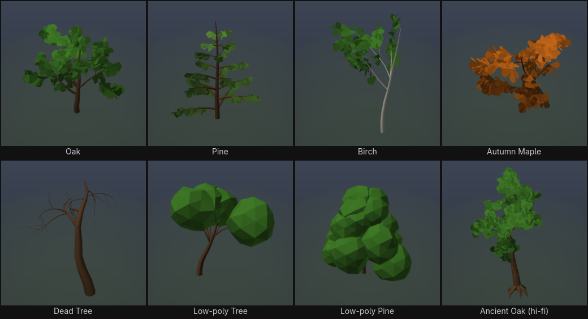

# Nature Generator: procedural rocks, trees and plants, built with nodes

The **Nature** tab (next to Inspector and Material) builds rocks, trees and low vegetation from a **node
graph**. The same graph serves a flat-shaded low-poly pine and a hi-fi mossy forest: pick a **Quality**,
wire the nodes you want, give every part **your own material or texture**, and **Place in scene**. Terrain is
a separate, later tool: nothing here scatters over a landscape.


## 1. How a graph works

Three typed ports, drawn in three colours; a link only connects ports of the same type and never closes a
cycle (the status line says why a link was refused):

| Port | Carries |
|---|---|
| **Mesh** | geometry (positions, normals, UVs, indices) |
| **Skeleton** | a branch tree (trunk, branches, roots) that *Branch Tubes* and *Leaves* turn into meshes |
| **Points** | positions, orientations and scales produced by *Scatter Points* |

Every mesh that should end up in the model goes through a **Part** node into the **Output** node (one input
per part). A Part is a mesh **and its material, both wired in**: its *Material* port takes a node from the
**Materials** category, and nothing is chosen inside the Part. A part with no material refuses to build ("The
trunk part has no material: wire a material node..."). The engine gives one material per mesh, so each part
becomes its own entity when placed.

Interaction: add nodes from the left palette (search box, categories) or drag from it; drag nodes by their
header; drag from an output port to an input port; **Fit** frames the graph; undo/redo cover every edit.
Selecting a node shows its parameters in the right column, beside the live 3D preview (drag to orbit).
Everything is deterministic: the same graph, quality and seeds always build the same model.

## 2. Node catalogue

| Category | Nodes |
|---|---|
| Shapes | **Icosphere**, **Ellipsoid** |
| Modifiers | **Noise Displace** (fractal lumps), **Cut Planes** (faceted rock faces), **Flat Base**, **Transform**, **Place on Ground**, **Subdivide**, **Shade** (smooth / flat / crease angle), **UV Box Projection** |
| Combine | **Merge** |
| Trees | **Grow Branches** (skeleton), **Roots**, **Branch Tubes**, **Leaves** (folded, drooping cards with a leaf-shape atlas, or blobs) |
| Plants | **Grass Blades**, **Fern Fronds**, **Leafy Bush**, **Stem**, **Petals** |
| Scatter | **Scatter Points**, **Instance on Points** (moss, pebbles, small leaves on any mesh) |
| Materials | **Library Material** (rock, bark, ground presets), **Leaf / Petal Texture** (cards and atlases), **Solid Colour**, **Your Material (.mat)**, **Your Texture (PNG)** |
| Output | **Part**, **Output** |

Rocks are `Icosphere → Noise Displace → Cut Planes → Noise Displace (grain) → Flat Base → Transform → Place
on Ground → Shade → UV Box → Part`. Trees are `Grow Branches → Branch Tubes → Part` plus
`Grow Branches → Leaves → Part` (and **Roots**). Because the stages are nodes, you can insert your own:
a second noise for weathering, a Merge of two rocks, a Scatter of pebbles on a boulder.

## 3. Quality: low poly to high fidelity

Quality is a property of the graph (the toolbar picker); nodes read it, so **one graph covers the whole
range**.

| Quality | What changes |
|---|---|
| **Stylized (low poly)** | at most 2 icosphere subdivisions, faceted rocks, blob crowns and 5-sided flat-shaded trunks, half the counts; materials fall back to **solid colours** (no textures needed) |
| Balanced | the graph as authored |
| **Detailed** | one more subdivision, rounder trunks, 1.6x the segments, leaves and blades, roots and moss that stay off at lower quality |

Tested rule: Stylized < Balanced < Detailed in triangle count for rocks, trees and plants.





Presets are graphs too (23 of them; open one and every node is there to edit). The hi-fi ones show what
the graph is for: **Mossy Rock** (moss cards scattered over the rock), **Ancient Oak** (roots, thick
branches and a dense crown) and **Fern Patch** (a scatter of fern clumps). Low-poly presets: Low-poly Rock,
Low-poly Tree and Low-poly Pine.

## 4. Materials are nodes, and they are real assets

Nothing about a material is hidden inside a generated object. Every part has a **material node** wired into its
Part, and the preset graphs show them (a bark node feeding the trunk, a leaf texture feeding the leaves):

| Node | Gives |
|---|---|
| **Library Material** | a preset from the PBR library (rock, bark, ground), baked once into `nature/materials/` |
| **Leaf / Petal Texture** | a procedural cut-out card (leaf, petal) or an **atlas** (*Broadleaf Mix*, *Autumn Mix*: eight leaf shapes and tints in one image) baked to RGBA |
| **Solid Colour** | a plain colour and roughness, ideal for low poly |
| **Your Material (.mat)** | any `.mat` of the project, used **as it is**, never copied or rebaked |
| **Your Texture (PNG)** | a PNG with alpha; a **Cutout** material is made around it (`nature/materials/project_<name>.mat`) |

When you **Place in scene**, each part's material is written to the project as a normal asset and assigned to
the entity: open it in the **Material** tab or the Texture Generator and change it. Swap a node (a Solid Colour
for your own `.mat`) to change what the whole model uses. Low poly (*Stylized*) turns library and card
materials into solid colours, but **your own assets are never replaced**.

The **Leaves** node also takes the leaf texture on its *Texture* port (the same node that feeds the leaves'
Part), which is how it knows the atlas layout, and sizes the leaves as a **percentage of the tree's height**
(*Leaf size*, default 7 %), so the proportions follow the tree instead of being a number in metres.

UVs come from the nodes (UV Box for rocks, tube UVs for trunks, card UVs for leaves) so your textures tile as
expected. Saved `.nature` files from before this change have no material nodes and need one wired in.

## 4b. Generated surfaces: a texture set baked from the model itself

The **Rock Surface** node (category *Surface*, between the last mesh node and **Part**) replaces a library
preset with a **generated PBR texture set** (albedo, normal + height, occlusion/roughness/metal), so a
rock gets the surface of a scan instead of one repeating texture.


How it works (`uikit/nature/bake.rs`, `surface.rs`):

1. **Atlas**: the mesh is re-unwrapped into six non-overlapping charts (a cube map from the model's centre),
   each fitted into its own cell. Baked maps need unique UVs; the box-projection UVs of the other nodes repeat.
2. **Mesh maps**: for every texel, the position, smooth normal, **curvature** (convex edges vs crevices),
   **ambient occlusion** (disk occluders in a spatial hash, no ray casting) and height are rasterised into UV space.
3. **Layers** read those maps and 3D noise at the baked positions, so nothing breaks at seams: stone tones
   and strata, grain, **cracks** that deepen in crevices, **edge wear** on convex curvature, **lichen** crusts
   on exposed faces, **moss** in cavities and on top, **dust** on upward faces.
4. The height becomes the normal map (and its alpha, for parallax/geometric displacement); occlusion and
   roughness are packed into the ORM map. Placement writes `nature/materials/rock_*_{albedo,normal,orm}.png`
   plus a `.mat`, reused until a parameter changes.


Parameters: moss, lichen, cracks, edge wear, dust, pattern scale, warmth (grey to sandstone), texture size
(256-2048; Stylized caps it at 512) and seed. Everything is deterministic and tested (coverage, curvature
sign, more moss means more green, same inputs give the same maps).

The engine samples texture rows as `v * height` (no V flip) and applies `ORM` over the material scalars with
the AO scaled by the material's AO strength; the bake follows both.

## 5. Placing models in the scene

**Export** writes `nature/<name>_<part>.obj` (one per part) and the editable `nature/<name>.nature` into the
project's assets folder. **Place in scene** does that and builds the model as a **group entity** with one
child per part:

* the mesh goes on a **Mesh Filter** (primitive Custom) plus a Mesh Renderer;
* cut-out cards **do not cast shadows** (they would only shadow each other); trunks and rocks do;
* the group appears at the viewport's focus, is selected, and the placement is one undo step.

## 6. Files, scripting and agents

`.nature` is text: the header `CAFNATURE2`, the name and quality, then the `NATUREGRAPH1` node and link lines
(including any project asset paths). Loading it rebuilds exactly the same model. Without a window or engine:

```bash
doppio-material nature --list
doppio-material nature Oak --out /tmp/nature --quality 2
doppio-material nature --all --out /tmp/nature --seed 7
```

MCP (`--features agent`): query `nature` (graph, nodes, parameters, presets); actions `nature_apply_preset
{ name }`, `nature_add_node { op }`, `nature_connect { from, output, to, input }`, `nature_set { node, param,
value | string, quality, name }`, `nature_export` and `nature_place`. Headless: fixture `nature` builds an
engine-backed scene of generated models (`reset` accepts a `preset`).

## 7. Engine fixes found while building this

* **A crash in `propagateTransforms`**: a group whose children had no world matrix yet added the component
  while the hierarchy was being iterated, which invalidated the iteration. New matrices are now collected
  first and written afterwards (C++ test in `tests/test_scenemanager.cpp`).
* Custom meshes are drawn from the **Mesh Filter**, not from the Mesh Renderer's `Mesh` path, so placement
  sets the filter.

## 8. Limits and roadmap

### Leaves: what is done, what is still missing


**Done (the first refinement of vegetation):**

* **Leaves of many shapes.** The Leaves node's *Leaf shapes* option uses a **4 x 2 atlas** baked from the Texture
  Generator's leaf operator: ovate, serrated, narrow, rounded, dark mature, young yellow-green, dry-edged and
  lobed leaves (*Broadleaf Mix*), or the autumn palette (*Autumn Mix*). Every card picks a random cell, so a crown
  mixes shapes and tints; card sizes vary from 0.55x to 1.35x. Oak, Birch, Autumn Maple, Ancient Oak and the
  other broadleaf presets use it.
* **Leaves that are not a flat quad.** Each card is a **folded, drooping blade**: three vertices across (the
  edges sit lower than the midrib, a shallow V), 2-4 segments along it by quality, the tip drooping under its
  weight and a little twist. *Fold* and *Droop* are node parameters. A test checks the atlas is sampled in full,
  the blade is not planar and Detailed has more segments than Balanced.

**Still missing:**

* **Real 3D leaf meshes** for the nearest leaves, a **translucent back face** (leaves facing away from the sun are
  nearly black under a single sun, there is no light transmission through the blade) and a **normal map** on the
  cards.
* **Compound leaves and needle clusters** as atlas cells (the atlas is broadleaf only; conifers still use the
  single card), and a per-instance **tint** (it needs vertex colour, so tints come from the atlas cells).
* **High-resolution trunks and branches.** The same bake used by the Rock Surface (curvature, AO, height) feeding
  a **bark surface**: deep furrows, peeling, knots, moss on the shady side and in cracks, roots flaring into the
  ground, broken branches and stumps (the reference is a mossy rotten stump).
* **Ground cover that blends.** Moss carpets and low grass mixed with leaf litter, twigs, cones and small
  plants, as a **blended ground material plus instances**: moss as a surface layer (it already is one on rocks)
  and as thick clumps; grass as GPU-instanced blades with colour variation and dry patches.
* **Trees as a model plus a texture set**: a trunk mesh with its bark set, branch tubes with their own, and
  leaf clusters, all driven from the same graph and quality range.

References for the target: a photoreal mossy stump with ferns, clover and leaf litter around it; a dense
oak crown with varied, curved leaves.

* The Rock Surface node covers **rock only** for now; bark, grass-card and soil surfaces use the same bake with other layers. Steep faces of a very lumpy rock still stretch a little in the cube atlas (a seam-aware unwrap would fix it).
* Next for hi-fi vegetation: **GPU-instanced scatter** (grass and leaves are still merged meshes), **vertex colour**, material slots and **wind** (a later transformation pass).
* One material per mesh: parts are separate entities. **Material slots per submesh** is the next engine step
  and needs a C ABI version.
* The Low-poly Pine preset is still a stack of blobs rather than tiered cones; a cone-tier node is wanted.
* No vertex colour (no height shading for stylised models), no **wind** mask, no per-instance variation, no
  leaf **atlas**, no LOD chain or billboard impostor for distant trees.
* The preview is a quick shape render without textures or shadows; **Place in scene** shows the real thing.
* `.obj` only (no `.glb` writer yet).
* Scattering over terrain, biomes and density maps belong to the terrain generator, which is separate.

## 9. Regenerating the images

```bash
./scripts/render-nature-docs.sh       # the three preview sheets (software renderer, no engine)
./scripts/capture-nature-docs.sh      # headless screenshots of the tab and the placed scene (needs libcaffeine-capi)
```

## Golden rule: every material is an asset

The Library Material, Leaf / Petal Texture and Solid Colour nodes (and every preset) are only
**moulds**. Applying a preset, or placing a model, writes each material's picture and `.mat` into
`nature/materials/` in your project and turns the node into **Your Material (.mat)** pointing at
them. Nothing stays hidden in the menu: open the `.mat` in the Material tab, repaint the PNG, or
point the node at another file. A material is only written once, so your edits to it are kept.
Your Material and Your Texture carry *Shapes across / down*, the atlas layout of the picture, which
the Leaves node reads to know how many leaf shapes it holds.
