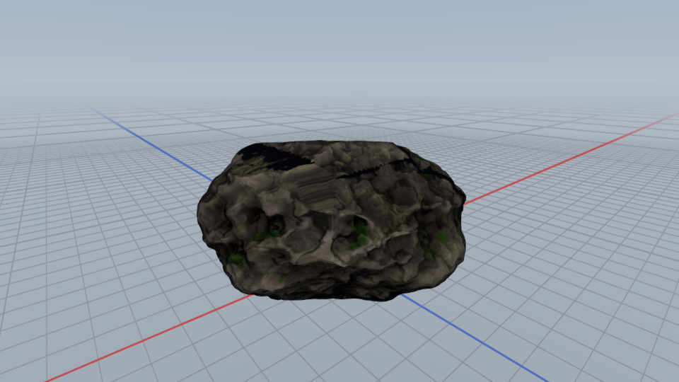

# Nature Generator: procedural rocks, trees and plants, built with nodes

The **Nature** tab (next to Inspector and Material) builds rocks, trees and low vegetation from a **node
graph**. The same graph serves a flat-shaded low-poly pine and a hi-fi mossy forest: pick a **Quality**,
wire the nodes you want, give every part **your own material or texture**, and **Place in scene**. Terrain is
a separate, later tool: nothing here scatters over a landscape.


## 1. How a graph works

Three typed ports, drawn in three colours; a link only connects ports of the same type and never closes a
cycle (the status line says why a link was refused):

| Port | Carries |
|---|---|
| **Mesh** | geometry (positions, normals, UVs, indices) |
| **Skeleton** | a branch tree (trunk, branches, roots) that *Branch Tubes* and *Leaves* turn into meshes |
| **Points** | positions, orientations and scales produced by *Scatter Points* |

Every mesh that should end up in the model goes through a **Part** node into the **Output** node (one input
per part). A part carries a name and a material; the engine gives one material per mesh, so each part
becomes its own entity when placed.

Interaction: add nodes from the left palette (search box, categories) or drag from it; drag nodes by their
header; drag from an output port to an input port; **Fit** frames the graph; undo/redo cover every edit.
Selecting a node shows its parameters in the right column, beside the live 3D preview (drag to orbit).
Everything is deterministic: the same graph, quality and seeds always build the same model.

## 2. Node catalogue

| Category | Nodes |
|---|---|
| Shapes | **Icosphere**, **Ellipsoid** |
| Modifiers | **Noise Displace** (fractal lumps), **Cut Planes** (faceted rock faces), **Flat Base**, **Transform**, **Place on Ground**, **Subdivide**, **Shade** (smooth / flat / crease angle), **UV Box Projection** |
| Combine | **Merge** |
| Trees | **Grow Branches** (skeleton), **Roots**, **Branch Tubes**, **Leaves** (cards or blobs) |
| Plants | **Grass Blades**, **Fern Fronds**, **Leafy Bush**, **Stem**, **Petals** |
| Scatter | **Scatter Points**, **Instance on Points** (moss, pebbles, small leaves on any mesh) |
| Output | **Part**, **Output** |

Rocks are `Icosphere → Noise Displace → Cut Planes → Noise Displace (grain) → Flat Base → Transform → Place
on Ground → Shade → UV Box → Part`. Trees are `Grow Branches → Branch Tubes → Part` plus
`Grow Branches → Leaves → Part` (and **Roots**). Because the stages are nodes, you can insert your own:
a second noise for weathering, a Merge of two rocks, a Scatter of pebbles on a boulder.

## 3. Quality: low poly to high fidelity

Quality is a property of the graph (the toolbar picker); nodes read it, so **one graph covers the whole
range**.

| Quality | What changes |
|---|---|
| **Stylized (low poly)** | at most 2 icosphere subdivisions, faceted rocks, blob crowns and 5-sided flat-shaded trunks, half the counts; materials fall back to **solid colours** (no textures needed) |
| Balanced | the graph as authored |
| **Detailed** | one more subdivision, rounder trunks, 1.6x the segments, leaves and blades, roots and moss that stay off at lower quality |

Tested rule: Stylized < Balanced < Detailed in triangle count for rocks, trees and plants.


Presets are graphs too (23 of them; open one and every node is there to edit). The hi-fi ones show what
the graph is for: **Mossy Rock** (moss cards scattered over the rock), **Ancient Oak** (roots, thick
branches and a dense crown) and **Fern Patch** (a scatter of fern clumps). Low-poly presets: Low-poly Rock,
Low-poly Tree and Low-poly Pine.

## 4. Your own materials and textures

The **Part** node has a *Material* choice:

| Choice | Meaning |
|---|---|
| Library presets (rock, bark, moss, ...) | baked once from the PBR library into `nature/materials/` |
| Texture Generator cards | a procedural cut-out card (leaf, blade, petal) baked to RGBA |
| Solid colours / custom colour | only a `.mat`, ideal for low poly |
| **Your material (.mat)** | pick any `.mat` of the project; it is applied **as it is**, never copied or rebaked |
| **Your texture (cut-out PNG)** | pick a PNG with alpha; a **Cutout** material is made around it (`nature/materials/project_<name>.mat`) |

The pickers list the project's materials and textures. Project assets are never replaced when the quality
is Stylized, so a hand-painted bark stays on a low-poly trunk. UVs come from the nodes (UV Box for rocks,
tube UVs for trunks, card UVs for leaves) so your textures tile as expected.

## 4b. Generated surfaces: a texture set baked from the model itself

The **Rock Surface** node (category *Surface*, between the last mesh node and **Part**) replaces a library
preset with a **generated PBR texture set** (albedo, normal + height, occlusion/roughness/metal), so a
rock gets the surface of a scan instead of one repeating texture.



How it works (`uikit/nature/bake.rs`, `surface.rs`):

1. **Atlas**: the mesh is re-unwrapped into six non-overlapping charts (a cube map from the model's centre),
   each fitted into its own cell. Baked maps need unique UVs; the box-projection UVs of the other nodes repeat.
2. **Mesh maps**: for every texel, the position, smooth normal, **curvature** (convex edges vs crevices),
   **ambient occlusion** (disk occluders in a spatial hash, no ray casting) and height are rasterised into UV space.
3. **Layers** read those maps and 3D noise at the baked positions, so nothing breaks at seams: stone tones
   and strata, grain, **cracks** that deepen in crevices, **edge wear** on convex curvature, **lichen** crusts
   on exposed faces, **moss** in cavities and on top, **dust** on upward faces.
4. The height becomes the normal map (and its alpha, for parallax/geometric displacement); occlusion and
   roughness are packed into the ORM map. Placement writes `nature/materials/rock_*_{albedo,normal,orm}.png`
   plus a `.mat`, reused until a parameter changes.


Parameters: moss, lichen, cracks, edge wear, dust, pattern scale, warmth (grey to sandstone), texture size
(256-2048; Stylized caps it at 512) and seed. Everything is deterministic and tested (coverage, curvature
sign, more moss means more green, same inputs give the same maps).

The engine samples texture rows as `v * height` (no V flip) and applies `ORM` over the material scalars with
the AO scaled by the material's AO strength; the bake follows both.

## 5. Placing models in the scene

**Export** writes `nature/<name>_<part>.obj` (one per part) and the editable `nature/<name>.nature` into the
project's assets folder. **Place in scene** does that and builds the model as a **group entity** with one
child per part:

* the mesh goes on a **Mesh Filter** (primitive Custom) plus a Mesh Renderer;
* cut-out cards **do not cast shadows** (they would only shadow each other); trunks and rocks do;
* the group appears at the viewport's focus, is selected, and the placement is one undo step.

## 6. Files, scripting and agents

`.nature` is text: the header `CAFNATURE2`, the name and quality, then the `NATUREGRAPH1` node and link lines
(including any project asset paths). Loading it rebuilds exactly the same model. Without a window or engine:

```bash
doppio-material nature --list
doppio-material nature Oak --out /tmp/nature --quality 2
doppio-material nature --all --out /tmp/nature --seed 7
```

MCP (`--features agent`): query `nature` (graph, nodes, parameters, presets); actions `nature_apply_preset
{ name }`, `nature_add_node { op }`, `nature_connect { from, output, to, input }`, `nature_set { node, param,
value | string, quality, name }`, `nature_export` and `nature_place`. Headless: fixture `nature` builds an
engine-backed scene of generated models (`reset` accepts a `preset`).

## 7. Engine fixes found while building this

* **A crash in `propagateTransforms`**: a group whose children had no world matrix yet added the component
  while the hierarchy was being iterated, which invalidated the iteration. New matrices are now collected
  first and written afterwards (C++ test in `tests/test_scenemanager.cpp`).
* Custom meshes are drawn from the **Mesh Filter**, not from the Mesh Renderer's `Mesh` path, so placement
  sets the filter.

## 8. Limits and roadmap

### Still missing: high-resolution trees and real vegetation

Rocks are in good shape; **trees and plants are not at the same level yet**. Look at the Oak or the Ancient
Oak: the leaves are, literally, flat round cards. Nothing about them resembles a real tree or real foliage,
and the hi-fi presets only add more of the same. What is needed, in order:

* **Leaves of many shapes.** Real foliage mixes outlines (lobed, serrated, compound, needle clusters, ferns),
  sizes and ages (fresh, dry, spotted) on the same plant. The leaf cards need a *set* of shapes with a
  per-instance pick, plus colour and size variation, instead of one round card.
* **Leaves that are not a flat PNG.** Curved and folded blades and leaves (a midrib fold, a droop, a twist),
  real 3D leaf meshes for the nearest ones, a translucent back face and a normal map, not a single straight quad.
* **High-resolution trunks and branches.** The same bake used by the Rock Surface (curvature, AO, height) feeding
  a **bark surface**: deep furrows, peeling, knots, moss on the shady side and in cracks, roots flaring into the
  ground, broken branches and stumps (the reference is a mossy rotten stump).
* **Ground cover that blends.** Moss carpets and low grass mixed with leaf litter, twigs, cones and small
  plants, as a **blended ground material plus instances**, not only cards: moss as a surface layer (it already is
  one on rocks) and as thick clumps; grass as GPU-instanced blades with colour variation and dry patches.
* **Trees as a model plus a texture set**: a trunk mesh with its bark set, branch tubes with their own, and
  leaf clusters with an atlas of leaf shapes, all driven from the same graph and quality range.

References for the target: a photoreal mossy stump with ferns, clover and leaf litter around it; a dense
oak crown with varied, curved leaves.


* The Rock Surface node covers **rock only** for now; bark, grass-card and soil surfaces use the same bake with other layers. Steep faces of a very lumpy rock still stretch a little in the cube atlas (a seam-aware unwrap would fix it).
* Next for hi-fi vegetation: **GPU-instanced scatter** (grass and leaves are still merged meshes), **vertex colour**, material slots and **wind** (a later transformation pass).
* One material per mesh: parts are separate entities. **Material slots per submesh** is the next engine step
  and needs a C ABI version.
* The Low-poly Pine preset is still a stack of blobs rather than tiered cones; a cone-tier node is wanted.
* No vertex colour (no height shading for stylised models), no **wind** mask, no per-instance variation, no
  leaf **atlas**, no LOD chain or billboard impostor for distant trees.
* The preview is a quick shape render without textures or shadows; **Place in scene** shows the real thing.
* `.obj` only (no `.glb` writer yet).
* Scattering over terrain, biomes and density maps belong to the terrain generator, which is separate.

## 9. Regenerating the images

```bash
./scripts/render-nature-docs.sh       # the three preview sheets (software renderer, no engine)
./scripts/capture-nature-docs.sh      # headless screenshots of the tab and the placed scene (needs libcaffeine-capi)
```
