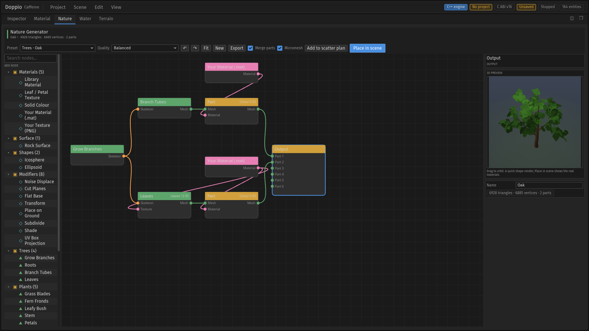
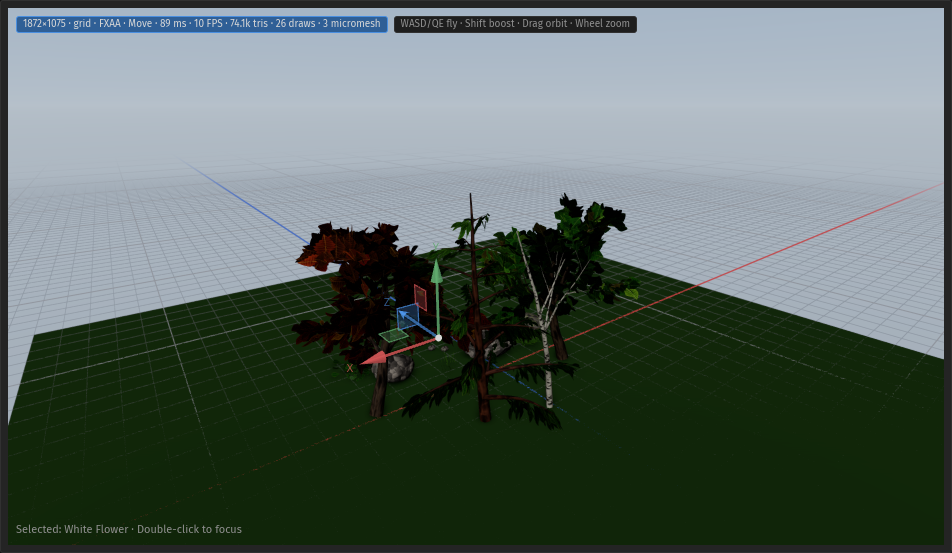
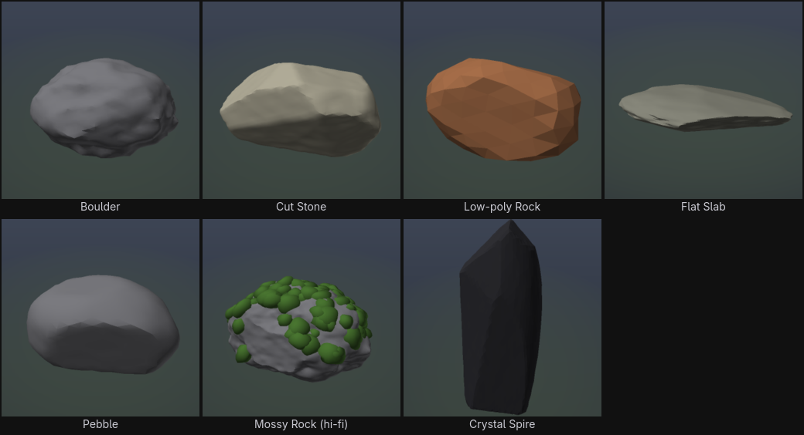
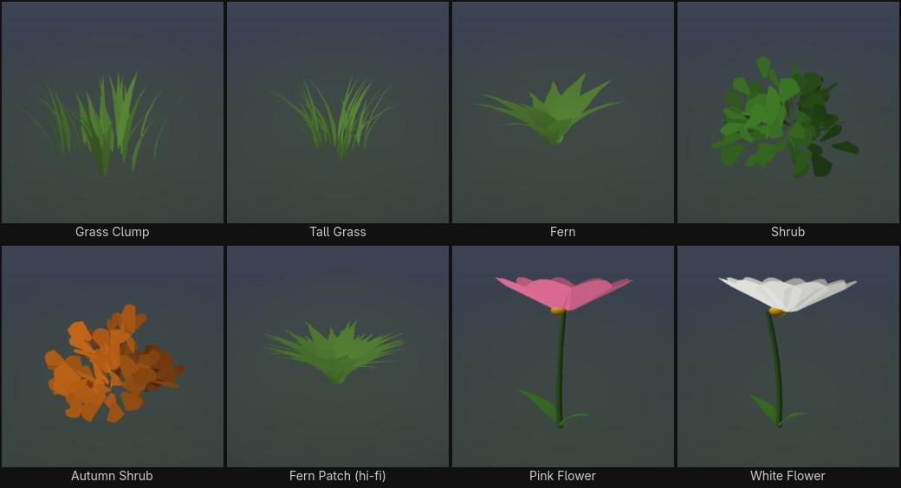
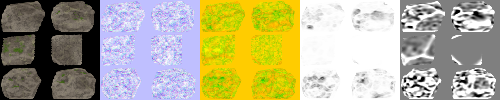
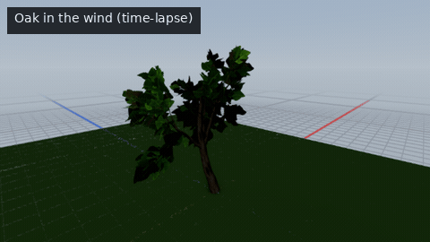
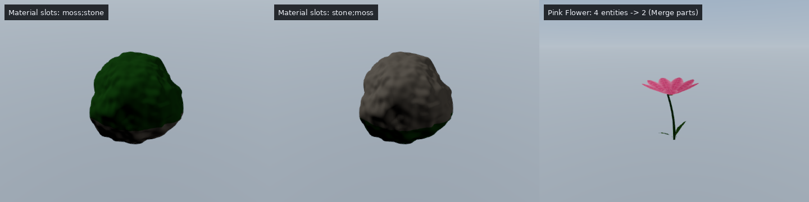
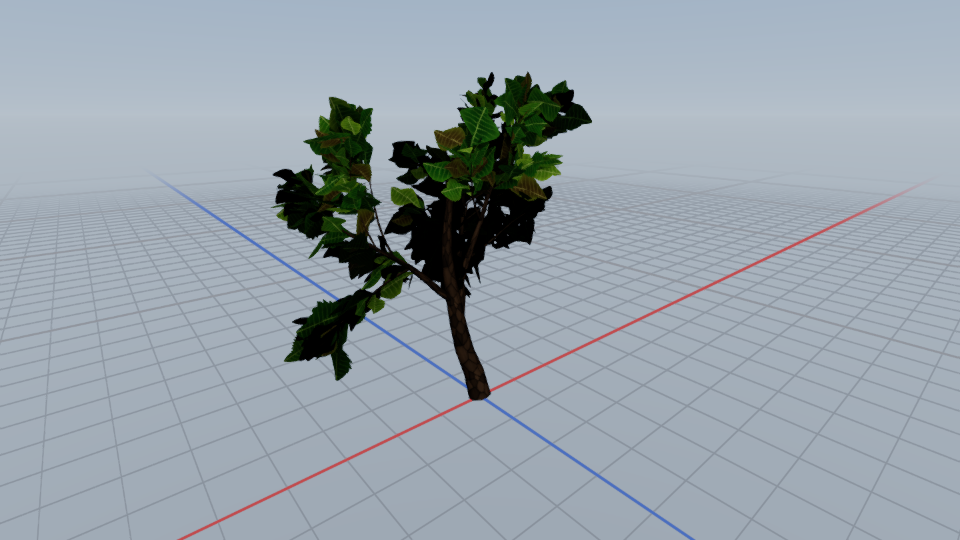

# Nature Generator: procedural rocks, trees and plants, built with nodes

<div class="doc-meta">
  <span class="doc-badge doc-badge--stable">Stable</span>
  <span class="doc-badge">Doppio</span>
  <span>Last updated: <time datetime="2026-11-21">2026-11-21</time></span>
</div>

<p class="doc-lede">Build rocks, trees and low vegetation from a node graph, choose a quality level and place the result in the scene.</p>

The **Nature** tab (next to Inspector and Material) builds rocks, trees and low vegetation from a **node
graph**. The same graph serves a flat-shaded low-poly pine and a hi-fi mossy forest: pick a **Quality**,
wire the nodes you want, give every part **your own material or texture**, and **Place in scene**. Terrain is a separate tool: nothing here scatters over a landscape automatically.

<figure class="doc-figure">
  
  <figcaption>The Nature tab with the Oak graph</figcaption>
</figure>


<figure class="doc-figure">
  
  <figcaption>Generated trees placed in the scene</figcaption>
</figure>


## 1. How a graph works

Three typed ports, drawn in three colours; a link only connects ports of the same type and never closes a
cycle (the status line says why a link was refused):

| Port | Carries |
|---|---|
| **Mesh** | geometry (positions, normals, UVs, indices) |
| **Skeleton** | a branch tree (trunk, branches, roots) that *Branch Tubes* and *Leaves* turn into meshes |
| **Points** | positions, orientations and scales produced by *Scatter Points* |

Every mesh that should end up in the model goes through a **Part** node into the **Output** node (one input
per part). A Part is a mesh **and its material, both wired in**: its *Material* port takes a node from the
**Materials** category, and nothing is chosen inside the Part. A part with no material refuses to build ("The
trunk part has no material: wire a material node..."). The engine gives one material per mesh, so each part
becomes its own entity when placed.

Interaction: add nodes from the left palette (search box, categories) or drag from it; drag nodes by their
header; drag from an output port to an input port; **Fit** frames the graph; undo/redo cover every edit.
Selecting a node shows its parameters in the right column, beside the live 3D preview (drag to orbit).
Everything is deterministic: the same graph, quality and seeds always build the same model.

## 2. Node catalogue

| Category | Nodes |
|---|---|
| Shapes | **Icosphere**, **Ellipsoid** |
| Modifiers | **Noise Displace** (fractal lumps), **Cut Planes** (faceted rock faces), **Flat Base**, **Transform**, **Place on Ground**, **Subdivide**, **Shade** (smooth / flat / crease angle), **UV Box Projection** |
| Combine | **Merge** |
| Trees | **Grow Branches** (skeleton), **Roots**, **Branch Tubes**, **Leaves** (folded, drooping cards with a leaf-shape atlas, or blobs) |
| Plants | **Grass Blades**, **Fern Fronds**, **Leafy Bush**, **Stem**, **Petals** |
| Scatter | **Scatter Points**, **Instance on Points** (moss, pebbles, small leaves on any mesh) |
| Output | **Texture** (images summed into a material), **Material** (surface settings), **Part**, **Output** |
| Materials | **Library Material** (rock, bark, ground presets), **Leaf / Petal Texture** (cards and atlases), **Solid Colour**, **Your Material (.mat)**, **Your Texture (PNG)** |
| Output | **Part**, **Output** |

Rocks are `Icosphere → Noise Displace → Cut Planes → Noise Displace (grain) → Flat Base → Transform → Place
on Ground → Shade → UV Box → Part`. Trees are `Grow Branches → Branch Tubes → Part` plus
`Grow Branches → Leaves → Part` (and **Roots**). Because the stages are nodes, you can insert your own:
a second noise for weathering, a Merge of two rocks, a Scatter of pebbles on a boulder.

## 3. Quality: low poly to high fidelity

Quality is a property of the graph (the toolbar picker); nodes read it, so **one graph covers the whole
range**.

| Quality | What changes |
|---|---|
| **Stylized (low poly)** | at most 2 icosphere subdivisions, faceted rocks, blob crowns and 5-sided flat-shaded trunks, half the counts; materials fall back to **solid colours** (no textures needed) |
| Balanced | the graph as authored |
| **Detailed** | one more subdivision, rounder trunks, 1.6x the segments, leaves and blades, roots and moss that stay off at lower quality |

Tested rule: Stylized < Balanced < Detailed in triangle count for rocks, trees and plants.

<figure class="doc-figure">
  
  <figcaption>Rock presets</figcaption>
</figure>


<figure class="doc-figure">
  
  <figcaption>Tree presets</figcaption>
</figure>


<figure class="doc-figure">
  
  <figcaption>Plant presets</figcaption>
</figure>


Presets are graphs too (23 of them; open one and every node is there to edit). The hi-fi ones show what
the graph is for: **Mossy Rock** (moss cards scattered over the rock), **Ancient Oak** (roots, thick
branches and a dense crown) and **Fern Patch** (a scatter of fern clumps). Low-poly presets: Low-poly Rock,
Low-poly Tree and Low-poly Pine.

## 4. Materials are nodes, and they are real assets

Nothing about a material is hidden inside a generated object. Every part has a **material node** wired into its
Part, and the preset graphs show them (a bark node feeding the trunk, a leaf texture feeding the leaves):

| Node | Gives |
|---|---|
| **Library Material** | a preset from the PBR library (rock, bark, ground), baked once into `Nature/Materials/` |
| **Leaf / Petal Texture** | a procedural cut-out card (leaf, petal) or an **atlas** (*Broadleaf Mix*, *Autumn Mix*: eight leaf shapes and tints in one image) baked to RGBA |
| **Solid Colour** | a plain colour and roughness, ideal for low poly |
| **Your Material (.mat)** | any `.mat` of the project, used **as it is**, never copied or rebaked |
| **Your Texture (PNG)** | a PNG with alpha; a **Cutout** material is made around it (`Nature/Materials/project_<name>.mat`) |

When you **Place in scene**, each part's material is written to the project as a normal asset and assigned to
the entity: open it in the **Material** tab or the Texture Generator and change it. Swap a node (a Solid Colour
for your own `.mat`) to change what the whole model uses. Low poly (*Stylized*) turns library and card
materials into solid colours, but **your own assets are never replaced**.

The **Leaves** node also takes the leaf texture on its *Texture* port (the same node that feeds the leaves'
Part), which is how it knows the atlas layout, and sizes the leaves as a **percentage of the tree's height**
(*Leaf size*, default 7 %), so the proportions follow the tree instead of being a number in metres.

UVs come from the nodes (UV Box for rocks, tube UVs for trunks, card UVs for leaves) so your textures tile as
expected. Saved `.nature` files from before this change have no material nodes and need one wired in.

### Texture and Material nodes

Textures go **after the object**: wire the mesh (Leaves, Branch Tubes, a rock...) into a **Texture** node, then
into a **Part**. A new Part keeps *From nodes (Material / Texture)*, so what the nodes made is what is placed;
choosing any other material in the Part overrides them.

* **Texture** takes one image through an **asset slot**: a thumbnail with the file name, a **×** to clear it, **drag an image from the Assets pane onto it**, or click it to open the **picker with previews** (search included); a path field stays for typing and puts it in a **map**:
  *Albedo*, *Normal* or *Occlusion / Roughness / Metal*. Chain several Texture nodes and they are **summed**
  per map, in wiring order, each with a **blend** (*Replace*, *Add*, *Multiply*, *Overlay*), a strength, its own
  repeats and (for albedo) a tint: a bark colour, then a moss texture multiplied on top, then a normal map of
  cracks added to a second one. Normals add their slopes instead of their colours.
* **Fit to the object** re-projects the part's UVs from its own size, so the texture adapts to the object:
  *Fit to object* repeats it N times across the whole part, *Per metre* keeps the texel density whatever the
  size. *Keep mesh UVs* leaves the node's UVs (leaf cards keep their atlas cell).
* An albedo image with transparency makes the material **cut out** automatically (a leaf PNG); the cut-out also
  casts alpha-tested shadows.
* **Material** has a **Base material (.mat)** slot (same picker, drag and drop, materials only): the placed material starts from that `.mat` (its maps and settings stay) and only the layers and switches you set change it. It sets the surface of the mesh: colour (the base the layers blend over), roughness, metallic,
  cut-out, normal strength, translucency, wind sway and flutter. Put it before or after the Texture nodes: the
  layers stay.

Placing bakes the summed maps to `Textures/Nature/custom_<hash>_{albedo,normal,orm}.png` plus a `.mat` in `Materials/Nature/` (the
hash comes from the settings, so different settings never overwrite each other). Source images are read from
the project and never copied or changed.

## 4b. Generated surfaces: a texture set baked from the model itself

The **Rock Surface** node (category *Surface*, between the last mesh node and **Part**) replaces a library
preset with a **generated PBR texture set** (albedo, normal + height, occlusion/roughness/metal), so a
rock gets the surface of a scan instead of one repeating texture.

<figure class="doc-figure">
  
  <figcaption>The Photoreal Rock preset, placed in the engine</figcaption>
</figure>


How it works (`uikit/nature/bake.rs`, `surface.rs`):

1. **Atlas**: the mesh is re-unwrapped into six non-overlapping charts (a cube map from the model's centre),
   each fitted into its own cell. Baked maps need unique UVs; the box-projection UVs of the other nodes repeat.
2. **Mesh maps**: for every texel, the position, smooth normal, **curvature** (convex edges vs crevices),
   **ambient occlusion** (disk occluders in a spatial hash, no ray casting) and height are rasterised into UV space.
3. **Layers** read those maps and 3D noise at the baked positions, so nothing breaks at seams: stone tones
   and strata, grain, **cracks** that deepen in crevices, **edge wear** on convex curvature, **lichen** crusts
   on exposed faces, **moss** in cavities and on top, **dust** on upward faces.
4. The height becomes the normal map (and its alpha, for parallax/geometric displacement); occlusion and
   roughness are packed into the ORM map. Placement writes `Textures/Nature/rock_*_{albedo,normal,orm}.png`
   plus a `.mat`, reused until a parameter changes.

<figure class="doc-figure">
  
  <figcaption>Albedo, normal, ORM, ambient occlusion and curvature of the Photoreal Rock</figcaption>
</figure>


Parameters: moss, lichen, cracks, edge wear, dust, pattern scale, warmth (grey to sandstone), texture size
(256-2048; Stylized caps it at 512) and seed. Everything is deterministic and tested (coverage, curvature
sign, more moss means more green, same inputs give the same maps).

The engine samples texture rows as `v * height` (no V flip) and applies `ORM` over the material scalars with
the AO scaled by the material's AO strength; the bake follows both.

## 4c. Realism: bark, leaves, wind and translucency

Placing a model now writes materials that do more than carry one flat texture.

<figure class="doc-figure">
  
  <figcaption>A placed oak in the engine, in a steady gust. The crown leans more than the trunk base (sway grows with the height
  above the origin), the leaf cards shimmer on top of that, and the shadow moves with them. Rendered by
  <code>./scripts/render-world-docs.sh</code>.</figcaption>
</figure>

| What | How |
|---|---|
| **Bark** | The *Oak*, *Pine* and *Birch* bark choices are **generated**, not the flat library bake: a tileable albedo, a normal map with the height in its alpha (parallax and micro self-shadowing in the furrows) and an occlusion/roughness map. Oak has deep meandering furrows with a little moss in the cracks, pine large plates cut by horizontal cracks, birch smooth pale bark with dark lenticels. One repeat covers the trunk once around. |
| **Leaf normals** | Every leaf and petal card gets a **normal map derived from the card**: veins from the luminance, a rounded blade profile from the alpha edge. Roughness drops to 0.55 so leaves catch a highlight. |
| **Crown depth** | Cards deep inside the crown pick the atlas's **dark mature leaf** more often than the outer shell, and every leaf vertex carries **baked occlusion** (darker inside the crown, a little different per leaf) in its painted colour. |
| **Alpha-tested shadows** | Cut-out cards (leaves, petals, blades) **cast shadows through their alpha**: the engine's shadow pass reads the albedo and discards the gaps, so the sun falls through the crown and every leaf shades the ones below it. |
| **Painted colour and flutter weight** | Leaf cards and grass/fern blades are exported with a **vertex colour** (`v x y z r g b a` in the `.obj`): rgb tints the albedo (occlusion, per-leaf variation), alpha is the **flutter weight** painted along the blade: 0 at the stalk or root (rigid, it follows its branch), 1 at the tip (full shimmer). The engine reads it into a second vertex stream; the lean with the wind always follows the object, only the flutter is painted. |
| **GPU-instanced scatter** | *Instance on Points* parts (moss, pebbles, small plants on a surface) are placed as **one template mesh plus one entity per copy**, grouped under a holder entity. Copies share mesh and material, so the renderer batches them into one instanced draw call, and each copy has its own wind phase. The merged geometry is still what the preview and **Export** use. This also holds for meshes with a painted colour stream (a third vertex buffer feeds the instanced foliage pipeline). |
| **Translucency** | Leaves, blades, fronds and petals let light through: the face turned away from the sun glows in the leaf colour (back-lit crowns stop going black), brighter when you look toward the sun. Values: leaves 0.55, blades and fronds 0.45, petals 0.4. |
| **Wind** | `wind_strength` is the sway **per metre of height above the entity origin**, so a tall crown moves more than the trunk base and grass moves at its tips. Trunk, branches and leaves use the same 0.012 (a 6 m crown leans about 20 cm in a gust, phased per tree so a forest does not move in lockstep); leaves add `wind_flutter` 0.6 (fast per-vertex shimmer). Low plants use 0.25. The shadow pass applies the same offset, so shadows move with the foliage. |

These settings are also sliders in the **Material** tab (*Translucency*, *Wind sway*, *Wind speed*, *Leaf
flutter*) for your own materials, and live in the `.mat` as `wind_strength`, `wind_speed`, `wind_flutter` and
`translucency` (C ABI v9). Wind is time-based, so it plays in the viewport while the engine renders.

**Stylized (low poly)** keeps all of this: solid colours still sway, flutter and let light through, so a
5-sided trunk with blob crowns moves and glows like the detailed model. Parts called `rock`, `moss`, `ground`
and `body` stay still.

Material files written by earlier versions are not reused: the wind profile is part of the file name
(for example `green_leaf_w12f60t55.mat`), so placing again writes the new ones.

## 4d. Asset folders

Every generator asks one place (`uikit/asset_folders.rs`) where to write, and that place **reuses an existing
folder whatever its case** (a project with `textures/` keeps using it) and only creates the capitalised name
when there is none:

| Content | Folder |
|---|---|
| Nature meshes and `.nature` recipes | `Models/Nature/` |
| Nature `.mat` files | `Materials/Nature/` |
| Baked maps of those materials | `Textures/Nature/` |
| Texture Generator `.png` + `.texgraph` | `Textures/` |
| Texture Set projects | `TextureSets/` |
| Material Generator output | `Materials/` |

## 5. Placing models in the scene

**Export** writes `Models/Nature/<name>_<part>.obj` (one per part) and the editable recipe
`Models/Nature/<name>.generator.nature` into the project's assets folder (see *Asset folders* below). **Place in scene** does that and builds the model as a **group entity** with one
child per part:

* the mesh goes on a **Mesh Filter** (primitive Custom) plus a Mesh Renderer;
* every part casts shadows; cut-out cards use alpha-tested shadows (see 4c);
* scattered parts become a holder entity with one child per copy (see 4c, GPU-instanced scatter);
* the group appears at the viewport's focus, is selected, and the placement is one undo step.

### Merge parts: one entity, a material slot per part

With **Merge parts** on (the default, a checkbox in the toolbar next to *Place in scene*; agent action `nature_merge_parts`) the parts that are not scattered copies
are placed as **at most two entities**: one for the solid parts (trunk, branches, roots, rocks) and one for the cut-out parts (leaves, petals,
blades; they keep their no-shadow setting). Each merged entity has **one mesh with a sub-mesh per part**: Place writes
`<name>_solid.obj` / `<name>_foliage.obj` with a `usemtl <part>` group per part (the engine turns every group into a sub-mesh), and fills the
Mesh Filter's **Material slots** with each part's `.mat`, in the same order (`a.mat;b.mat`, an empty slot uses the entity's own material).
Material slots are an engine feature, not a Nature trick: any OBJ with `usemtl` groups or a glTF with several primitives takes them (see
`micromeshes.md` and the roadmap). Switch Merge parts off to get one entity per part again.

### Micromesh on placing

With **Micromesh** on (also in the toolbar; agent action `nature_micromesh`) a solid part of **3 000 triangles or more** is placed with the Mesh
Renderer's Micromesh switch on, so dense rocks and trunks draw as a GPU-selected cluster cut (see `micromeshes.md`). Cut-out cards and
scattered copies never get it (alpha-tested and instanced paths stay as they are); a part with wind sway falls back to a plain draw by itself.

### Add to scatter plan: from one tree to a forest

**Add to scatter plan** (toolbar; agent action `nature_add_to_scatter`) writes the model into the project's `Scatter/default.scatter` as a **composite
class**: the solid and the foliage meshes are written as merged OBJs with their material slots, and the class lists them as `part` lines, so every
instance the scatter action places is an empty entity with one child per part. Spacing comes from the model's footprint (a 6 m crown gets about 2.4 m of
radius and 7 m between cells), the scale range is 0.8 to 1.3, and *where* starts as gentle slopes; edit the plan to change any of it
(*Terrain* tab > *Edit scatter plan*). See *Scatter on a terrain* in `terrain-generator-guide.md`. Tested end to end: an Oak added from the Nature tab
is planted by the Terrain tab's *Scatter* as a forest of two-part trees (`nature_models_scatter_from_the_terrain_tab_as_composite_instances`).

<figure class="doc-figure">
  
  <figcaption>Material slots in the engine. Left and middle: the same two-group rock, <code>Material slots</code> = <code>moss;stone</code> and
  <code>stone;moss</code>. Right: the Pink Flower placed with Merge parts, 4 entities become 2 (stem and leaf share one, petals and centre the
  other), each with its own slot list. Regenerate with <code>scripts/render-material-slots-docs.sh</code>.</figcaption>
</figure>

## 6. Files, scripting and agents

`.nature` is text: the header `CAFNATURE2`, the name and quality, then the `NATUREGRAPH1` node and link lines
(including any project asset paths). Loading it rebuilds exactly the same model. Without a window or engine:

```bash
doppio-material nature --list
doppio-material nature Oak --out /tmp/nature --quality 2
doppio-material nature --all --out /tmp/nature --seed 7
```

MCP (`--features agent`): query `nature` (graph, nodes, parameters, presets); actions `nature_apply_preset
{ name }`, `nature_add_node { op }`, `nature_connect { from, output, to, input }`, `nature_set { node, param,
value | string, quality, name }`, `nature_export` and `nature_place`. Headless: fixture `nature` builds an
engine-backed scene of generated models (`reset` accepts a `preset`).

### Variants from a recipe

The saved recipe is also an input for other tools. `doppio-material variants Oak.generator.nature --out DIR --count 8 --seed 3`
bakes eight deterministic variants: every node's `seed` is moved by a hash of the variant seed, and the OBJ parts go into
`DIR/<name>_<key>/`, where the key hashes the recipe's graph, its `generator_version`, the seed and the quality. Running
it again reuses the folders; editing the recipe changes the key. A scatter or vegetation generator is meant to call the same
function (`uikit::recipe_ref::nature_variants`). See [`generator-recipes.md`](generator-recipes.md).

## 7. Engine fixes found while building this

* **A crash in `propagateTransforms`**: a group whose children had no world matrix yet added the component
  while the hierarchy was being iterated, which invalidated the iteration. New matrices are now collected
  first and written afterwards (C++ test in `tests/test_scenemanager.cpp`).
* Custom meshes are drawn from the **Mesh Filter**, not from the Mesh Renderer's `Mesh` path, so placement
  sets the filter.

## 8. Limits and roadmap

### Leaves: what is done, what is still missing

<figure class="doc-figure">
  
  <figcaption>An oak with the broadleaf atlas: different shapes, tints, folds and droop</figcaption>
</figure>


**Done (the first refinement of vegetation):**

* **Leaves of many shapes.** The Leaves node's *Leaf shapes* option uses a **4 x 2 atlas** baked from the Texture
  Generator's leaf operator: ovate, serrated, narrow, rounded, dark mature, young yellow-green, dry-edged and
  lobed leaves (*Broadleaf Mix*), or the autumn palette (*Autumn Mix*). Every card picks a random cell, so a crown
  mixes shapes and tints; card sizes vary from 0.55x to 1.35x. Oak, Birch, Autumn Maple, Ancient Oak and the
  other broadleaf presets use it.
* **Leaves that are not a flat quad.** Each card is a **folded, drooping blade**: three vertices across (the
  edges sit lower than the midrib, a shallow V), 2-4 segments along it by quality, the tip drooping under its
  weight and a little twist. *Fold* and *Droop* are node parameters. A test checks the atlas is sampled in full,
  the blade is not planar and Detailed has more segments than Balanced.

**Still missing:**

* **Real 3D leaf meshes** for the nearest leaves. (The translucent back face and the card normal map are done,
  see 4c.)
* **Compound leaves and needle clusters** as atlas cells (the atlas is broadleaf only; conifers still use the
  single card). Per-leaf tint now comes from the painted vertex colour as well as the atlas cells.
* **Bark from the mesh bake.** The generated bark (4c) tiles in UV space; the same bake used by the Rock Surface
  (curvature, AO, height) could drive knots, peeling, moss on the shady side, roots flaring into the ground,
  broken branches and stumps (the reference is a mossy rotten stump).
* **Ground cover that blends.** Moss carpets and low grass mixed with leaf litter, twigs, cones and small
  plants, as a **blended ground material plus instances**: moss as a surface layer (it already is one on rocks)
  and as thick clumps; grass as GPU-instanced blades with colour variation and dry patches.
* **Trees as a model plus a texture set**: a trunk mesh with its bark set, branch tubes with their own, and
  leaf clusters, all driven from the same graph and quality range.

References for the target: a photoreal mossy stump with ferns, clover and leaf litter around it; a dense
oak crown with varied, curved leaves.

* The Rock Surface node covers **rock only** for now; bark, grass-card and soil surfaces use the same bake with other layers. Steep faces of a very lumpy rock still stretch a little in the cube atlas (a seam-aware unwrap would fix it).
* Material slots exist now (see *Merge parts*); what is left for hi-fi vegetation is the root flare and the ground-contact blend.
* The slot list is one text field of at most ~250 bytes: about seven slots with project-relative paths. Placement keeps the slots that fit whole
  and reports the rest.
* The Low-poly Pine preset is still a stack of blobs rather than tiered cones; a cone-tier node is wanted.
* Painted colour exists only on leaf cards and blades (trunks and rocks are white), there is no LOD chain or
  billboard impostor for distant trees.
* The preview is a quick shape render without textures or shadows; **Place in scene** shows the real thing.
* `.obj` only (no `.glb` writer yet).
* Scattering over terrain, biomes and density maps belong to the terrain generator, which is separate.

Scatter, LOD and impostors are planned in [`photoreal-world-roadmap.md`](photoreal-world-roadmap.md).

## 8b. Near-photoreal trees with what exists today

A photoreal tree is not one feature: it is a **silhouette** that is irregular, **bark** with real relief, a crown
whose leaves differ and shade each other, **light that goes through the leaves**, **motion**, and above all
**variety** (no two trees alike). The tool already has an answer for most of these; this section is the recipe to
combine them, then an honest list of what is still short of a close-up photograph.

<table class="doc-table">
  <thead><tr><th>Ingredient</th><th>Status</th><th>How to get it now</th></tr></thead>
  <tbody>
    <tr><td>Irregular skeleton</td><td>Done</td><td><strong>Grow Branches</strong>: <em>Gnarl</em>, <em>Droop</em>, 3-4 levels, <em>Branches start at</em> 0.3-0.4, a high segment budget, different seeds</td></tr>
    <tr><td>Bark relief and colour</td><td>Done (UV-space)</td><td>generated oak, pine or birch bark: parallax furrows, occlusion in the cracks, moss in oak crevices; stack your own scans with <strong>Texture</strong> nodes</td></tr>
    <tr><td>Roots and trunk base</td><td>Partial</td><td><strong>Roots</strong> node (flare is geometry, not a blended skirt)</td></tr>
    <tr><td>Varied leaves</td><td>Done</td><td>4 x 2 leaf atlas, folded and drooping cards, 0.55-1.35x sizes, dark inner leaves</td></tr>
    <tr><td>Leaf shading</td><td>Done</td><td>baked crown occlusion in the vertex colour, normal map from the card, alpha-tested shadows, <em>translucency</em></td></tr>
    <tr><td>Motion</td><td>Done</td><td>wind sway shared by trunk and crown, painted flutter on the leaf tips, phase per tree</td></tr>
    <tr><td>Variety across a forest</td><td>Done in the tool, not yet in the world</td><td>seeded variants (<code>doppio-material variants</code>) and the scatter core (tint, scale, variant per instance)</td></tr>
    <tr><td>Season, rain, snow, age</td><td>Done</td><td>run-time modifiers on the Mesh Renderer or the material: tint, wetness, snow, age</td></tr>
    <tr><td>Mass of trees</td><td>Partial</td><td>batched instanced copies; no LOD chain or impostors yet</td></tr>
  </tbody>
</table>

### The recipe (a mature broadleaf, about 12 m)

1. **Quality: Detailed.** It adds segments, rounder trunks and the roots; keep the preview on Balanced while you edit.
2. **Skeleton.** *Grow Branches*: Height 12, Trunk radius 0.35-0.45, Branch levels 4, Branches per limb 4-5, Branch angle
   40-55, Child length 0.55-0.65, Taper 0.85, **Gnarl 0.4-0.55**, **Droop 0.2-0.3**, Branches start at 0.35, Segment budget
   4000-6000. Gnarl and droop are what separate a tree from a diagram; change only the seed to get a sibling.
3. **Trunk.** *Branch Tubes* with ~10-12 sides, then a **Roots** node (6-9 roots, Dive below ground 0.4) merged into the same
   part so the base flares. Add a *Texture* node after it (see below) instead of one flat bark preset.
4. **Bark material.** A *Library Material* for the generated oak bark gives relief and occlusion. For a close-up, wire
   *Texture* nodes in this order into the trunk: **Albedo** (your bark scan, *Per metre* 0.5), **Normal** (the scan's
   normal map, *Add*), **ORM** (its roughness and occlusion), then a second **Albedo** with a moss or lichen image
   (*Multiply*, strength 0.4, tint toward green) so the shady lower trunk is not the same colour as the upper limbs.
   *Per metre* keeps the same texel density on a 12 m trunk and on a 2 m branch.
5. **Leaves.** *Leaves* on the outer limbs and ~0.45 on the inner ones, **Leaf shapes: Atlas**, Leaf size about 5-7 % of
   the tree height, Fold 0.35, Droop 0.3, triangle budget 15000-30000. The atlas gives eight shapes and tints; the inner
   leaves automatically use the dark cell and carry baked occlusion, which is most of the "depth" in the crown.
6. **Leaf material.** A *Leaf / Petal Texture* with the broadleaf atlas, or your own PNG with alpha through a *Texture*
   node (it becomes cut-out and casts shadows through its alpha). Add a *Material* node: **Translucency 0.5-0.6, Wind sway
   0.012 (the same as the trunk), Leaf flutter 0.5-0.7**. The sway must match the trunk's or the leaves detach from the
   branches.
7. **Ground contact.** Put the tree on the terrain with *Place on Ground*; scatter *Instance on Points* moss, fern and
   leaf-litter parts around the base (they place as batched copies with their own wind phase).
8. **Variants.** Save the recipe and bake eight to sixteen seeds (`doppio-material variants Oak.generator.nature --count 12`)
   so a stand of trees is not twelve copies. Scale (0.8-1.25) and a tint jitter of a few percent per channel are the second
   half of the variety; the scatter core generates both per instance.

### Lighting and rendering settings that matter

* A **directional light with cascaded shadows** and the environment sky: leaves look right only when light reaches them
  from behind. Translucency is what stops a back-lit crown from going black.
* Keep **alpha-tested shadows** on (default): the crown shades itself and the trunk.
* Leave **Photon** or ambient occlusion on for contact darkening between the trunk and the ground.
* Use the **run-time modifiers** instead of re-baking: *Age* 0.2-0.4 on an old tree, *Wetness* after rain (darker bark,
  glossy leaves), *Snow* by season, a warm *Tint* for autumn.

### What is still short of a close-up photograph

<details>
  <summary>Honest list, and which roadmap closes each item</summary>
  <ul>
    <li><strong>Leaves are cards, not meshes.</strong> At a metre the silhouette is a card with an alpha edge; real 3D leaf meshes for the nearest leaves are planned (section 8, <em>Real 3D leaf meshes</em>).</li>
    <li><strong>Bark is tiled in UV space.</strong> No knots, peeling plates, broken stubs or moss that follows the shady side: the mesh bake that drives the Rock Surface could do it (<em>Bark from the mesh bake</em>).</li>
    <li><strong>One material per kind of surface.</strong> A merged entity has a material slot per part (trunk, branches, roots, each with its own bark), but solid and cut-out parts stay two entities because shadows are per entity.</li>
    <li><strong>No subsurface scattering model.</strong> Translucency is a back-lit term, not light diffusing inside a leaf or bark.</li>
    <li><strong>No LOD chain or impostors.</strong> A hero tree is expensive and a forest of them is not possible yet (<a href="photoreal-world-roadmap.md">photoreal-world-roadmap.md</a>, phase 4).</li>
    <li><strong>Nothing places trees over terrain on its own.</strong> The scatter core exists and is tested, but no editor tool or terrain mask feeds it yet (phases 1, 2 and 6).</li>
    <li><strong>Global illumination is screen-space for direct light.</strong> Light bouncing under a crown is approximate until Photon injects the real lights (<a href="graphics-roadmap.md">graphics-roadmap.md</a>, phase P-A).</li>
    <li><strong>Dense geometry.</strong> A 100k-triangle trunk with real bark geometry needs the cluster renderer, and it exists: turn on <strong>Micromesh</strong> in the Mesh Renderer of a placed opaque part (rocks, trunks, boulders) and it draws as a GPU-selected cluster cut with shadows, vertex colours and sub-meshes (see <a href="micromeshes.md">micromeshes.md</a>; 6x fewer triangles on dense rocks, 3x on a dense forest). Placing switches it on for solid parts of 3 000 triangles or more (the <strong>Micromesh</strong> checkbox), and alpha-tested foliage cards and wind-animated parts stay on the instanced path by design.</li>
  </ul>
</details>

### Quality checklist before you place a hero tree

| Check | Target |
|---|---|
| Triangles | 40-120 k for a hero tree at Detailed, 8-20 k at Balanced, under 2 k at Stylized |
| Silhouette | no two limbs parallel, taper and gnarl visible from 30 m |
| Bark | relief visible in grazing light, at least two colour layers, no visible tiling from 5 m |
| Crown | dark interior, bright rim, sun glowing through leaves from behind |
| Motion | trunk and crown sway together, only the tips flutter |
| Forest | 8+ variants, per-instance scale and tint, wetness or age set by the world, not baked |

## 9. Regenerating the images

```bash
./scripts/render-nature-docs.sh       # the three preview sheets (software renderer, no engine)
./scripts/capture-nature-docs.sh      # headless screenshots of the tab and the placed scene (needs libcaffeine-capi)
```

## Golden rule: every material is an asset

The Library Material, Leaf / Petal Texture and Solid Colour nodes (and every preset) are only
**moulds**. Applying a preset, or placing a model, writes each material's picture and `.mat` into
`Nature/Materials/` in your project and turns the node into **Your Material (.mat)** pointing at
them. Nothing stays hidden in the menu: open the `.mat` in the Material tab, repaint the PNG, or
point the node at another file. A material is only written once, so your edits to it are kept.
Your Material and Your Texture carry *Shapes across / down*, the atlas layout of the picture, which
the Leaves node reads to know how many leaf shapes it holds.

### Opening old `.nature` files

Files saved before materials became nodes (`NATUREGRAPH1`) are migrated when they load. Each Part gets the
material node its old choice meant (library, texture, solid colour with its old colour, your `.mat` or your
PNG with its old path). The Leaves node is wired to its leaf part's texture so it reads the atlas from it,
and its old size in metres becomes a share of the tree height (measured on that tree), with fold and droop
kept. Saving writes the new format (`NATUREGRAPH2`), which older builds cannot open. A leaf-shape choice
of "atlas" on a single-picture texture is not carried over: the layout now comes from the texture.
