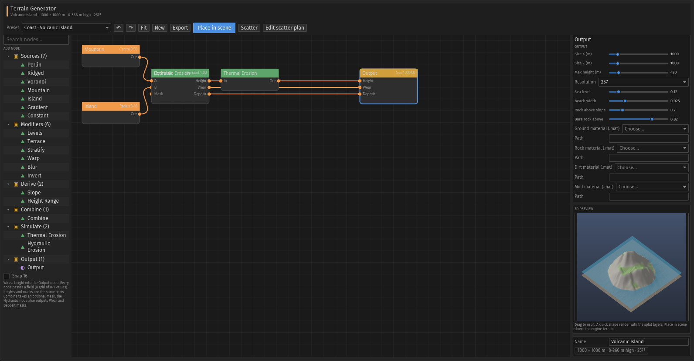
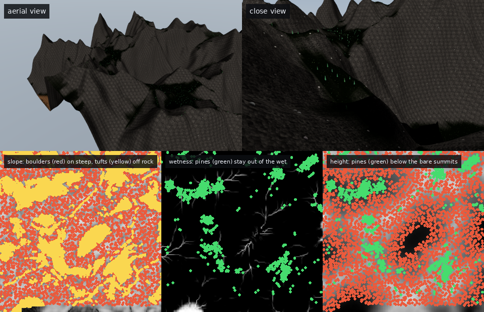

# Terrain Generator: heightfields built with nodes

<div class="doc-meta">
  <span class="doc-badge doc-badge--stable">Stable</span>
  <span class="doc-badge">Doppio</span>
  <span>Last updated: <time datetime="2026-11-21">2026-11-21</time></span>
</div>

<p class="doc-lede">Build heightfields from a node graph and place them as engine terrain with ground, rock, dirt and mud splat layers.</p>

The **Terrain** tab (View menu, next to Nature and Water) builds landscapes from a **node graph** and places
them in the scene as an engine terrain with ground, rock, dirt and mud splat layers. It is the last of the
generators (material, texture, nature, water, terrain) and borrows its shape from node-based terrain tools:
a graph of sources, shapers, masks and erosion ending in an Output.

The `reference/nerthus` folder (MIT, a Rust terrain generator of ~100k lines and 25 node families) served as
the map of what a complete tool needs. **Nothing was copied**; the nodes here are our own implementations of
well-known techniques (gradient noise, ridged multifractals, Voronoi, terracing, thermal and particle-based
hydraulic erosion), sized to what the engine can use today.

<figure class="doc-figure">
  
  <figcaption>The Terrain tab with the Volcanic Island graph</figcaption>
</figure>


<figure class="doc-figure">
  
  <figcaption>The six presets, rendered by the tab's software preview</figcaption>
</figure>


<figure class="doc-figure">
  
  <figcaption>Alpine Range placed in the engine</figcaption>
</figure>


## 1. How a graph works

The graph carries one kind of data, a **field**: a square grid of 0..1 values that is either a height map or a
mask. Every pattern is defined on the unit square, so the live 129 x 129 preview and the 513 x 513 result
show the same landscape. Everything is deterministic for the seeds.

| Category | Nodes |
|---|---|
| Sources | **Perlin** (fBm), **Ridged** (multifractal crests), **Voronoi** (cells, distance, edges, cracks), **Mountain** (a massif with ridges), **Island** (radial mask with noisy shore), **Gradient**, **Constant** |
| Modifiers | **Levels**, **Terrace**, **Stratify** (tilted sedimentary layers), **Warp** (domain warp), **Blur**, **Invert** |
| Derive | **Slope** (steepness mask), **Height Range** (mask of a height band) |
| Combine | **Combine** (Add, Subtract, Multiply, Maximum, Minimum, Blend, Screen, Difference, with an optional mask) |
| Simulate | **Thermal Erosion** (talus slumping), **Hydraulic Erosion** (droplets carrying sediment; also outputs **Wear** and **Deposit** masks) |
| Output | **Output**: size X/Z, max height, resolution (129/257/513), sea level, beach width, rock slope, bare-rock line; optional **Wear** and **Deposit** inputs (from Hydraulic Erosion) become masks |

## 2. The Output node and the splat layers

The Output turns the final height into the engine terrain and computes the four **splat layers** from the
terrain itself:

| Layer | Where |
|---|---|
| 0 ground (grass, moss) | everywhere that is not rock, beach or underwater |
| 1 rock | slopes steeper than *Rock above slope* (real rise over run from the size and max height) and heights above *Bare rock above* |
| 2 dirt | the beach band just above the sea level |
| 3 mud | below the sea level |

Weights are normalised to sum to one; the engine resamples them to its splat map. The **sea level** is only a
height used for the layers and the preview: place a **Water** body at that height (the tab reports it in
metres).

## 3. Presets

| Group | Presets |
|---|---|
| Gentle | **Rolling Hills** |
| Mountains | **Alpine Range**, **Highland Lake** |
| Coast | **Volcanic Island**, **Archipelago** |
| Arid | **Badlands** |

Each is an ordinary graph you can open and edit. Tests check that every preset builds a valid terrain (values in
range, real relief, splat weights summing to one), that thermal erosion softens the surface while conserving
material, that hydraulic erosion is deterministic and produces wear and deposit masks, that the same graph at
two resolutions shows the same landscape, and that seeds change the result.

## 4. Engine side (C ABI v8)

* `CaffeineTerrain` (POD) with `caffeine_session_set_terrain(entity, terrain, heights, splat_rgba)`,
  `caffeine_session_terrain` and `caffeine_session_terrain_height`. Heights are 0..1 and scaled by the max
  height; the optional splat bytes are resampled to the splat map. The Rust `doppio-engine` crate wraps them as
  `Terrain` and `Engine::set_terrain/terrain/terrain_height`.
* The session now **syncs terrain meshes before rendering** (it did not, so a terrain never drew in the editor)
  and gives the entity the mesh components the renderer looks for.
* The terrain mesh is **centred on its entity**; `terrain_height(x, z)` measures from the corner, and so do the mask reads.
* Placing is one undo step, selects the entity and reports the sea level; **Export** writes
  `Terrain/<name>.generator.terrain` (a recipe wrapping the `CAFTERRAIN1` / `TERRAINGRAPH1` text) and a **16-bit height map
  PNG** for other tools.

### Masks (C ABI v15)

Placing a terrain sends the engine more than a height and a splat map: it sends **masks**, named 0..1 fields that scatter, the biome
table and (later) the shaders read to place things by what the terrain *is*.

<figure class="doc-figure">
  
  <figcaption>The Alpine Range placed in the engine and every mask read back through the C ABI at 256 x 256: the three the engine derives from the
  heightfield, the two the graph derives (drainage lines in <em>flow</em>, the wet valley floors and the sea in <em>wetness</em>) and the two
  hydraulic erosion left (<em>wear</em> where it cut, <em>deposit</em> where it dropped sediment).</figcaption>
</figure>

| Mask | Made by | Meaning |
|---|---|---|
| `height` | engine, from the heightfield | normalised height |
| `slope` | engine | angle from the horizontal, 0 flat .. 1 = 90 degrees |
| `curvature` | engine | 0.5 on flat ground, towards 1 in a valley, towards 0 on a ridge (+-0.125 per metre is the full range) |
| `flow` | graph (Output node) | D8 flow accumulation: how much of the terrain drains through a texel, log-scaled |
| `wetness` | graph | steady drainage that is not steep, plus everything at or below the sea level |
| `wear`, `deposit` | graph, **when wired** | what hydraulic erosion took and left; the Output node has two optional inputs for them (the presets with erosion wire them) |

The built-ins cost nothing: the engine computes them from the heightfield on demand. The stored ones are 8 bits per texel on the
heightfield's grid (a mask is a weight, not a height), up to 16 per terrain, **saved with the terrain file** (version 3; a terrain
without masks is still written as version 2 so older readers open it).

* `caffeine_session_set_terrain_mask(entity, name, res_x, res_z, bytes)` (NULL bytes removes it), `terrain_mask_count`, `terrain_mask_at`
  (name, grid, built-in), `terrain_mask(entity, name, x, z)` for one point and `terrain_mask_rect(entity, name, x0, z0, x1, z1, w, h, out)` to
  resample a rectangle. Coordinates are metres from the terrain's corner, like `terrain_height`; outside the terrain reads the nearest edge.
* `caffeine_session_terrain_normal(entity, x, z)`: the unit surface normal.
* The Rust crate wraps them: `Engine::set_terrain_mask`, `remove_terrain_mask`, `terrain_masks`, `terrain_mask`, `terrain_mask_rect`,
  `terrain_normal`.

### The biome table

`terrain/TerrainBiome` turns masks into the 0..1 density of each scatter class: a class density is `base x` a product of terms, each term a
trapezoid over one mask. It is plain text and plugs straight into the scatter module's density callback:

```text
class 2 base 0.9            # trees: gentle, dry, above the beach
  slope     0.00 0.00 0.15 0.35
  wetness   0.00 0.00 0.30 0.60
  height    0.22 0.28 1.00 1.00
class 1 base 1              # rocks: steep ground
  slope     0.30 0.45 1.00 1.00
```

A class without a rule has density 1; a term that names a mask the terrain does not have gives 0 (nothing is placed rather than
everywhere) and `missingMasks` lists those names. Tested end to end: scattered trees never land on steep or wet ground and rocks only on the
ridge. The editor reads a table through the scatter plan below; a World tab that edits tables visually is phase 6 of the world roadmap.

### Scatter on a terrain (C ABI v16)

**Scene > Scatter on Terrain** (id `editor.menu.scene.scatter_terrain`), or the **Scatter** button in this tab's toolbar (next to *Place in scene*; it scatters the selected terrain, else the one you placed last), places a whole plan of vegetation and rocks on the selected terrain in one
undo step. The plan is a project text file, `Scatter/default.scatter`, written from a built-in plan the first time; edit it and run the action
again. A `class` line says *what* (shape, size, spacing, scale, tilt, sink, tint, variants, Micromesh), and the lines under it are the biome
terms that say *where*, the same trapezoids as above:

```text
seed 7
class 1 name boulder primitive sphere color 0.45 0.43 0.40 size 1.6 1.1 1.4 cell 16 radius 2.2 density 0.9 priority 30 scale 0.7 1.6 tilt 0.8 sink 0.3 micromesh on
  slope 0.30 0.45 1.00 1.00
class 2 name pine primitive cone color 0.12 0.32 0.15 size 1.8 6 1.8 cell 8 radius 2.4 density 0.85 priority 20 scale 0.8 1.4 tilt 0.1 tint 0.1
  slope   0.00 0.00 0.15 0.35
  wetness 0.00 0.00 0.30 0.60
  height  0.12 0.20 0.70 0.85
```

**Edit scatter plan** (toolbar) opens the plan in the script editor. A class can also be a **composite**: indented `part mesh <path> [slots a.mat;b.mat]
[micromesh on|off] [cutout on|off]` lines make every instance an empty entity with one child per part (a generated tree is a solid and a foliage mesh);
the Nature tab's *Add to scatter plan* writes them for you.

A shape is `primitive <cube|sphere|cone|cylinder|capsule|pyramid|torus>` or `mesh <path>` (a `{v}` in the path is the variant number, so a
`.nature` rock set scatters as variants); `material <path>` and `color r g b` set the look. The plan is validated before anything is placed:
a bad line or a biome term for a mask the terrain does not have reports an error in the status bar and changes nothing.

<figure class="doc-figure">
  
  <figcaption>The Alpine Range scattered with the built-in plan (20 000 instances: 2 692 boulders, 651 pines, 16 657 tufts). Top: lit views, pines in
  the basins. Bottom: where each class landed over the mask it reads: boulders on the steep (bright) slope, tufts off rock, pines only on dry
  (black) wetness and below the bare summits. Regenerate with <code>scripts/render-scatter-docs.sh</code>.</figcaption>
</figure>

What happens underneath:

* `scatterTerrain` (`src/caffeine/scatter/TerrainScatter`) runs the deterministic scatter core over a region of the terrain with its height,
  normal and the biome density. The result depends only on the seed, the plan and the terrain, not on the chunk size: the two halves of a
  region add up to the whole. It stops at `maxInstances` and reports the total, so the status line tells you when the plan was cut
  (default 5 000 in the editor; raise it with `max_instances`).
* `caffeine_session_scatter_terrain(session, entity, seed, classes, class_count, biome_text, region, out, capacity, out_total)` returns each
  instance's world position, `up` (the terrain normal), Euler rotation in degrees, scale, tint and variant. `capacity` 0 only counts.
  `caffeine_biome_check(text, error, size)` validates a table. The Rust crate wraps them as `Engine::scatter_terrain` and `biome_check`.
* Doppio creates a holder entity `Scatter <plan name>` and one child per instance with Mesh Filter, Mesh Renderer (material, tint = class colour
  x instance tint, Micromesh) and the position, rotation and scale from the engine. Same seed and plan, same placement.
* Limits: every instance is an entity, so thousands are slow to edit (the instanced and Micromesh draw paths handle them, per-chunk instance
  buffers are phase 4); the plan is global to the terrain (no painted regions yet); rocks use a single height sample at the instance centre.

## 5. Limits and roadmap

This is the first slice of a tool that is far larger elsewhere (the reference has ~25 node families). Honest
status:

* **Node coverage.** 19 nodes against the reference's hundreds. Missing families, roughly in the order they
  matter: **rivers and lakes** (flow routing, carving, water masks), **snow and glaciers**, **sediment and
  scree** simulations, **rock detail** (outcrops, shattered stone, sandstone), **cartography** (contours,
  hillshade), **vegetation and object scattering** from masks, **vector masks** (splines, roads), **file input**
  (import heightmaps and meshes), and a **colorize** stage that paints a colour map from palettes and masks.
* **Fidelity.** The erosion is a compact particle model, not a production solver: it carves believable gullies
  and deposits but does not match dedicated tools on large, long-running simulations; it runs on the CPU at up
  to 513 x 513. The engine itself accepts terrains up to 4097 x 4097 and its chunked LOD draws them (a 1025 x 1025 terrain submits about 0.84 M of its 2.1 M triangles in about 410 draws; see the benchmark set in `micromeshes.md`); what is missing is a generator output above 513 and tiling or streaming of anything larger than one heightfield.
* **Splat textures.** The four layers use the terrain component's layer texture paths (defaults point at the
  `hdr-assets-texture` ground sets). In a project without them the terrain draws dark; choosing the layer
  textures from the tab is next. There is **no snow layer** (the engine has four), so mountains show rock, not
  snow.
* **Masks to the engine.** Only the four splat layers reach the engine. Wear, deposit and flow masks stay in the
  graph; exporting masks as images and driving vegetation scatter from them is not done.
* **A process-wide cache.** The engine's terrain cache is a singleton keyed by entity id and a session's teardown clears it, so two engine sessions in one process must not build terrains at the same time (the engine tests take a lock for this). A per-session cache is the clean fix.
* **One output.** One terrain per graph; no tiling or multi-terrain export, no build/export queue.
* **Preview.** The 3D preview is a software render of the splat colours and sea plane with a 1.4x vertical
  exaggeration; the engine's lighting, shadows and textures differ.
* **Water.** The sea level is a number, not a water body; the Water tab places the surface separately.
* **Tuning.** Preset relief and sea levels were tuned against the software preview and a single engine render;
  expect to adjust them (max height, sea, rock slope) per project.

World-level plan (masks to the engine, scatter, chunk streaming): see [`photoreal-world-roadmap.md`](photoreal-world-roadmap.md).

## 6. Agents and scripting

The tab is a pane like the others (`editor.pane.terrain_generator`, `terraingen.*` ids). Headless: fixture
`terrain` (`reset` takes a `preset`, e.g. `Badlands`); no engine is needed for the graph and preview. Placement
and rendering are covered by engine-backed tests.

The toolbar buttons are the MCP actions `terrain_scatter` and `terrain_edit_scatter_plan` (and the Nature tab's `nature_add_to_scatter`). Agents place a scatter with the MCP action `scatter_on_terrain` (`plan_text` or `plan_file`, `seed`, `max_instances`, `terrain_id`); it sends the same
message as the menu, so it is one undo step too. Tests: `scatter_on_terrain_places_the_plan_by_the_terrains_masks` (engine-backed).

## 7. Regenerating the images

```bash
./scripts/capture-terrain-docs.sh                                              # the tab (headless, no engine)
./scripts/render-terrain-mask-docs.sh                                          # the mask sheet (engine renders and reads back every mask)
DOPPIO_TERRAIN_DUMP=/tmp/terrain cargo test -p doppio-ui --lib terrain_presets_dump   # preview of every preset
DOPPIO_TERRAIN_DUMP=/tmp/terrain cargo test -p doppio-ui --lib placing_a_terrain      # engine render of Alpine Range
```

## The layers are project materials

The Output node holds four material slots (ground, rock, dirt, mud). Applying a preset, or placing,
fills empty slots by baking a material-library picture into `Terrain/Layers/<layer>.png` and writing a
`Terrain/Layers/<layer>.mat` whose albedo map is that picture. The slot holds the `.mat`; placing
paints the engine's `Splat Layer Paths 1..4` with each material's albedo map. A slot that already has a
path, or a file that already exists, is never touched: repaint the PNG, edit the `.mat`, or pick another
material from the node's list. A slot holding a plain picture (older graphs) still works.

Limit: the engine's splat shader blends the four **albedo** pictures only. Normal, roughness and the
other `.mat` channels are stored in the file but not used for terrain layers yet; that needs a shader
change.

Old `.terrain-graph` files load as before; their empty slots are filled the next time you apply or place.
