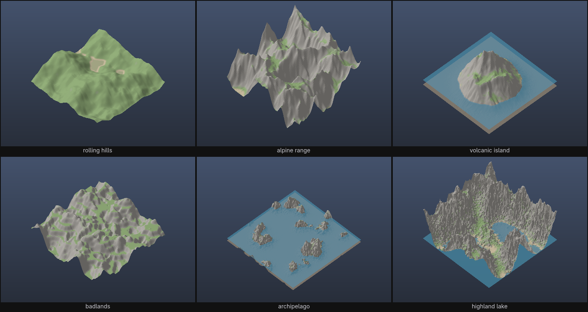
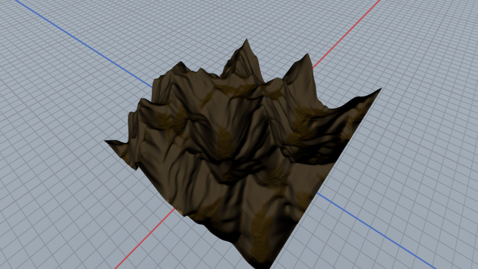

# Terrain Generator: heightfields built with nodes

<div class="doc-meta">
  <span class="doc-badge doc-badge--stable">Stable</span>
  <span class="doc-badge">Doppio</span>
  <span>Last updated: <time datetime="2026-11-18">2026-11-18</time></span>
</div>

<p class="doc-lede">Build heightfields from a node graph and place them as engine terrain with ground, rock, dirt and mud splat layers.</p>

The **Terrain** tab (View menu, next to Nature and Water) builds landscapes from a **node graph** and places
them in the scene as an engine terrain with ground, rock, dirt and mud splat layers. It is the last of the
generators (material, texture, nature, water, terrain) and borrows its shape from node-based terrain tools:
a graph of sources, shapers, masks and erosion ending in an Output.

The `reference/nerthus` folder (MIT, a Rust terrain generator of ~100k lines and 25 node families) served as
the map of what a complete tool needs. **Nothing was copied**; the nodes here are our own implementations of
well-known techniques (gradient noise, ridged multifractals, Voronoi, terracing, thermal and particle-based
hydraulic erosion), sized to what the engine can use today.

<figure class="doc-figure">
  
  <figcaption>The Terrain tab with the Volcanic Island graph</figcaption>
</figure>


<figure class="doc-figure">
  
  <figcaption>The six presets, rendered by the tab's software preview</figcaption>
</figure>


<figure class="doc-figure">
  
  <figcaption>Alpine Range placed in the engine</figcaption>
</figure>


## 1. How a graph works

The graph carries one kind of data, a **field**: a square grid of 0..1 values that is either a height map or a
mask. Every pattern is defined on the unit square, so the live 129 x 129 preview and the 513 x 513 result
show the same landscape. Everything is deterministic for the seeds.

| Category | Nodes |
|---|---|
| Sources | **Perlin** (fBm), **Ridged** (multifractal crests), **Voronoi** (cells, distance, edges, cracks), **Mountain** (a massif with ridges), **Island** (radial mask with noisy shore), **Gradient**, **Constant** |
| Modifiers | **Levels**, **Terrace**, **Stratify** (tilted sedimentary layers), **Warp** (domain warp), **Blur**, **Invert** |
| Derive | **Slope** (steepness mask), **Height Range** (mask of a height band) |
| Combine | **Combine** (Add, Subtract, Multiply, Maximum, Minimum, Blend, Screen, Difference, with an optional mask) |
| Simulate | **Thermal Erosion** (talus slumping), **Hydraulic Erosion** (droplets carrying sediment; also outputs **Wear** and **Deposit** masks) |
| Output | **Output**: size X/Z, max height, resolution (129/257/513), sea level, beach width, rock slope, bare-rock line |

## 2. The Output node and the splat layers

The Output turns the final height into the engine terrain and computes the four **splat layers** from the
terrain itself:

| Layer | Where |
|---|---|
| 0 ground (grass, moss) | everywhere that is not rock, beach or underwater |
| 1 rock | slopes steeper than *Rock above slope* (real rise over run from the size and max height) and heights above *Bare rock above* |
| 2 dirt | the beach band just above the sea level |
| 3 mud | below the sea level |

Weights are normalised to sum to one; the engine resamples them to its splat map. The **sea level** is only a
height used for the layers and the preview: place a **Water** body at that height (the tab reports it in
metres).

## 3. Presets

| Group | Presets |
|---|---|
| Gentle | **Rolling Hills** |
| Mountains | **Alpine Range**, **Highland Lake** |
| Coast | **Volcanic Island**, **Archipelago** |
| Arid | **Badlands** |

Each is an ordinary graph you can open and edit. Tests check that every preset builds a valid terrain (values in
range, real relief, splat weights summing to one), that thermal erosion softens the surface while conserving
material, that hydraulic erosion is deterministic and produces wear and deposit masks, that the same graph at
two resolutions shows the same landscape, and that seeds change the result.

## 4. Engine side (C ABI v8)

* `CaffeineTerrain` (POD) with `caffeine_session_set_terrain(entity, terrain, heights, splat_rgba)`,
  `caffeine_session_terrain` and `caffeine_session_terrain_height`. Heights are 0..1 and scaled by the max
  height; the optional splat bytes are resampled to the splat map. The Rust `doppio-engine` crate wraps them as
  `Terrain` and `Engine::set_terrain/terrain/terrain_height`.
* The session now **syncs terrain meshes before rendering** (it did not, so a terrain never drew in the editor)
  and gives the entity the mesh components the renderer looks for.
* The terrain mesh is **centred on its entity**; `terrain_height(x, z)` measures from the corner.
* Placing is one undo step, selects the entity and reports the sea level; **Export** writes
  `terrain/<name>.terrain-graph` (`CAFTERRAIN1` header plus `TERRAINGRAPH1` lines) and a **16-bit height map
  PNG** for other tools.

## 5. Limits and roadmap

This is the first slice of a tool that is far larger elsewhere (the reference has ~25 node families). Honest
status:

* **Node coverage.** 19 nodes against the reference's hundreds. Missing families, roughly in the order they
  matter: **rivers and lakes** (flow routing, carving, water masks), **snow and glaciers**, **sediment and
  scree** simulations, **rock detail** (outcrops, shattered stone, sandstone), **cartography** (contours,
  hillshade), **vegetation and object scattering** from masks, **vector masks** (splines, roads), **file input**
  (import heightmaps and meshes), and a **colorize** stage that paints a colour map from palettes and masks.
* **Fidelity.** The erosion is a compact particle model, not a production solver: it carves believable gullies
  and deposits but does not match dedicated tools on large, long-running simulations; it runs on the CPU at up
  to 513 x 513. A GPU or tiled path is needed for 2K-8K terrains, which the engine's LOD and chunking can draw.
* **Splat textures.** The four layers use the terrain component's layer texture paths (defaults point at the
  `hdr-assets-texture` ground sets). In a project without them the terrain draws dark; choosing the layer
  textures from the tab is next. There is **no snow layer** (the engine has four), so mountains show rock, not
  snow.
* **Masks to the engine.** Only the four splat layers reach the engine. Wear, deposit and flow masks stay in the
  graph; exporting masks as images and driving vegetation scatter from them is not done.
* **A process-wide cache.** The engine's terrain cache is a singleton keyed by entity id and a session's teardown clears it, so two engine sessions in one process must not build terrains at the same time (the engine tests take a lock for this). A per-session cache is the clean fix.
* **One output.** One terrain per graph; no tiling or multi-terrain export, no build/export queue.
* **Preview.** The 3D preview is a software render of the splat colours and sea plane with a 1.4x vertical
  exaggeration; the engine's lighting, shadows and textures differ.
* **Water.** The sea level is a number, not a water body; the Water tab places the surface separately.
* **Tuning.** Preset relief and sea levels were tuned against the software preview and a single engine render;
  expect to adjust them (max height, sea, rock slope) per project.

World-level plan (masks to the engine, scatter, chunk streaming): see [`photoreal-world-roadmap.md`](photoreal-world-roadmap.md).

## 6. Agents and scripting

The tab is a pane like the others (`editor.pane.terrain_generator`, `terraingen.*` ids). Headless: fixture
`terrain` (`reset` takes a `preset`, e.g. `Badlands`); no engine is needed for the graph and preview. Placement
and rendering are covered by engine-backed tests.

## 7. Regenerating the images

```bash
./scripts/capture-terrain-docs.sh                                              # the tab (headless, no engine)
DOPPIO_TERRAIN_DUMP=/tmp/terrain cargo test -p doppio-ui --lib terrain_presets_dump   # preview of every preset
DOPPIO_TERRAIN_DUMP=/tmp/terrain cargo test -p doppio-ui --lib placing_a_terrain      # engine render of Alpine Range
```

## The layers are project materials

The Output node holds four material slots (ground, rock, dirt, mud). Applying a preset, or placing,
fills empty slots by baking a material-library picture into `terrain/layers/<layer>.png` and writing a
`terrain/layers/<layer>.mat` whose albedo map is that picture. The slot holds the `.mat`; placing
paints the engine's `Splat Layer Paths 1..4` with each material's albedo map. A slot that already has a
path, or a file that already exists, is never touched: repaint the PNG, edit the `.mat`, or pick another
material from the node's list. A slot holding a plain picture (older graphs) still works.

Limit: the engine's splat shader blends the four **albedo** pictures only. Normal, roughness and the
other `.mat` channels are stored in the file but not used for terrain layers yet; that needs a shader
change.

Old `.terrain-graph` files load as before; their empty slots are filled the next time you apply or place.
