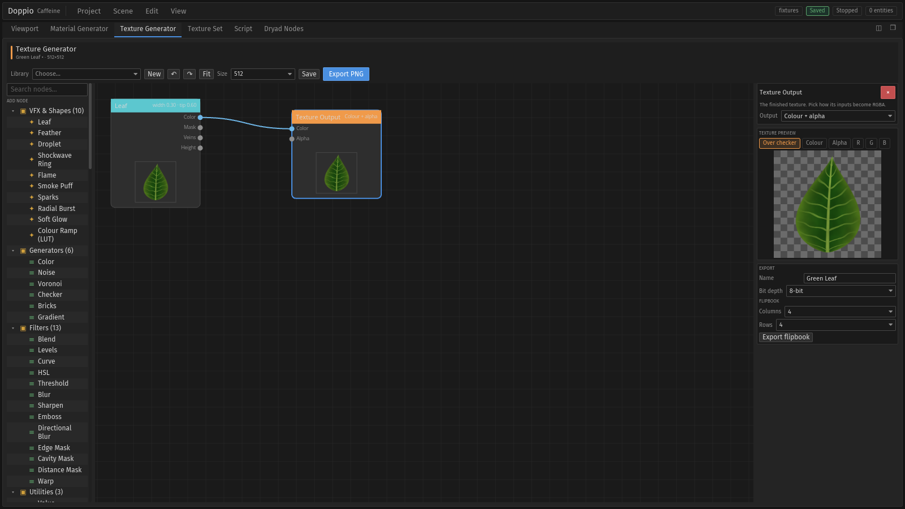
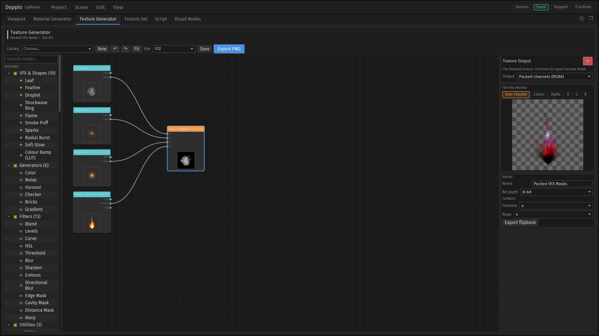
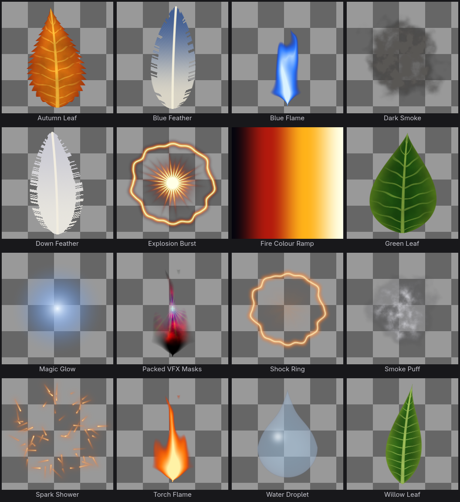
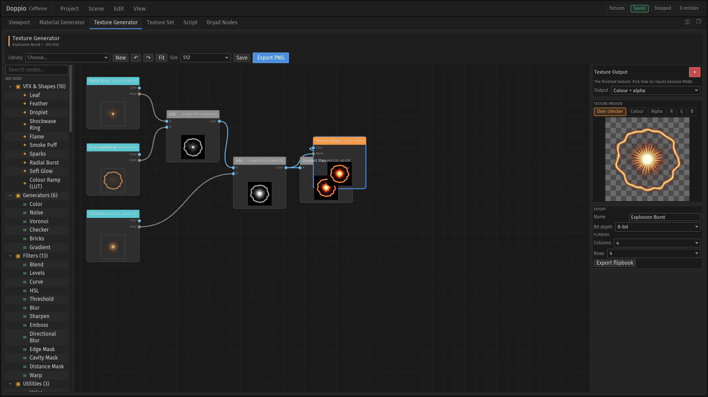
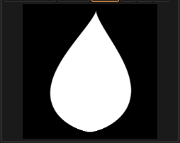
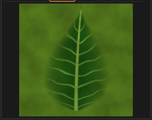
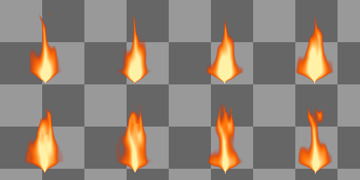
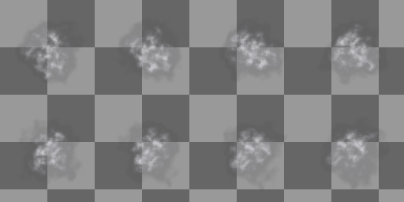

# Texture Generator: procedural sprites, VFX and packed masks

The **Texture Generator** is a node graph that bakes **one texture**: a leaf, a feather, a
flame, a shock ring, a packed RGBA mask. It is a tool of its own, next to the
**Material Generator**, because the two jobs differ.

| | Material Generator | Texture Generator |
|---|---|---|
| Produces | a PBR material (`.mat` plus base, normal, ORM, emissive maps) | a single image, with alpha |
| Result node | `Output` (Color, Roughness, Metallic, Height, AO, Emissive, Opacity, Normal) | `Texture Output` (Colour + alpha, or packed R, G, B, A) |
| Tiling | seamless | optional: an object sits in the image with a transparent margin |
| Preview | engine sphere or plane with real lighting | checkerboard, plus single-channel views |
| File | `<material>.mgraph` beside the `.mat` | `<name>.texgraph` in `textures/`, with the `.png` |
| Library | 85 materials | 21 textures: foliage, organic, fire and smoke, effects, procedural, data |
| Accent colour | cyan | orange (title bar and the Texture Output node) |

They can feed each other (bake a flame to a PNG and use it as an emissive map), but a texture
graph never opens as a material and vice versa: the loaders refuse the other format.



Images are produced headless by the engine tooling; the commands to regenerate them are at the
end.

## 1. What is shared and what is not

Both tools run on the same engine room, so every improvement to one helps the other:

* the **node store and evaluator** (`generators::MaterialGraph` is only the container of nodes and
  links, evaluated lazily with a memo);
* the **procedural library** in `uikit/procedural/` (139 ops: 129 for materials plus 10 new VFX &
  Shapes ops);
* the **node canvas**, the **parameter editor** (sliders, colour pickers, dropdowns generated
  from each op's table row) and the **undo history**.

What is separate: the `.texgraph` format (`uikit/texture_graph.rs`), the `TextureOutput` node, the
palette, the presets, the panel (`panels/texture_generator.rs`), the editor state and messages
(`windows/main/texturegen.rs`), the ids (`texturegen.*`) and the agent actions.
The material palette no longer offers the VFX & Shapes ops, and the texture palette hides the PBR
`Output`, image readers and normal-map nodes.

## 2. The Texture Output node

| Mode | Ports | Use |
|---|---|---|
| **Colour + alpha** | Color, Alpha | sprites, leaves, decals. Without an Alpha input the colour's own alpha is kept, which is how the VFX & Shapes ops mask themselves. |
| **Packed channels (RGBA)** | R, G, B, A | data and VFX textures: four greyscale masks in one file. Unconnected R, G and B are 0, A is 1. |

Changing the mode drops links to ports that no longer exist. The node cannot be deleted: it is the
graph's result. Output goes to a PNG of **8 or 16 bits** with straight alpha.



## 3. VFX & Shapes nodes

Ten ops, in `uikit/procedural/vfx.rs`. None is tileable: each draws an object. Colour outputs carry
the object's mask in alpha, and the RGB is kept under the transparent area so mip-maps do not gain
dark halos. Everything is deterministic for a seed.

| Op | Makes | Outputs | Notable parameters |
|---|---|---|---|
| Leaf | silhouette from a width profile, midrib and curved side veins | Color, Mask, Veins, Height | half width, tip sharpness, base roundness, serration, teeth, bend, side veins, vein sweep, texture |
| Feather | vane with barbs, splits and a shaft | Color, Mask, Barbs | width, vane curve, barbs, slant, splits, bend |
| Droplet | teardrop (smooth union of a circle and a tapered cone) | Color, Mask, Dome | radius, tail, join smoothing, highlight, tilt |
| Shockwave Ring | distorted ring with an inner glow | Color, Value | radius, thickness, softness, distortion, noise scale |
| Flame | warped teardrop eroded by noise, fire ramp | Color, Intensity, Core | width, height, turbulence, stretch, sharpness, **phase** |
| Smoke Puff | turbulent soft puff | Color, Value | radius, turbulence, density, softness, **phase** |
| Sparks | streaking embers with a hot head | Color, Value | count, length, thickness, radial bias, glow |
| Radial Burst | rays with random lengths and a core | Color, Value | rays, sharpness, reach, length variation, core size |
| Soft Glow | elliptical falloff | Color, Value | radius, falloff power, intensity, aspect |
| Colour Ramp (LUT) | 1D gradient along X, Y or radially, four stops | Color, Position | direction, stops B and C, smooth blend |



The ops combine with everything else in the library: the *Explosion Burst* preset is a burst, a
ring and a glow added together and mapped through a Gradient Map, with the sum also wired to the
Alpha port.



## 4. Library

The **Library** dropdown replaces the graph with one of 21 presets (one undo step; your size is
kept). They are normal graphs, so you can keep editing them.

| Category | Presets |
|---|---|
| Foliage | Green Leaf, Autumn Leaf, Willow Leaf, Petal Pink / White / Yellow (the [Nature Generator](nature-generator-guide.md) uses them for flowers) |
| Organic | Blue Feather, Down Feather, Water Droplet |
| Fire & Smoke | Torch Flame, Blue Flame, Smoke Puff, Dark Smoke |
| Effects | Spark Shower, Shock Ring, Magic Glow, Explosion Burst |
| Procedural | Wave Function Collapse Bricks, Diamond-Square Clouds (both from the **Variation** class, see the [materials guide](materials-guide.md#variation-lively-patterns-that-never-repeat)) |
| Data | Fire Colour Ramp (a 1D LUT), Packed VFX Masks (R smoke, G burst, B glow, A flame) |

## 5. Preview

The preview is baked at 256 px after every edit (node thumbnails at 96 px), so it follows sliders
live. It is drawn **over a checkerboard**, so transparency is visible. The chips switch the view:

| Over checker | Colour | Alpha | R, G, B |
|---|---|---|---|
| the real result | RGB with no alpha | the mask as grey | one channel as grey, for packed masks |

| Alpha | Colour |
|---|---|
|  |  |

## 6. Saving and exporting

Files go to `<project assets>/textures/` (`textures/` relative to the working directory without a
project):

| Button | Writes |
|---|---|
| **Save** | `<name>.texgraph`, the editable graph (`CAFTEXGRAPH1`, same text format as material graphs) |
| **Export PNG** | `<name>.png` at the chosen size and bit depth; the graph is saved with it so the image can always be edited again |
| **Export flipbook** | `<name>_flipbook_<C>x<R>.png`, a sheet of `C x R` frames |

**Flipbooks.** Flame and Smoke Puff have a **Phase** parameter that loops from 0 to 1. The flipbook
bakes the graph once per frame, advancing every `phase` parameter in the graph from 0 to just under
1, and lays the frames out row by row; the last frame leads back into the first. A graph without a
phase parameter gives identical frames. Frames are `size` pixels square, so a 4 x 2 sheet at 128 is
512 x 256.





## 7. For agents and scripts

Command line (no window):

```bash
doppio-material bake-texture --list                                  # presets
doppio-material bake-texture "Torch Flame" --out /tmp/tex --size 512 --bits 16
doppio-material bake-texture "Torch Flame" --out /tmp/tex --size 128 --flipbook 4x2
doppio-material bake-texture my.texgraph --out /tmp/tex
doppio-material bake-texture --all --out /tmp/tex --size 256
```

MCP (`--features agent`): query `texture_generator` (name, size, nodes, links, preset names);
actions `texture_generator_apply_preset { name }`, `texture_generator_configure { name | bits |
size | flipbook: [c, r] }` and `texture_generator_export { flipbook?: true }`. Everything is a
`Message`, so an agent can do no more than the UI.

Headless driver: fixture `texture` shows the tab, with `preset` naming a texture preset
(`Torch Flame`); the flow `tests/ui-flows/texture-generator.json` covers it.

## 8. Limits and next steps

* The preview is CPU-evaluated at 256 px; exports go up to 2048 px (a 4 x 4 flipbook at 512 is a
  2048 px sheet).
* PNG only: float / EXR output for heightmaps and LUTs is not implemented.
* The Texture Generator has no image-reader node yet, so it cannot read project bitmaps.
* Presets do not expose a seed or colour variation in the UI; change them in the node properties.
* A tiled export mode (seamless textures) is not offered: use the Material Generator for tiles.

## 9. Regenerating the images

```bash
./scripts/capture-texture-docs.sh         # headless UI screenshots (tab, preview modes, graphs)
./scripts/render-texture-gallery.sh       # bakes every preset and two flipbooks (needs ImageMagick)
```

The UI screenshots come from the headless driver (see [headless-testing.md](headless-testing.md));
the flow is `doppio/docs/flows/capture-texture-docs.json`.
