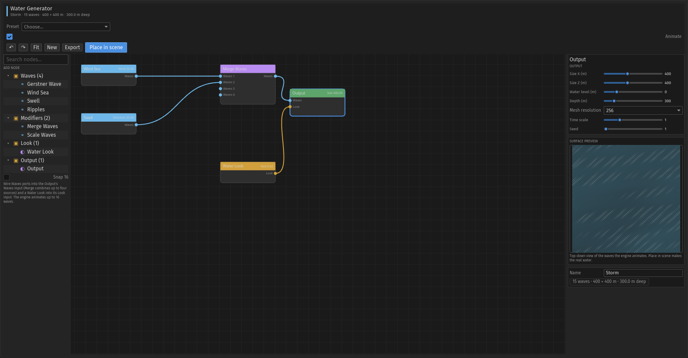
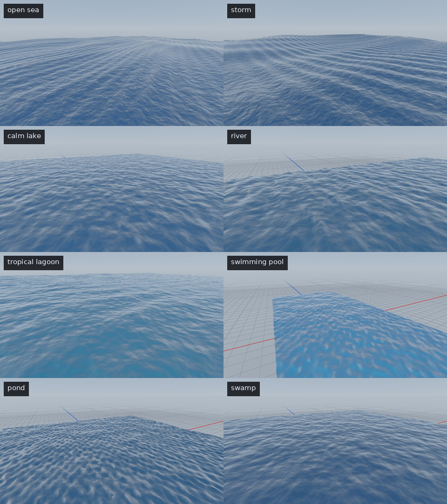
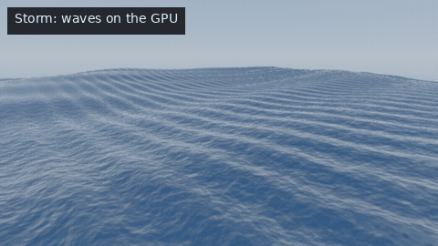

# Water Generator: water bodies built with nodes

<div class="doc-meta">
  <span class="doc-badge doc-badge--stable">Stable</span>
  <span class="doc-badge">Doppio</span>
  <span>Last updated: <time datetime="2026-11-20">2026-11-20</time></span>
</div>

<p class="doc-lede">Assemble lakes, rivers, seas and storms from a node graph and place them as an animated engine water surface.</p>

The **Water** tab (View menu, next to Nature) builds lakes, rivers, seas and storms from a **node graph**
and places them in the scene as an animated engine water surface. It replaces the old fixed wind-wave
block: waves are now *data* you assemble, and the same waves drive the editor preview, the engine mesh and
gameplay queries (`water_height`, for floating objects).

<figure class="doc-figure">
  
  <figcaption>The Water tab with the Storm graph</figcaption>
</figure>


<figure class="doc-figure">
  
  <figcaption>The eight presets, rendered by the engine</figcaption>
</figure>

<figure class="doc-figure">
  
  <figcaption>The Storm preset in motion. The waves are displaced on the GPU (<code>water.vert</code>) from the wave list, so the
  surface is one flat grid and the frame rate does not depend on how many waves the graph has (up to 16). Rendered by
  <code>./scripts/render-world-docs.sh</code>.</figcaption>
</figure>


## 1. How a graph works

Two typed ports (two colours); a link only connects ports of the same type and never closes a cycle:

| Port | Carries |
|---|---|
| **Waves** | a list of Gerstner waves (direction, wavelength, amplitude, steepness, phase) |
| **Look** | the **Water Material**: colour, opacity (low = clear), roughness and foam threshold |

| Category | Nodes |
|---|---|
| Waves | **Gerstner Wave** (one explicit wave), **Wind Sea** (a spectrum from wind speed, direction, spread and choppiness), **Swell** (long regular trains from afar), **Ripples** (short waves from many directions) |
| Modifiers | **Merge Waves** (up to four sources; keeps the strongest 16), **Scale Waves** (amplitude, wavelength, choppiness, rotation) |
| Look | **Water Material** |
| Output | **Output**: size X/Z, water level, depth, mesh resolution, time scale, seed |

Interaction is the same as the other generators: palette on the left, canvas in the middle, parameters and
the animated **Surface preview** on the right. Undo/redo cover every edit, *Export* writes
`Water/<name>.generator.water` (a recipe wrapping the `CAFWATER1` / `WATERGRAPH1` text), **Place in scene** creates
the entity. The preview is a top-down render of the same Gerstner sum the engine animates (sun-lit slopes, a
Fresnel sky reflection, foam where crests compress); it is a shape preview, not the final shading.

## 1b. The water always has its material

Water cannot exist without a material: the Output's **Material** port needs a **Water Material** node, and a graph
without one does not build ("The water has no material: wire a Water Material node..."). **Place in scene** writes
that node as a real project asset, `Water/<name>.mat` (colour and opacity, roughness, a low base reflectance, a thin
clearcoat, transmission and the refraction index of water, alpha blend), and assigns it to the water entity, so the
material is visible in the Assets panel and editable in the **Material** tab like any other. The engine renders the
water with the entity's material whenever it has one (without a material it falls back to a built-in water look).
Placing again regenerates the `.mat` from the node; keep your edits by assigning your own material afterwards.

## 2. Why this is modular and cheap

* **Waves are the unit of work.** A sea is a handful of well-chosen waves, not a texture or a simulation. The
  engine evaluates at most **16 explicit waves** on a vertex-displaced mesh, so the cost is
  `vertices x waves` regardless of how you built them. *Merge* keeps the strongest; the Gerstner stability
  bound (`sum(Q k A) < 1`, crests never fold over themselves) is enforced by the sources and tested.
* **One model for everything.** Lake, river, pool and ocean differ only in graph and Output: a river is two
  stretched waves along the flow plus cross ripples; a storm is a gale-driven spectrum plus a tall swell.
* **Gameplay can sample it.** `caffeine_session_water_height(entity, x, z)` returns the simulated surface
  height, so boats and floating objects follow the same waves you see.
* **Mesh-aware.** A vertex mesh cannot show a wave shorter than about three of its cells. Instead of aliasing
  into blocky patterns, such waves are **faded out** (between 2.5 and 4 cells) and the tab says how many.
  Fine detail needs a higher *Mesh resolution* (up to 256), a smaller body, or longer waves.

## 3. Presets

| Group | Presets |
|---|---|
| Still | **Calm Lake**, **Pond**, **Swimming Pool** |
| Coast | **Tropical Lagoon** |
| Inland | **River**, **Swamp** |
| Sea | **Open Sea**, **Storm** |

Each is a graph you can open and edit. Tested properties: every preset builds valid water, the storm is
taller than the sea which is taller than the lake, a stormier sea has a lower foam threshold, seeds change
the waves, and no preset contains a wave its mesh cannot show.

## 4. Engine side (C ABI v7)

* `NaturalFluidComponent` gained `customWaveCount` and `customWaves[16][6]`, **appended** at the end: older
  scenes load unchanged (the serialiser copies the common prefix) and tests cover it. With custom waves the
  component uses them instead of the generated wind spectrum (`WaveSettings::explicitWaves`; the dispersion
  relation fills in the missing angular frequency).
* `CaffeineWater` (POD, up to 16 `CaffeineWaterWave`) with `caffeine_session_set_water`,
  `caffeine_session_water` and `caffeine_session_water_height`. The Rust `doppio-engine` crate wraps them as
  `Water`, `WaterWave`, `Engine::set_water/water/water_height`.
* `caffeine_session_tick` now steps natural fluids, and the editor ticks the engine while a water surface is
  in the scene, so the surface animates in the viewport (the runtime app already did this).
* **Waves run on the GPU.** The surface used to be rebuilt on the CPU every frame (a 256 x 256 grid sampled
  against 16 waves, normals included, then re-uploaded: about **28 ms per frame** at 256 x 256). Now an
  analytic sea is a **flat grid uploaded once**; `water.vert` evaluates the Gerstner sum (the same maths as
  `WaveField::sample`, so `water_height` agrees with what you see) and the CPU cost per frame is about zero.
  The culling box is padded by the wave amplitude and choppiness (`MeshGeometryComponent::boundsPadding`).
  Surfaces with **shallow-water physics** or more than 16 waves keep the CPU mesh, as before.
* **Water look in the shader** (`scene_lit.frag`, enabled for water surfaces): two layers of procedural
  **ripple normals** that fade out with distance (the fine, chaotic detail a displaced mesh cannot show),
  **depth colour** (turquoise shallows when looking down, deep blue at grazing angles), **whitecaps** from the
  wave Jacobian (crests that compress), broken up by noise, and sun glints from the ripples on the glossy
  surface. The body is still the PBR transparent path with the retuned low F0 and thin clearcoat.

### Artefacts that were fixed (and why they cannot come back)

<table class="doc-table">
  <thead><tr><th>What you saw</th><th>Cause</th><th>Fix and guard</th></tr></thead>
  <tbody>
    <tr>
      <td>Thin straight bright lines forming a grid across the water</td>
      <td>The ripple normals came from <em>value</em> noise with a smooth blend. Its slope is exactly zero along every lattice line, so each line is a flat, mirror-bright stripe in a field of tilted ripples.</td>
      <td>Ripples are now <strong>gradient (Perlin) noise</strong> with an integer hash, every octave rotated so no two lattices line up. There is no slope-free line left.</td>
    </tr>
    <tr>
      <td>Large smooth black patches with hard, scalloped edges (very visible in the Storm)</td>
      <td>The screen-space reflection trace of the water read last frame's depth and colour. Water writes no depth, so the trace hit stale or black pixels, and the patch edge followed the screen border.</td>
      <td>Water takes <strong>no screen-space reflection</strong>: it reflects the sky/probe only. The mirror direction is also kept above the horizon (<code>R.y = abs(R.y)</code>) so a tilted ripple never samples the dark ground half of the environment. Guard: <code>storm_water_has_no_dark_reflection_patches</code> renders the sea then the storm and checks that the darkest 5&nbsp;% of the frame stays within 72&nbsp;% of the median (it was 64&nbsp;% before the fix, 81&nbsp;% after).</td>
    </tr>
    <tr>
      <td>Crests that fold over themselves</td>
      <td><code>Scale</code> (choppiness above 1) and <code>Merge</code> can push <code>sum(Q&nbsp;k&nbsp;A)</code> past 1.</td>
      <td>The final wave list is scaled so <code>sum(Q&nbsp;k&nbsp;A) &le; 0.95</code>, both in the editor (<code>limit_total_steepness</code>) and in the engine for authored waves (<code>WaveField::configure</code>). Guard: a C++ test with eight over-steep waves checks the Jacobian and the normal stay positive on a grid of points.</td>
    </tr>
  </tbody>
</table>

The trade-off: because water takes no screen-space reflection, objects standing in the water are not mirrored in it yet. A planar reflection pass for water is the way to get them (listed below).

## 5. Agents and scripting

The tab is a pane like the others (`editor.pane.water_generator`, `watergen.*` ids). Headless: fixture
`water` (`reset` takes a `preset`, e.g. `Storm`); no engine is needed for the graph and preview. Placement
and animation are covered by engine-backed tests.

## 6. Limits and roadmap

### Reference targets and what they say about the gap

Four references frame where water has to get to. They are context, not assets: the images are not stored here.

1. **A sculpted block of stylised sea** (layered, folding, glossy turquoise-to-blue crests). Real water is
   **not uniform**: waves overtake, steepen, fold and break against each other, and the colour moves with
   depth and angle. Our graphs are a *sum of 16 regular Gerstner waves*, which is smooth and periodic; at a
   distance it reads as a repeating pattern. It needs irregular, non-repeating energy: a real spectrum with
   many more components (FFT), noise-driven amplitude and direction that vary over space, wave groups,
   and breaking/foam where crests fold.
2. **A pool cut-away with caustics** (bright net-like light patterns on the floor and walls, a sphere
   floating in the surface). Water is a **volume**: the interesting light happens *under* the surface, so it
   needs **depth-based absorption, refraction and caustics**, plus walls and a floor to receive them.
3. **A rubber duck on a simulated surface, annotated**: *water simulation, object interaction, reflection,
   god rays, shadow, caustic*. These are the layers a complete system has, and the objects both float and
   **disturb the water**. That is two-way coupling (displacement and impulses from bodies into the
   height field), which the engine's shallow-water solver can provide.
4. **A top-down ripple from an impact** (concentric rings that interfere, caustic filaments, a brighter
   rim). Ripples are **a simulation, not a sum of fixed waves**: they spread from a point, reflect from edges,
   interfere and fade. Gerstner waves cannot make them; a **height-field solver** (shallow water or a
   wave equation on a grid) driven by drops and moving objects can.

What this changes in the roadmap, in order:

* **Chaos before polish.** Add *spatially varying* and *non-repeating* waves: an **FFT/spectrum ocean node**
  with many hundreds of components, **noise-modulated amplitude and direction** (so no two patches look
  alike), **wave groups** and **breaking foam**. A hand-built Wind Sea of 8-12 waves will always look tidy.
* **Water as a volume.** Depth-based absorption and colour, refraction of what is under the surface,
  **caustics** projected on floors and walls, and **god rays**. A water body then needs a **container shape**
  (pool, basin, shoreline), not only a flat rectangle.
* **A simulation layer next to the waves.** A **height-field solver node** (drops, impacts, rain, boundary
  reflection) added on top of the analytic waves; objects add **buoyancy** and push the surface back
  (**two-way interaction**), with `water_height` already available for the first half.
* **Detail without vertices.** Normal-map layers and a **dedicated water shader** for the fine, chaotic
  ripples that a displaced mesh cannot show (see the mesh limit below).
* **Reflection and shadow.** Planar/screen-space reflection tuned for water, and the shadow of floating
  objects on the water and the floor under it.

### Limits of the current implementation

This is the foundation of the rework, not all of it. Honest status:

* **The water shading is a mode of the lit shader, not a full water shader.** Done: ripple detail, depth-ish
  colour from the view angle, whitecaps, GPU waves. Still missing: **true depth-based absorption** (it needs
  the floor depth), **refraction** with a floor, **shoreline foam**, **caustics**, **god rays**, and the
  **Look node's colour does not yet vary over depth**, and **no reflection of objects** (see the table
  above: the screen-space trace is off for water, a planar reflection pass is the fix). The editor grid shows
  through clear water (it is part of the refracted scene).
* **Vertex-displaced grid**, up to 256 x 256 cells (a few thousand quads cost nothing now; the grid is no longer
  rebuilt). A **clipmap/LOD mesh** around the camera is what lets an ocean reach the horizon with the detail
  near you; waves are already plain data for it.
* **Orbit-free preview**: the tab previews the surface top-down; the 3D look is in the viewport after Place.
* No **FFT ocean** node, no **flow maps** (rivers are stretched waves, not advected), no **interactive
  ripples** from objects yet (the shallow-water solver exists in the engine and is the way to get them), no
  **buoyancy** component, and water bodies are flat rectangles (no shorelines or islands).
* One water colour per body; a Look cannot vary over depth until the shader lands.
* The Nature Generator can scatter plants and rocks at the edges once bodies have shorelines.

## 7. Regenerating the images

```bash
./scripts/capture-water-docs.sh                                   # the tab (headless, no engine)
DOPPIO_WATER_DUMP=/tmp/water cargo test -p doppio-ui --lib water_presets_render   # engine renders of every preset
```

## The material is an asset from the start

The Water Material node is a mould. Applying a preset (or placing) writes `Water/<name>.mat` into the
project and turns the node into **Your Water Material (.mat)** pointing at it. An existing file is
never overwritten, so repainting it in the Material tab, or pointing the node at your own `.mat`,
sticks. The terrain's splat layers are still shaded by the engine; making them project materials
needs an engine change and is on the list.

### Opening old `.water` files

A graph saved before the material was required has no Water Material node. It gets the default one wired
into the Output when it loads, so it builds again; apply or place to turn it into the project's `.mat`.
Graphs saved with *Your Water Material* keep their `.mat` path (stored with the graph, spaces escaped).
